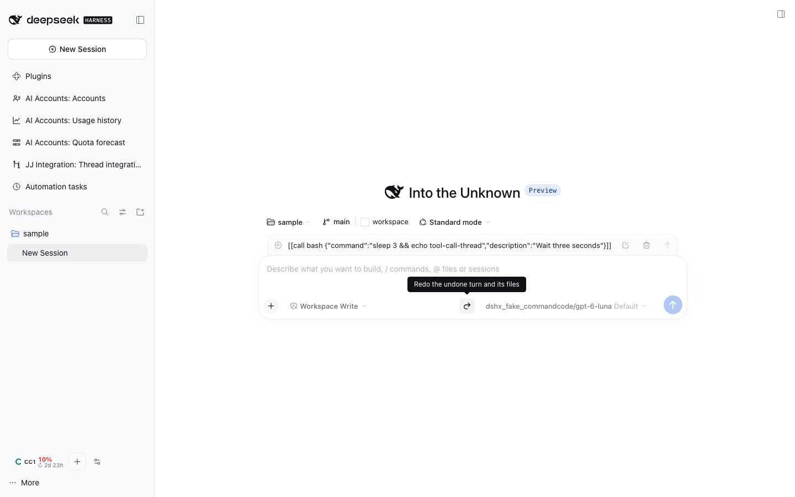

# @dshfiles/session-undo



Undo a thread's last turn and get both the conversation and the files back to where they were before it; redo
reverses it. The controls sit in the composer's right toolbar: **Undo last turn** once the thread has a recorded
turn (its tooltip names the turn's prompt), **Redo** while the undo is fresh.

- **Snapshot at every turn start.** When a turn starts, its workspace files are recorded through the
  [VCS provider](../vcs-provider-port/README.md) that claims the folder: the jj operation that snapshotted the
  working copy in a jj workspace, a snapshot commit under `refs/dsh/snapshots/` in a plain git repository
  (`@dshfiles/git-worktrees`). The turn's tool calls wait for the snapshot, so it never holds the turn's own
  edits. A folder no provider claims records the turn without files.
- **Undo** restores that snapshot, continues in a fork of the conversation cut just before the turn (DSH's own
  `session/fork`), copies the model selection over and archives the original. The undone prompt comes back as the
  fork's queued message, ready to edit, send again or delete. Undo again to go further back (20 turns are kept).
- **Redo** puts the files back as they were before the undo, brings the original thread back and archives the fork.
  A new turn in the fork drops its redo, as in an editor.
- Both are refused while the thread runs, and a fork that fails after the files were restored puts them back.
- A jj restore only touches that workspace's working-copy files (`jj restore --from 'at_operation(<op>, @)'`):
  revisions the agent committed, bookmarks and other workspaces stay. Ignored files are never part of a snapshot.

Agent tools: `session_undo_history` (read-only), `session_undo` (needs `confirm: true`) and `session_redo`, to run
only when the user asked; a thread cannot undo itself mid-turn, since it is running. History lives in the
`dshfiles_session_undo` storage domain; the running-turn guard reads Session events, so after a Host restart
turns recorded before it can still be undone.

## Verify

```sh
pnpm --dir plugins/@dshfiles/session-undo test     # undo/redo, refusals, fork failure, the snapshot gate
dshx dev open session-undo/turn-undo-redo          # scratch DSH: undo a seeded turn, the Redo button appears
```
