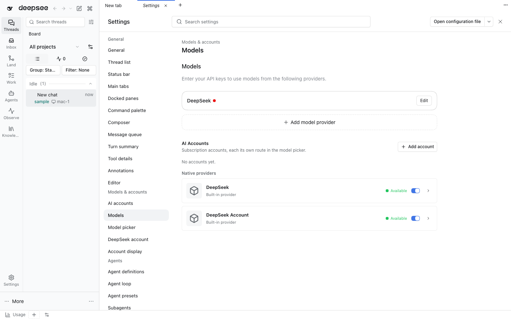

# Settings models



Owned whole-package fork of `@deepseek-ai/dsh-client-ui-settings-models` from stock DSH **0.2.1-rc.2**, tag
`dsh-v0.2.1-rc.2` (commit `687f282e8625c6b8d11ff58211a90524be2e4317`), upstream
[`packages/client/ui-settings-models`](https://github.com/deepseek-ai/deepseek-harness/tree/dsh-v0.2.1-rc.2/packages/client/ui-settings-models).
The original MIT notice is retained in [LICENSE](LICENSE).

## Why fork the native row?

The native row registers the Models settings section, the `deepseek-official` onboarding step and the welcome
notice around one package-private store. On a fresh load the onboarding step loads that store to decide whether to
prompt, and from then on every `settings/document-updated`, `credentials/*-updated`, `llm/adapters-updated` and
`connection/reset` re-read `llm/listProviders`, `llm/listConfigurableProviders`, `credentials/describe` and
`session/modelCatalog`, once per event, for a page nobody had open (five provider-directory reads in one fresh load of
the live GUI). The store and its event wiring are private to the package, so no slot can reach them.

## Composition

[cordis.patch.yml](cordis.patch.yml) disables stock Loader row `ui-settings-models` and inserts
`dshfiles-settings-models`. The Host half is the native one (it publishes the onboarding option to the page). The
bundle is listed in the `profiles/web` seed; an existing live profile picks it up on its next reconcile and Host
restart.

## Native delta and updates

Provenance and path mappings live in [native-fork.json](native-fork.json). Vendored files stay byte-identical except
the recorded delta below.

| File                                              | Owned delta                                                                                                                                                                                                                                                                                                                                                                                                                          |
| ------------------------------------------------- | ------------------------------------------------------------------------------------------------------------------------------------------------------------------------------------------------------------------------------------------------------------------------------------------------------------------------------------------------------------------------------------------------------------------------------------ |
| [index.ts](src/native/index.ts)                   | Host change events go through `createDemandRefresh`: one refresh per burst (once quiet for 50 ms, at most 250 ms after it began) while the Models section or the onboarding step shows the store, none while nothing does (the page is marked stale and reloads once when a surface shows it again). An unloaded page ignores events, as natively, and `settings/document-updated` for a namespace no provider row names is ignored. |
| [store.ts](src/native/store.ts)                   | `markChanged()` records each Host change; the `deepseek-account` availability read of `session/modelCatalog` is shared page-wide with model-selection through dshx `joinPageRead`, never joining a read that started before the change.                                                                                                                                                                                              |
| [demand-refresh.ts](src/native/demand-refresh.ts) | Owned (no upstream file): the observed store surfaces bind and the coalesced, demand-gated trigger.                                                                                                                                                                                                                                                                                                                                  |

The onboarding step still loads the store once at boot while the main view is blank: it is a surface that may show,
and deciding whether to prompt needs the provider directory and the credential state. It stops being an observer
once it completes, so later Host changes no longer re-read anything until Settings › Models opens.

On a DSH upgrade, inspect upstream changes, reapply only the recorded deltas, and run:

```sh
node scripts/native-fork-diff.mjs settings-models
pnpm --dir plugins/@dshfiles/settings-models typecheck
pnpm --dir plugins/@dshfiles/settings-models test
pnpm --dir plugins/@dshfiles/settings-models build
node -e "import('./plugins/@dshfiles/settings-models/dist/index.js')"
```

The vendored `src/native` directory is excluded from Oxlint and Oxfmt like the other forks.
