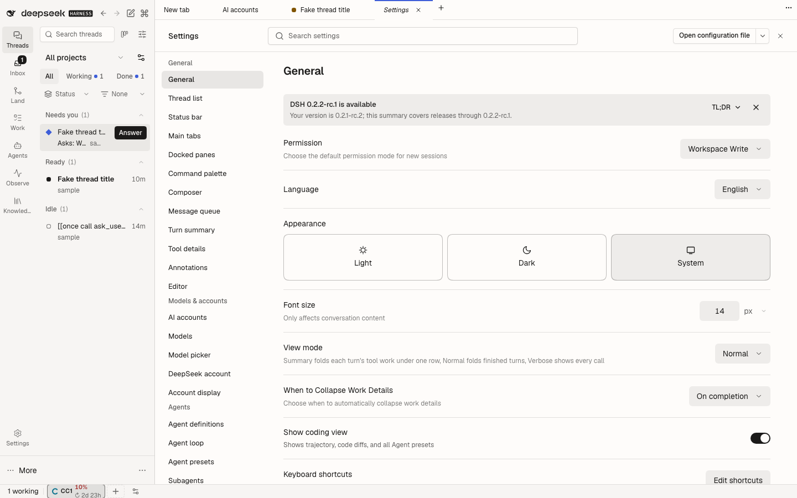
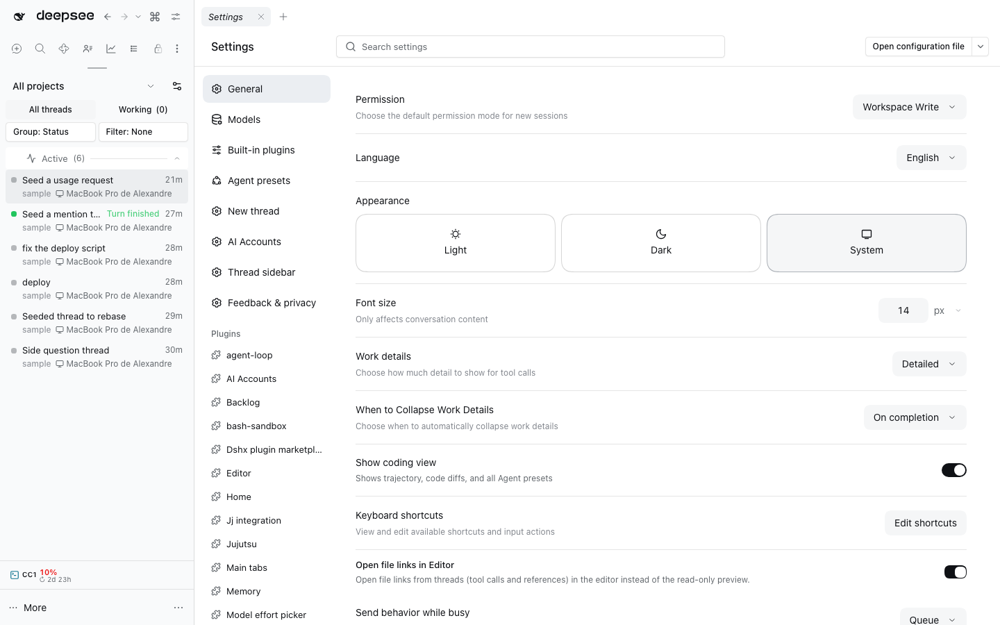
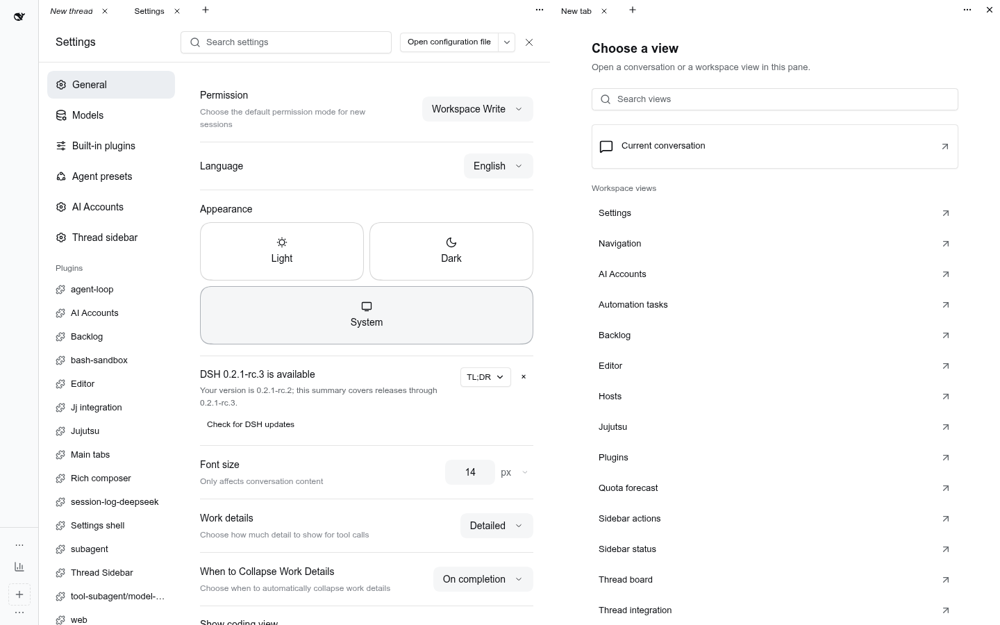
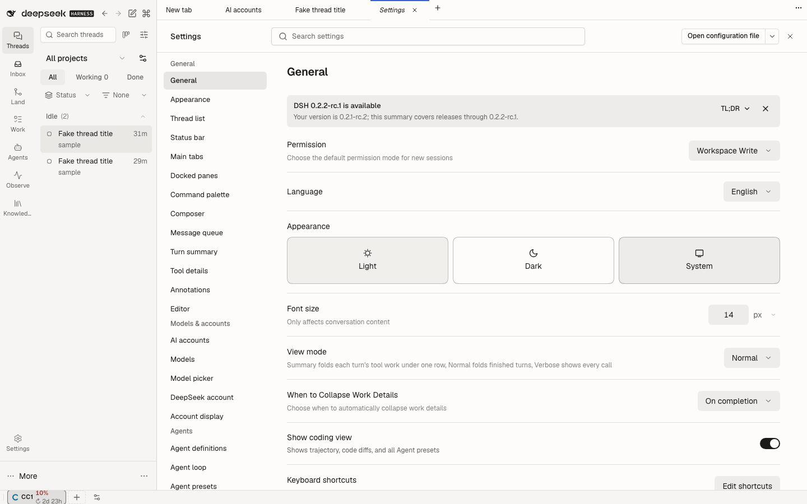
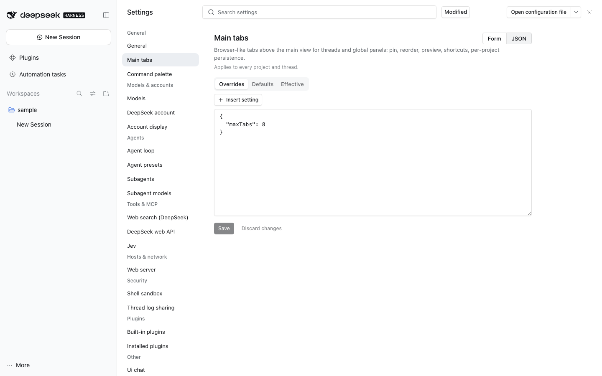
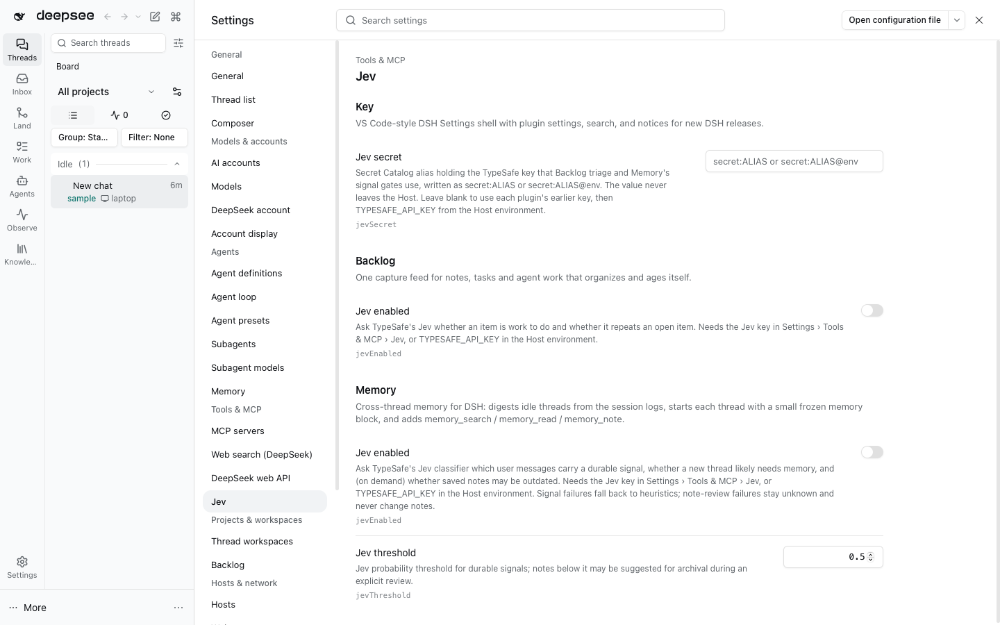

# @dshfiles/settings-shell











DSH's Settings, rebuilt as a plugin so it can grow VS Code-style behaviour the native shell has no seat for.

## Use

Settings is **one page in the stage** (plan [`docs/ade-ux`](../../../docs/ade-ux/README.md) §4.6).

- **Open**: the rail's **Settings**, the sidebar gear, `Mod+,` (Desktop) / `Mod+Alt+,` (Web), the command palette
  (_Open Settings_, or _Settings: <entry>_ for each entry), or another plugin (below). Every one of them opens the same
  page; with `@dshfiles/main-tabs` it gets a tab like any other page. Picking that tab, or a reload that lands on it,
  reopens Settings; leaving it closes Settings. With no other tab left, main-tabs keeps showing Settings.
- **Task groups**: the navigation lists **General** (appearance, language, Layout fixed/free docking, shortcuts, the
  thread list), **Models & accounts**, **Agents**, **Tools & MCP**, **Projects & workspaces**, **Hosts & network**,
  **Security**, **Notifications**, **Plugins**, **About**, and **Other** for anything not placed yet. The map lives in
  [`src/settings-groups.ts`](src/settings-groups.ts): native `settings.section` ids, plugin settings namespaces, and the
  stage pages other plugins own. Entries carry a person's name, never a package id (`agent-loop` reads _Agent loop_).
- **Deep links**: **AI accounts**, **MCP servers**, **Secrets** and **Hosts** are entries that open the page their plugin
  owns (_Open MCP servers_); Settings links them instead of copying their UI. AI accounts appears once: its section,
  its plugin settings and the link to the accounts page share one entry. Every Jev setting (enable, key, thresholds) of
  every plugin sits under **Tools & MCP › Jev**; the plugin's own page says so and links there.
- **Scope**: plugin pages say they apply to every project and thread. No setting stores a per-project or per-thread
  value today, so the page shows that as information instead of a scope control it could not honour.
- **Narrow windows and phones**: the group list becomes a searchable entry picker above the page.
- The former dialog, expanded dialog and side-panel presentations are gone. A `dshfiles:open-settings` request that
  still names `surface: 'modal'` opens the page.

### Free docking

With Layout › Free docking, Workbench's **New tab** chooser offers one **Settings** hub: the same grouped page in a
pane, with its own navigation and search. The shell remains the authorized `settings.section` renderer with genuine
owner props and the shared ConfigForm; it invents no `settings.page` slot. Leaf registrations remain available for
saved layouts and explicit deep links, but are hidden from primary chooser suggestions.

Panel identities are `dshfiles-settings.section/<UTF-8 hex section id>` and
`dshfiles-settings.page/<UTF-8 hex pageId>`. Labels update with the live sources/locale without replacing the panel's
component. Removed sources unregister; an already-open removed source renders no unrelated fallback section.
Section `close()` closes its own workbench occurrence, and section navigation opens the matching settings panel.
These are presentation-only panel registrations; setting reads/writes retain the existing settings tools.

### DSH release notices

The Settings trigger shows a small badge when GitHub has a release newer than the DSH version running on the Host. **General** lists releases between the installed version and latest, offers a concise English TL;DR, and links to the official release notes. Dismissal is browser-local and lasts until another release appears. Release checks run on the Host against the fixed public GitHub Releases API, are cached for one hour, and can be retried from General; an unavailable or unmatched history never guesses that an update exists. The read-only `dsh_release_status` Agent tool uses the same checked result.

### Search

One field at the top of Settings searches every setting the shell can draw: their titles, descriptions and key paths
(`thread sidebar children` finds `maxChildren` on the Thread list page), plus entry and group names ("models &
accounts") and key bindings, by command name or keys ("open settings", "⌘,"). Every
word must match; accents and case are ignored; hidden and secret fields never match. Results replace the section as a
flat list grouped by page, with matches highlighted, editable in place, and a count ("6 Settings Found"). The tree
stays visible with a match count per entry; picking an entry with matches scrolls to its results. `Escape` clears the
query. **Modified** beside the field toggles VS Code's `@modified` filter in the query: only fields the user layer
sets are listed (alone, or narrowed by the other words); sections, published entries and key bindings carry no user
layer, so the filter leaves them out. Leaving the Settings tab for another tab keeps the query, so returning to the tab
restores its results and the text in the field. Native sections draw their own rows, so a match on a section's name
offers to open it; the namespaces behind native rows (theme, language, …) stay searchable, and a match opens the
section that draws them.

A section can also publish the controls it draws as search entries (dshx `settings.section` `metadata.searchEntries`,
see the dshx [client guide](../../../tooling/dshx/docs/guides/client.md#settings-search-entries)). The shell indexes
every live section's entries without mounting it, matching their title, description, keywords and section name; results
list them under their section (a section whose entries do not decode is skipped with one console warning), and picking one opens that section with `target` set to the entry id, so the section
scrolls to and focuses that control. General publishes its _Show coding view_ switch this way. The same entries reach
the Agent: each page reports them to this plugin's Host, and a `query` to the read-only `settings_list` tool returns the
matching ones with their section and entry ids.

This replaces `@dshfiles/settings-search`, which was **folded** in: its popup under the navigation and its separate
search section are gone, and the schema walking and ranking it did now live in `src/schema-form/schema-model.ts` and
`src/settings-search.ts`.

### Plugin settings

Every settings namespace with a visible field gets a page in its task group (namespaces whose fields a native section
already draws get no second row; they stay searchable), titled by the group map, then its bundle's manifest, then its
schema, then its humanized id. The same renderer draws each dshx plugin's settings on its **Plugins** page detail, through dshx's
settings page renderer seat (`provideSettingsPageRenderer`); without this plugin the built-in dshx form shows.

Fields come from the serialized schemastery schema (`src/schema-form/schema-model.ts`): the title is the field's label
or its humanized key, the description its `.description()` (localized descriptions follow the active language). Hidden
and secret fields never show. Controls by type:

| Schema                                   | Control                                                                         |
| ---------------------------------------- | ------------------------------------------------------------------------------- |
| `boolean`                                | switch                                                                          |
| union of constants                       | segmented buttons (≤ 4 short labels) or a select; `"Label: explanation"` splits |
| `number`, `natural`, `percent`           | number input with bounds and a unit read from the key (`…Ms`, `…Minutes`, …, %) |
| `string` (`role('textarea')`: multiline) | text input                                                                      |
| array of scalars                         | list editor (add, edit, remove rows)                                            |
| dict of scalars                          | key/value editor                                                                |
| nested object                            | its fields, under a group heading                                               |
| anything else                            | JSON, saved only when it parses                                                 |

Edits save at once (switches, choices) or on Enter/blur (text, numbers) through the shared `ConfigForm`, the store
native rows and `useSettings` read, so every surface stays in step. A Host write takes seconds (it persists the profile
and reloads the entry), so a row shows the requested value until the write settles; a refused value shows under its
row.

**Modified settings** carry a thin bar on their left, as in VS Code: the field is set in the user layer (an override
equal to the default still counts, as natively). Hovering or focusing the row shows **Reset to default**, which unsets
the override so the field re-inherits the composition default. A deep link to a field scrolls it into view and
highlights it for two seconds.

**Where a value comes from.** Under its key path each row names its source in words, never only by colour:

| Label                        | Meaning                                                                                      |
| ---------------------------- | -------------------------------------------------------------------------------------------- |
| Override · inherits _v_      | The user layer sets the field; Reset re-inherits _v_.                                        |
| Override · same as inherited | An override equal to what it would inherit: still modified, still reset by Reset.            |
| Profile composition          | No override; the merged composition base differs from the schema default.                    |
| Default                      | No override; the value is the schema default.                                                |
| Source unknown               | No override and the schema declares no default to compare with, so the Host view cannot say. |

The Host's settings view gives each namespace three layers: `value` (resolved), `base` (schema defaults plus every
composition layer, merged) and `user` (the profile's raw override section). Everything above is derived from them
(`src/schema-form/setting-provenance.ts`); which composition file or bundle set a `base` value is not in the view, so
"Profile composition" never names a file ([Host gap 103](../../../plans/dsh-host-gaps.md)).

### JSON view

Each plugin page has **Form | JSON** beside its title. JSON shows three tabs:

- **Overrides**, editable: the namespace's user layer as JSON. **Insert setting** lists the fields not yet in the
  document, with their descriptions, and inserts one with the value it inherits (a default becomes an override only
  when you pick it). Every problem is listed under the text with its line: invalid JSON, a document that is not one
  object, a key the schema does not show (a typo, a hidden or secret field), or a value of the wrong type. Any of them
  blocks **Save**.
- **Defaults** and **Effective**, read-only: what every field inherits without an override, and the resolved value.
  Neither is ever written back.

Clean, the text follows the stored overrides. The first keystroke pins the revision and the overrides it started from,
and **Unsaved changes** shows until it is saved or discarded. **Save** sends one `mutate` with only the fields the draft
changed (`set` for added or changed, `unset` for removed), fenced by that revision, through the same `ConfigForm` the
form uses, so redacted secrets and fields the view does not draw are never restated or dropped. If the settings change
elsewhere first, the draft stays, Save is blocked and the warning offers **Load latest** (drops the draft) or **Save my
changes over them** (the same changed fields, fenced by the current revision). A refusal keeps the draft and points to
the Form view and the configuration file. Switching back to Form keeps the draft; leaving the page drops it. Writes go
through the profile patch exactly as form edits do; **Open configuration file** remains the way to edit the YAML itself,
comments included.

The editor is the kit's `Textarea`, `Tabs` and `Command`, not `@dshfiles/editor`'s Monaco. Monaco has JSON schema
completion, but using it here would need a new cross-plugin contract (Settings may not import the editor), a
schemastery-to-JSON-Schema converter and a multi-megabyte bundle in Settings, and Monaco is poor with a soft keyboard.
The kit version needs none of that and works on a phone; schema-aware completion is the Insert setting picker and the
diagnostics come from the same field model the form draws (`src/schema-form/settings-document.ts`). Type expectations
in diagnostics ("true or false", "a number ≥ 2") are English in every locale.

### Agent tools

| Tool                 | Reads or writes                                                                                             |
| -------------------- | ----------------------------------------------------------------------------------------------------------- |
| `settings_list`      | Namespaces with revision and secret-field count; one namespace's redacted value; published section entries. |
| `settings_inspect`   | One namespace field by field: schema default, override, inherited, effective value, source. Read-only.      |
| `settings_set`       | Merge a patch into one namespace (user asked).                                                              |
| `settings_unset`     | Reset one field path (user asked).                                                                          |
| `plugin_inventory`   | The profile's Loader entries: module, enabled, runtime phase, and why one cannot be changed. Read-only.     |
| `plugin_set_enabled` | Enable or disable one entry through the plugin manager (user asked); reversed with the opposite value.      |
| `dsh_release_status` | The DSH release check below. Read-only.                                                                     |

`plugin_set_enabled` is the plugin manager's `setPluginEnabled`, the verb behind the native Plugins page. The manager
writes the profile patch and reports, separately, how the running Host took it; the tool relays that verdict and claims
nothing else: `applied`, `restart-required` (with `no-hmr`, `host-module`, … as the reason; the user restarts), or
`overridden` (a higher-priority profile layer keeps the old value; edit that layer). It never restarts DSH. Entries the
patch cannot address (`management-required`, `unaddressable`) are listed with that reason.

### Configuration file

On a loopback browser whose Host keeps a settings document (the profile's `cordis.patch.yml`), the header shows
**Open configuration file** as a split button, like the thread header's open-in control. Existing documents open with the
Session Remote's configured default app. If the document is absent or desktop path opening is unavailable, the Host's
native action creates/opens it in its text editor. **▾** offers:

- **Open with** each app the desktop associates with the file (icons and the default from the Session Remote's path
  opener, the service behind the native open-in controls; their component is not exported, so the menu is drawn here);
- **Editor (in DSH)** when `@dshfiles/editor` is loaded, through its `dshfiles:open-file` request (it needs a thread
  to open files in);
- **Copy path**, and **Reveal in Finder** (_Show in folder_ elsewhere).

The path comes from this plugin's Host (`settings-shell.documentPath`, the settings provider's `documentPath`,
canonicalized). Until the document exists only the path can be copied. Remote browsers get neither action nor path.

### Open Settings from another plugin

```ts
window.dispatchEvent(
  new CustomEvent('dshfiles:open-settings', {
    detail: { section: 'models' }, // or { section, target: entryId }, { setting: { entryId, fieldPath } }, { query }, plus an optional surface: 'modal' | 'tab'
    cancelable: true,
  }),
)
```

`dispatchEvent` returns false when the shell took the request, the contract of `dshfiles:open-file`. Settings sections receive `close`, as natively, and `target` when opened at one of their
search entries.

## Port

This bundle is a **port** of `@deepseek-ai/dsh-client-ui-settings-general` **0.2.1-rc.2** (MIT, © DeepSeek), the
native Settings shell: the sidebar trigger row with its connection-recovery pill and Desktop update indicator, the
settings surface and its section navigation, the General section (Coding view switch, current version), the
`settings.*` child slots every settings page registers into, the onboarding coordinator, the `settings.open`
shortcut (Desktop `Mod+,`, Web `Mod+Alt+,`), and the Host-release reload prompt on the frame's `shell.overlay`
seat. Its `cordis.patch.yml` switches the native `ui-settings-general` row off
and inserts `dshfiles-settings-shell`.

Why a port and not a wrapper: the native sections are `settings.section` entries, child slots that only the declaring
`sidebar.settings` entry may `renderSlot`; a shadow registration cannot re-declare them, `SettingsRoot` is not
exported, and a disabled row's client module never loads, so nothing can reuse its `apply`. The port keeps every slot
name and owner prop, so native and plugin sections register exactly as before.

`src/native/` holds the ported code, one file per upstream module, each naming its source. `src/upstream.ts` records
the version it was taken from:

- `src/upstream-version.test.ts` fails when the workspace's DSH packages move past that version (or past the welcome
  notice's, below);
- the Host logs `settings-shell: ported from … but DSH ships …` at boot when the running DSH resolves another version,
  and the General section's version row shows the running one.

To refresh: diff the new `lib/client.js` of the native package against 0.2.1-rc.2, port the changes into
`src/native/`, then bump `PORTED_FROM`.

Deliberate differences from upstream:

- Styles are `dshx:` utilities instead of CSS modules (one shared plugin stylesheet).
- Dictionaries live under `dshfiles.settings-shell`; dshx reserves the native `settings` namespace.
- The native welcome notice (`@deepseek-ai/dsh-client-ui-settings-models` 0.2.1-rc.2) keeps its acknowledgement in
  the `ui-settings-general` namespace, which only the switched-off native row serves, and a Loader patch cannot give
  this row that id. So the step is ported too (`src/native/welcome-notice.tsx`): it shadows the `welcome-notice`
  onboarding entry and stores `welcomeNoticeVersion` in `dshfiles-settings-shell`. Someone who acknowledged the native
  notice sees it once more after switching. Its version is checked like the shell's.
- DSH 0.2.1 dropped the settings snapshot's explicit `mode`: the welcome store derives its process-local case from
  `writable`, which is the only remaining signal for a Host document that refuses writes, so a remote browser still
  acknowledges the notice for the session instead of getting a save error it cannot clear.

## Settings (`dshfiles-settings-shell`)

| Key         | Default | Meaning                                                                                             |
| ----------- | ------- | --------------------------------------------------------------------------------------------------- |
| `openIn`    | `auto`  | Retired and hidden: Settings always opens as the page in the stage; a saved value still validates.  |
| `jevSecret` | `''`    | The one TypeSafe Jev key (`secret:ALIAS[@env]`, Secret Catalog picker), read by Backlog and Memory. |

### One Jev key



`jevSecret` is the one TypeSafe key every Jev reader uses (plan `ade-ux` §4.6). It is published with the rest of this
namespace as the `@dshfiles/settings-shell/settings` dshx module, so Backlog, Memory and Secret Catalog read it without a
cycle; Settings › Tools & MCP › Jev shows it first as **Key**, then each plugin's Jev switches. Backlog's and Memory's
earlier `jevSecret` fields stay stored but hidden: each is the fallback while the shared key is empty, and each plugin
copies its value into an empty shared key once on start (`SharedJevKey` in `@dshfiles/credential-port/jev-key`, written
against the revision it read empty, so a set key is never overwritten). Clearing the shared key brings their own keys
back. Agents change it with `settings_set`.

Build, test and typecheck with `pnpm build`, `pnpm test` and `pnpm typecheck` from this package.
