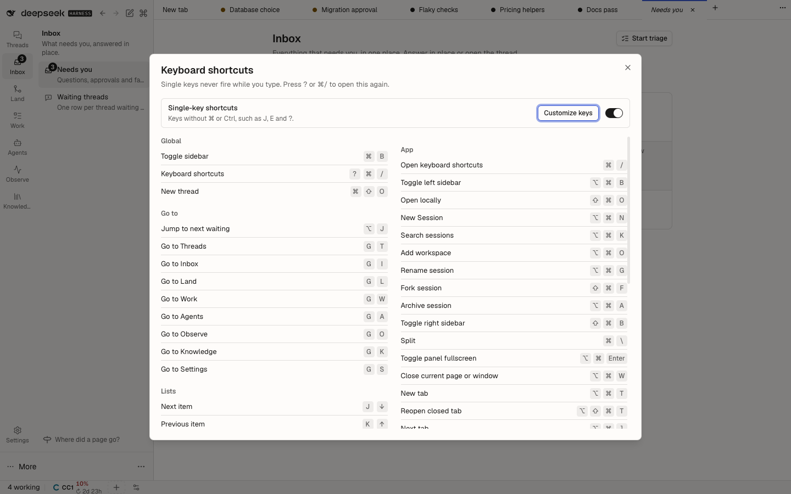

# @dshfiles/shortcuts

One capture-phase keyboard layer for every DSH plugin. It binds the keys of every dshx `Command` (one registry: the
palette lists the same commands and the `?` sheet shows the same keys), claiming them before the browser or the Host's
bubble-phase runtime does.

## Key grammar (`CommandKeys` in dshx)

| Spec                                    | Meaning                                                       |
| --------------------------------------- | ------------------------------------------------------------- |
| `Mod+K`, `Mod+Shift+K`, `Mod+Alt+Enter` | Chord with the platform primary (⌘ on macOS, Ctrl elsewhere). |
| `Alt+J`                                 | ⌥ letter; never inside a text field (it types `∆` on macOS).  |
| `J`, `Shift+J`, `?`, `Enter`, `1`       | Single key (a character key).                                 |
| `G I`                                   | Sequence: G, then I within 1.2 s.                             |

Keys match by physical key (`event.code`), with exactly the modifiers they name.

## Scopes (`Command.scope`)

| Scope                       | Fires                                                                                                                                                                                                                                  |
| --------------------------- | -------------------------------------------------------------------------------------------------------------------------------------------------------------------------------------------------------------------------------------- |
| `global` (default)          | Anywhere; a chord also fires from a text field.                                                                                                                                                                                        |
| `not-typing` (`page`)       | Anywhere except a text field, an IME composition or an open menu or dialog.                                                                                                                                                            |
| `list`, `triage`, `changes` | Only inside an element marked `data-shortcut-scope="<scope>"`: the focused one, else the region last used, else one marked `data-shortcut-ambient`. `Command.region` ties keys to one element, so two mounted lists can both bind `J`. |
| `composer`                  | Chords only, from inside `data-shortcut-scope="composer"`.                                                                                                                                                                             |

Single keys and ⌥ letters never fire while typing, whatever the scope. **Single-key shortcuts** (Settings › Plugins ›
Shortcuts, or the switch in the sheet; namespace `dshfiles-shortcuts`, field `singleKeys`, so an agent changes it with
`settings_set`) turns character keys off as a whole (WCAG 2.1.4); chords stay on.

A mounted surface contributes its keys with `useCommands(plugin, commands)` from `@dshfiles/plugin-ui/hooks/commands`;
menus and tooltips show them with `keys` on `DropdownMenuItem`, `ContextMenuItem` and `TooltipContent`, or with
`KeyHint`.

## Shortcut sheet

`?` or ⌘/ opens every bound key grouped by section (Global, Go to, Lists, Triage, Changes, Composer, App), generated from
the registry plus the Host shortcut catalog. **Customize keys** opens the Host's own rebinding editor, which ⌘/ opened
before.

A chord is claimed only where it cannot type anything and nothing else already answered it. The focused element decides the region the same way the Host adapter does: a terminal (`.xterm`) comes first, then a text field, then the page. Commands claimed through the `Command` registry keep their keys everywhere, except while a terminal has focus, where `allowInTerminal: false` leaves the key to the shell (`Ctrl+J` is a line feed).

This is an owned DSH bundle. Run `pnpm build`, `pnpm test`, and `pnpm typecheck` from this package.
