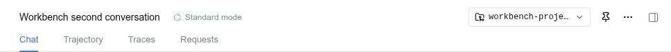
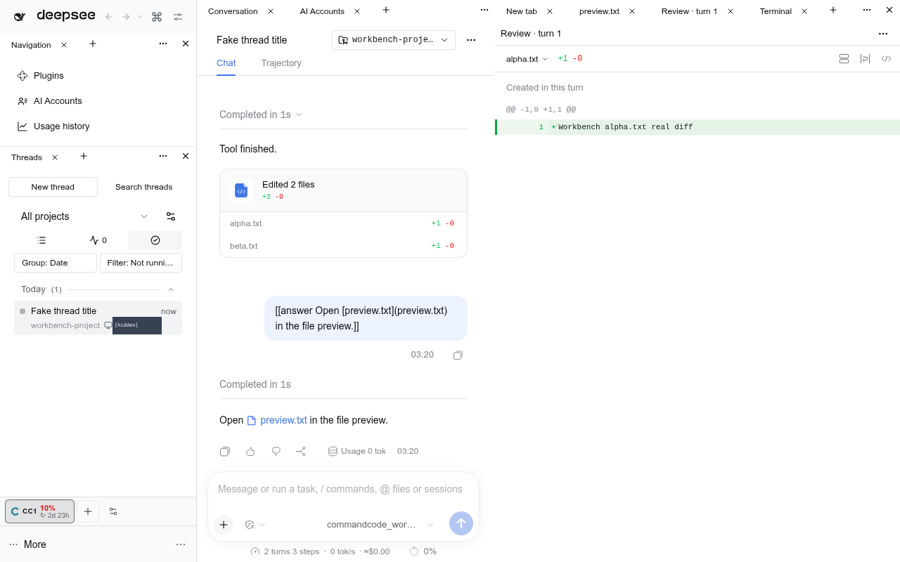

# Sidebar-right resource panels





Owned whole-package fork of `@deepseek-ai/dsh-client-ui-sidebar-right` 0.2.1-rc.2, pinned to `dsh-v0.2.1-rc.2` (`packages/client/ui-sidebar-right`). Upstream MIT license is retained in [LICENSE](LICENSE); mapping and deliberate changes are in [native-fork.json](native-fork.json).

## Why fork

The installed public service can open resource addresses and tab kinds, but cannot render an individual resource. Its private declaring entry alone may render the session-scoped body/title/menu slots and bind `useTabInfo`. An independent Workbench renderer would either fail slot authorization or counterfeit session/tab state.

This fork keeps the original services, persistence keys, tab registry, resource pins, navigation, occurrences, close handlers, guide and every contribution slot. File, diff, terminal and community providers remain stock. In the owned stack, all pane chrome belongs to Workbench tabs, with no native-layout opt-out. The native sidebar is only an absent-Workbench package fallback. No Host/core patch and no provider-specific resource reimplementation.

```text
Original adopted session store -> TabDomain occurrence -> authorized rightbar.session entry
                                                         | native mode: original sidebar
                                                         | workbench: owner-created portal
                                                         v
                                      Workbench target in any Dockview region
```

## Public presentation contract

Import `sidebarResourcePanels` from the declared dshx module `@dshfiles/sidebar-right/resource-panels`.

- `list()` / `subscribe()` project committed non-guide tabs, including thread-aside resources, with stable `(sessionId, tabId)` identity, native navigation revision, captured title and original address.
- `attach(id, element)` returns a token-safe presentation disposer. Moving/unmounting a Dockview target never closes the content or aborts its occurrence.
- `setVisible(id, element, visible)` forwards actual Dockview visibility to the real tab hook. Retained hidden terminals do not claim focus/size.
- `close(id)` calls the owning session's existing native close path. Provider cleanup admission runs first and can throw without removing the tab. Embedders must call it before an actual user close; never on drag/detach.
- Optional `openPage(kind, beforePublish)` admits an explicit Workbench picker intent through the same native allocator. The callback receives the exact stable resource ID before store publication, so the picker can seat it directly in its own group without revealing the right pane. It captures the currently mounted, adopted Session at the click; missing Session/provider/Workbench support returns `false`, never creates a hidden thread. Older already-loaded bridges may omit it. Registration, rendering and passive layout restoration never call it.
- A changed `navigationRevision` means reveal/focus the existing Workbench panel, not create a duplicate. Repeated file-line links retain navigation delivery.

On reload, Workbench acquires real `sessions.retain` references only for Host-catalog Session ids named by saved native resource records (`sidebarResourceView`), with at most four initial history openings in flight. Unknown/stale saved identities are not acquired. Those owner-controlled references render real SessionProvider roots, restoring adopted stores and their provider bodies even when the main conversation selected another Session. Closing the last resource or leaving Workbench releases that inventory hold; committed roots retain their reference until unmount. Dormant Sessions with only a guide/Workbench page are not opened.

The bridge stores **presentation endpoints and derived metadata only**. Native session stores remain the single persisted membership authority; providers retain real file/diff content, terminal processes and reconnection. The Workbench controls only arrangement.

## Integration requirements

The frame retains a hidden native `rightbar` carrier while Workbench owns the right column. This mints the genuine framework session store and supplies `SessionProvider` even though the slot body portals elsewhere. The owned frame's optional `ctx.mainSurface` identifies Workbench ownership; installs without that service retain the native presentation. Workbench mode suppresses all native chrome, including floating panes and geometry reports from a retiring native seat, and the selected real Session remains the public resource-navigation target even while a global panel is active.

In Workbench, `sidebarRight.isExpanded()` and `toggleExpanded()` use the currently registered `ctx.rightPanel?.dock?.()` actions. The original `sidebar.right.toggle` command drives that same global pane even when no Session is selected; it never changes hidden native expansion state. Successful explicit resource/page opens, repeated navigation and existing-resource focus reveal the dock; passive store restoration and selected-Session changes do not reopen a user-closed pane. Guide and Workbench-recursion pages are excluded. Registration is looked up at each action, so a missing, replaced or disposed dock cannot fall back to native chrome. Workbench owns the global dock's visibility state. The conversation header's original rightmost **Open right sidebar** icon observes those same dock actions and appears only while the Workbench right pane is closed. It opens the pane idempotently, never toggles or writes native carrier state. Its subscription is released on unmount or a change of presentation owner. The main group's **Pane options** also offers **Open right pane** only while closed; the right pane's own far-right **Close pane** icon hides it. No centre control closes the right pane. Outside Workbench, the original per-Session control and keyboard paths remain the fallback.

The Workbench right pane spans the full frame height, independently of the bottom row. Collapsing it hides a still-mounted tab region and native resource carrier: it does not close resources, discard tabs or reveal old native chrome. Preview/review/terminal resources open there by default; a saved move to another region is preserved. Historical Workbench `mainSurface`, `rightPanel` and `headerToggle` schema fields remain hidden decode-only migration inputs, not public layout choices.

DOM `data-*` occurrence markers support focused keyboard routing, not authentication: same-origin loaded plugins are trusted. The service additionally checks a committed adopted tab, the exact live occurrence object, navigation revision and visible resource root. File-provided interactive HTML stays in the native provider's opaque sandbox; the bridge does not grant that iframe parent DOM access.

The original per-tab contribution slots still render in each panel, including live title and content-action menu registrations. The guide and the per-thread Workbench tab itself are excluded to avoid recursion.

## Scope and verification

Nine vendored delta files: native assembly, real saved-resource Session reference ownership, focused background-resource close/refresh identity, global Workbench expansion/explicit reveal routing and shortcut dispatch, tab-information composition, private TabSlot export, root visibility and native expand control. `service.ts` also publishes `expanded`, `isExpanded()` as a snapshot that follows adopted store commits, the on-screen Session and the Workbench dock, so dshx `layout.side.expanded` can be observed instead of polled. The standalone bridge and portal seat live outside the vendored tree. There is no added Host work and no new model-facing verb; this is presentation of existing capabilities.

Focused tests cover presentation target replacement, cross-session identity, cleanup rejection, genuine native file/diff/terminal occurrences, lifetime preservation across thread selection and detach, four-at-once saved acquisition, suspension and final View-retirement release. The fresh assembled scratch journey opens a real Markdown file preview, reviews two tool-written files, starts a genuine terminal, reloads, and verifies all three provider bodies again. The screenshot above comes from that passing journey after the centralized build. This is scratch evidence; deploying it to the live Host still requires the user's restart decision.

## Updating

Copy unmodified files from the new pinned upstream source; reapply only the listed delta. Update the pin and run `node scripts/native-fork-diff.mjs`, package typecheck/tests, then the Workbench resource journey in scratch. The native mode is the regression fallback and remains unchanged unless explicitly documented.
