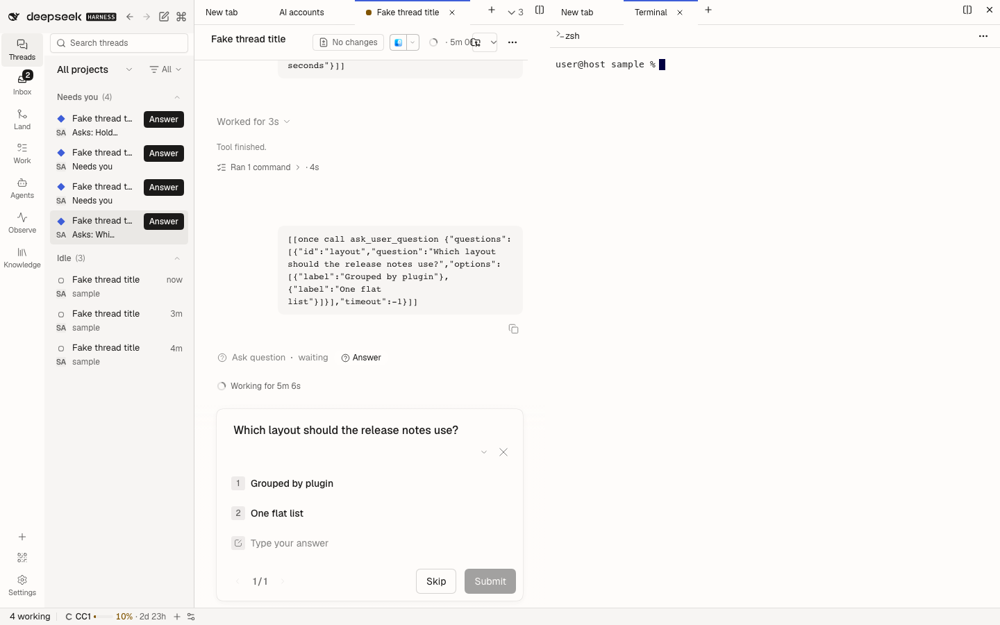

# Sidebar terminal

An owned fork of `@deepseek-ai/dsh-client-ui-sidebar-terminal` at `dsh-v0.2.2-rc.1` (MIT; see LICENSE). It keeps the upstream terminal lifecycle and tab identity, but adds **Add selection to chat**. Select output in the terminal, then activate the action that appears over the screen (or press `Ctrl+Shift+E`, `Cmd+Shift+E` on macOS) to attach an inspectable excerpt to the thread that owns that terminal. Nothing is copied or sent until explicitly requested; the chip stays in the draft and its full contents are sent when the draft is submitted. Remove it with the composer's normal chip deletion.

The chip is labelled with the terminal range it quotes (`Terminal 3-4`, 1-based lines of that terminal's output history) and reveals the captured output when activated, so a long or credential-bearing excerpt can be checked before the message leaves. A selection longer than 4000 characters keeps its head and ends with an ellipsis; the terminal itself keeps the full output.

Keyboard: `Ctrl+Shift+E` (`Cmd+Shift+E`) adds the current selection, and the chip action is a real button, so Enter and Space work once it shows. With nothing selected, the shortcut says a selection is needed instead of adding an empty chip.

The fork replaces the `ui-sidebar-terminal` Loader row. It needs `@dshfiles/rich-composer` for excerpt insertion. A failed insertion (that thread's composer is gone or read-only) leaves the selection in place and asks you to open the originating thread and retry. Terminal output can contain credentials; inspect it before submitting.

## Upstream updates

The source under `src/native` is pinned to the tag recorded in `native-fork.json`. Compare upstream with `node scripts/native-fork-diff.mjs sidebar-terminal --to <new-tag>`, preserve the explicit selection action, the owning-session binding and the lazily loaded terminal body while applying changes, then run the fork-diff check and the package tests. This is a native client fork, not a DSH core patch.
