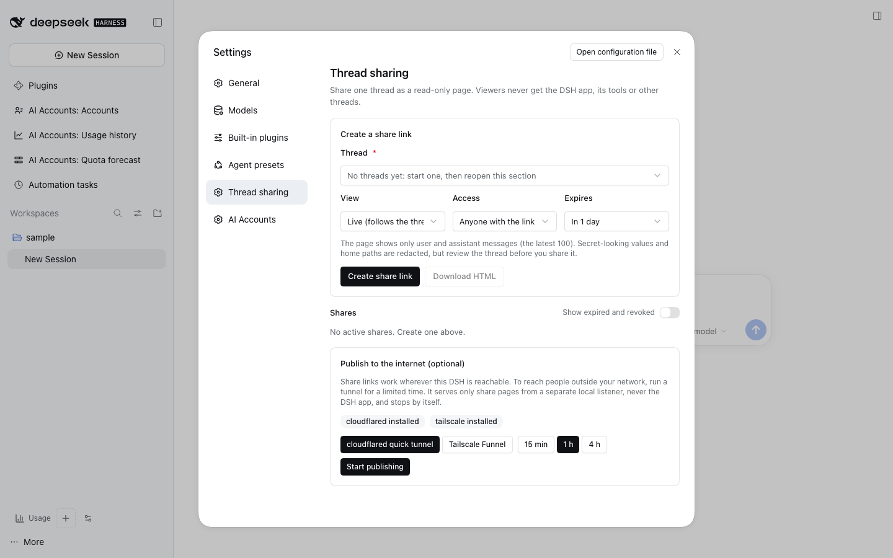

# @dshfiles/thread-share



Share one DSH thread as a **read-only** page behind a link. A viewer gets only that thread's user and assistant
messages: no DSH app, no tools, no other threads, no attachments.

Settings › **Thread sharing**:

- **Create a share link.** Pick a thread and choose:
  - **View** — _Live_ re-reads the thread on every visit (the page reloads every 30 s); _Snapshot_ freezes it now.
  - **Access** — _Anyone with the link_ (an unguessable 256-bit token), or _Link + passphrase_.
  - **Expires** — in 1 hour, 1 day, 7 days, or never.

  The link is shown **once**: DSH keeps only its SHA-256, so copy it then.

- **Shares** lists active shares with their access, expiry and view count. **Revoke** (behind a confirmation) turns a
  link off at once and deletes its snapshot; it cannot be undone — create a new share instead. _Show expired and
  revoked_ keeps the history visible.
- **Download HTML** saves the same redacted page as one self-contained file (inline CSS, no script, no external
  resource) to host or upload anywhere, without creating a link.
- **Publish to the internet (optional)** — see [Publishing](#publishing).

## The share page

`/thread-share/s/<token>` is a raw route on the DSH web server (`webServer.register`), outside the
cookie-authenticated `/api`, so it works in a browser that never signed in to DSH. It answers only that exact path:

- The token decides the one thread that is read; query parameters and other paths are ignored (404).
- Content is session-controller's `sessions.messages`: user and assistant text only, the latest 100 messages, each
  clipped to 8,000 characters.
- **Redaction**, before anything is rendered or stored: private keys, `sk-…`/GitHub/GitLab/AWS/Slack/Google/Stripe
  keys, JWTs, `Bearer` tokens, `user:password@` URL credentials, `password=`/`token:`-style assignments, DSH share and
  MCP tokens; the thread's working directory becomes `<workspace>` and home directories become `~`. `secret:ALIAS`
  references stay (they are names, not values). Redaction is pattern-based and best-effort: review a thread before
  sharing it.
- Every character is HTML-escaped before the only markup (code fences, inline code, paragraphs) is applied.
- Headers: `X-Robots-Tag: noindex, nofollow, noarchive, nosnippet`, `Cache-Control: no-store`,
  `Referrer-Policy: no-referrer`, a `Content-Security-Policy` with `default-src 'none'` (no script at all),
  `X-Frame-Options: DENY`, `nosniff`.
- **Rate limits:** 120 requests a minute per client; 5 wrong passphrases per share per 15 minutes, then 429 with
  `Retry-After`. Behind a loopback tunnel the forwarded client address is the key; a direct client cannot choose it.
- A wrong, expired or revoked link gets the same 404 ("ask the person who shared it for a new link"), so the page never
  says which.

### Protected shares

The passphrase (8–256 characters) is stored only as a salted scrypt hash (N=2¹⁵, r=8, p=1, a fresh 16-byte salt per
share) and compared in constant time. A correct passphrase sets an HttpOnly, `SameSite=Lax` grant cookie scoped to that
share's path (`Secure` over HTTPS) for 12 hours or until the share expires. Grants and rate-limit windows live in
memory: after a Host restart viewers enter the passphrase again.

## Publishing

Share links work wherever this DSH is reachable (loopback, LAN, your tailnet). To reach people outside, the section
detects `cloudflared` and `tailscale` and, **only after you confirm**, runs one tunnel for 15 minutes, 1 hour or 4
hours:

| Tunnel                   | Command (foreground, no `--bg`)                                    | Needs                           |
| ------------------------ | ------------------------------------------------------------------ | ------------------------------- |
| cloudflared quick tunnel | `cloudflared tunnel --no-autoupdate --url http://127.0.0.1:<port>` | `brew install cloudflared`      |
| Tailscale Funnel         | `tailscale funnel --https=8443 http://127.0.0.1:<port>`            | Funnel enabled for this machine |

The tunnel never points at the DSH server: `<port>` is a separate loopback listener this plugin opens that answers
only `/thread-share/…` and returns 404 for everything else. The tunnel stops on **Stop publishing**, at its deadline,
or when the plugin unloads; new share links then list the public URL too. opentunnel and Pi Durable were evaluated and
are not used ([research](../../../plans/thread-share/README.md#transports)).

## Agent tools

| Tool                          | What                                                                    |
| ----------------------------- | ----------------------------------------------------------------------- |
| `thread_share_list`           | shares with access, expiry, status and views; never a token (read-only) |
| `thread_share_create`         | create a share; only when the user asked; returns the link once         |
| `thread_share_revoke`         | revoke by id; requires `confirm: true`                                  |
| `thread_share_export`         | the self-contained HTML export (read-only)                              |
| `thread_share_publish_status` | installed tunnel CLIs and the running tunnel (read-only)                |
| `thread_share_publish_stop`   | stop the running tunnel                                                 |

Starting a tunnel has **no** agent tool on purpose: a prompt that steers the agent must not be able to publish
anything. A link or passphrase given to `thread_share_create` lands in the transcript; prefer the Settings form for
protected shares.

## Enable it

It is not in the `profiles/web` seed: it is security-sensitive and opt-in. It needs `@dshfiles/session-controller`
(the web profile has it). Build it and add just this bundle to the profile you choose, then restart DSH when you are
ready (it has a Host half, so it activates on the next Host start):

```sh
pnpm --dir plugins/@dshfiles/thread-share build
pnpm profile:sync --profile <name> --bundle @dshfiles/thread-share   # or: dshx add @dshfiles/thread-share --profile <name>
```

See [profile installs](../../../docs/profile-installs.md). Note that a profile **without** a seed in this repository
receives every owned bundle on a plain `profile:sync`, this one included; remove it there with
`dshx remove @dshfiles/thread-share --profile <name>` if you do not want it. Removing it and restarting stops every
link; stored shares stay in plugin storage (`@dshfiles/thread-share`) but nothing serves them.

## Telemetry

Each page request is one `thread share request` server span with `dshx.thread_share.outcome` (`served`, `not-found`,
`passphrase-required`, `passphrase-wrong`, `passphrase-accepted`, `passphrase-locked`, `rate-limited`, `unreadable`,
`method-not-allowed`), the share kind and access. Transcript reads add `thread share transcript read` with message and
redacted-message counts (never content); a tunnel start is `thread share publish start` with the provider and
duration. API methods and tools get their automatic `thread-share/<method>` and `execute_tool` spans.

## Limits

- Only the latest 100 messages; the page says when older ones were left out.
- One tunnel at a time. A tunnel that exits early shows its last output line (URLs and home paths removed).
- A live share of a thread that is deleted, or with session-controller missing, answers 503.
- Collaboration (guests typing into the thread) is a [v2 design](../../../plans/thread-share/README.md#v2-design-collaborative-threads-not-built),
  not built.
