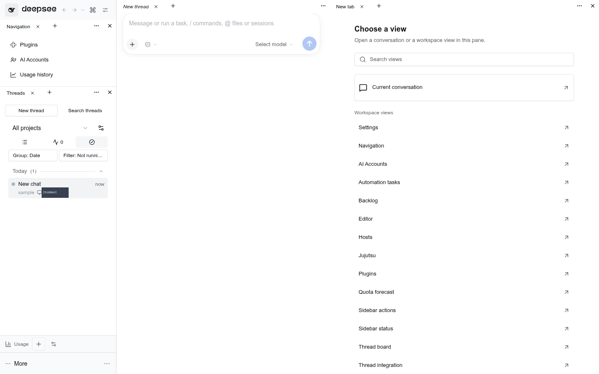
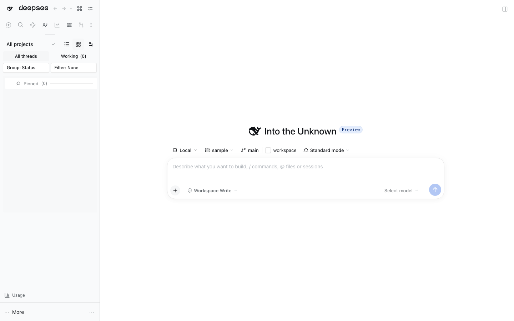
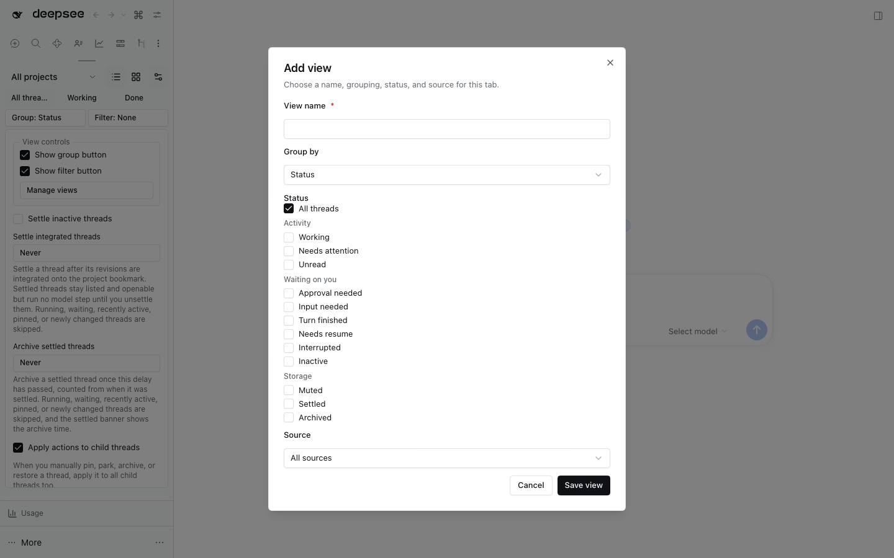
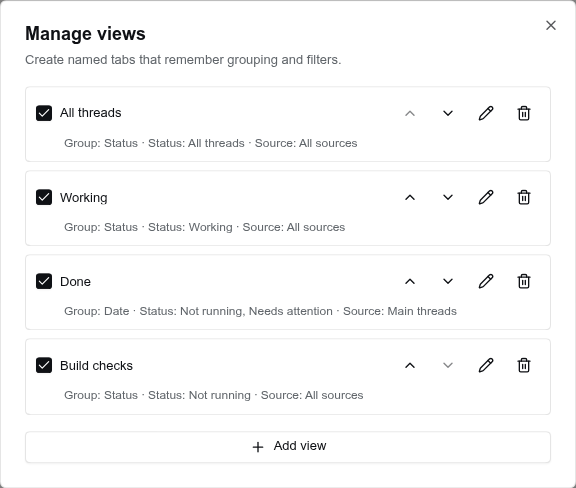
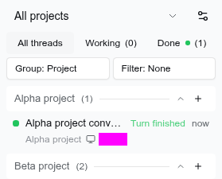
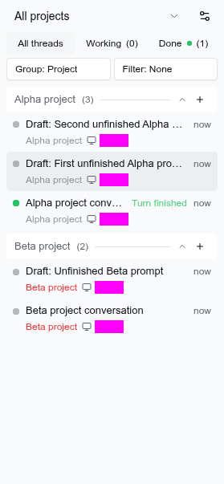
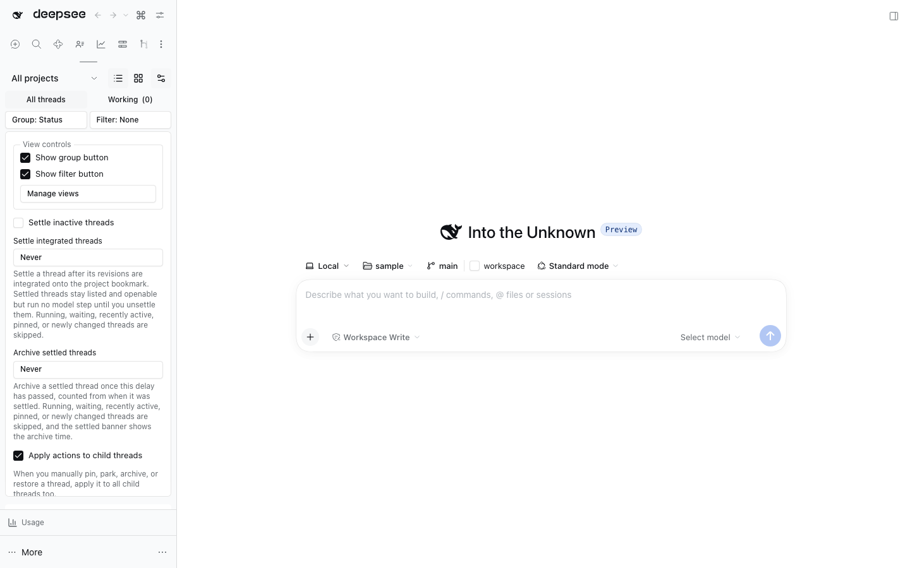
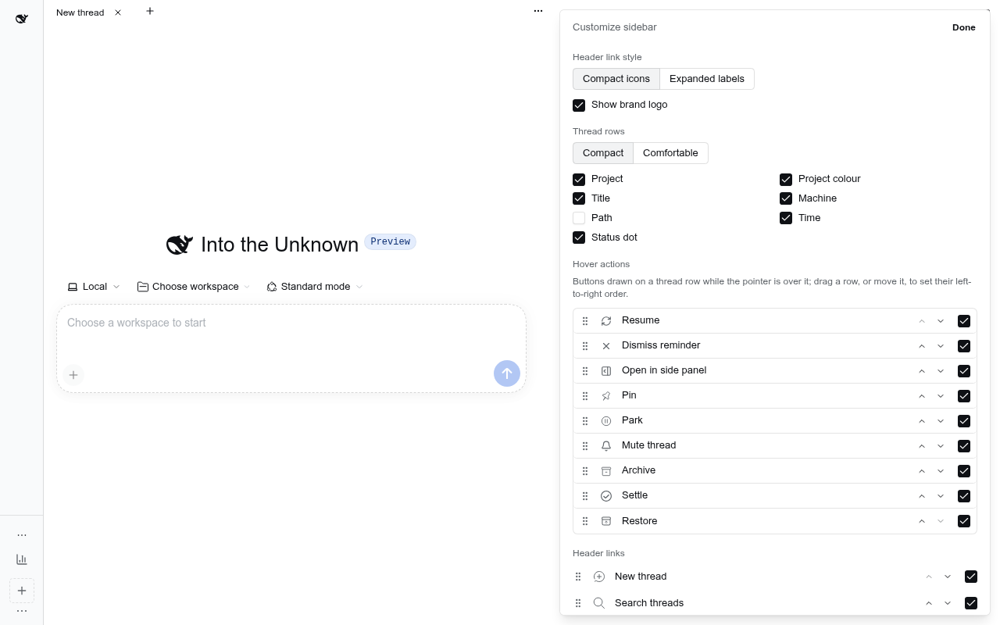
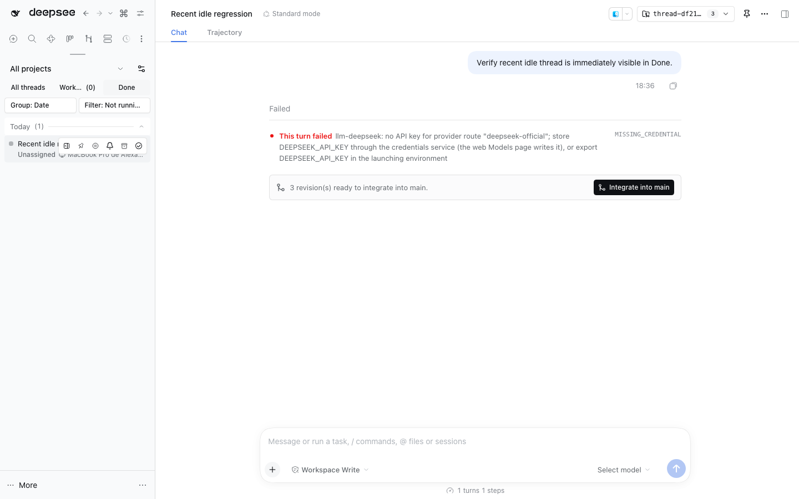

# Thread Sidebar












This bundle builds a full sidebar replacement with the repository's local
`@dshfiles/dshx` fork. It groups the real DSH session list by project and
activity, with pinned, active, parked, inactive, settled, and archived sections. Active
includes running or recently updated threads; the idle threshold moves older,
non-running threads to Inactive. Remote threads started from this DSH join the
current view by default: status views classify them as Active or Inactive from
their live running state, while date, project, and flat views group them
alongside local threads. Enable **Show remote threads in a separate group** in
**Thread list settings** to restore a standalone Remote section; in status views its
header joins the saved `sectionOrder` and can be reordered like local sections.
Remote runtime status does not include pinned, parked, settled, archived, or
attention state, so integrated remote sessions only participate in
Active/Inactive status grouping.
A local status section with no rows folds away and keeps its saved slot while the
shown ones reorder around it. The project picker scopes rows to one workspace or
unassigned sessions.

The reusable board page is **Thread Sidebar: Board**.

**Tabbed left pane.** In the owned stack, Workbench tabs are mandatory, with no
native-layout opt-out. The flexible middle belongs to its `shell.left` slot:
**Thread Sidebar: Navigation** and **Thread Sidebar: Threads** are reusable panels, not fixed sidebar furniture. Each group's **+**, named **New tab**, opens an actual chooser tab with **Choose a view**, **Search views**, **Rich Composer: Current conversation**, one **Settings Shell: Settings** hub and plugin views. **Pane options** sits at the group's far-right edge; there is no persistent Workbench toolbar. Threads retains **New thread**, **Search threads**, project creation,
filters, row actions and keyboard navigation. Its **Sidebar settings** gear opens
**Customize sidebar** inside that same panel, including after moving it or hiding
its tab row. The existing Root controller and preferences stay authoritative;
only the editor's owned React portal seat moves. The fixed header has no duplicate
customization button. The separate sliders control is **Thread list settings**
for list-specific options. The logo, Back/Forward and command palette remain
fixed at the top; native Settings/footer controls remain at the bottom.
[Settings ownership and verification](docs/panel-settings.md). Without a
Workbench occupant, the installed slot renderer falls back to the original
navigation/thread assembly. Collapsing reports the hidden geometry without
unmounting the live left docking region. That fallback is package compatibility,
not a user-selectable native layout. The fullheight right Workbench pane likewise
keeps its tabs and real Session resources mounted while collapsed; the conversation
main group's Pane options opener, pane-local Close pane icon and original sidebar shortcut address that pane,
not old native chrome. The bottom row occupies only left and centre.



**New chat from a project header.** With **Group: Project**, each registered local
project has an always-visible **+** beside its collapse chevron. It opens a fresh
chat in that project without changing whether the group is collapsed. The selected
blank chat appears as **New chat** in **All threads**, but stays local: leaving it
empty does not create a saved Host conversation. Typing meaningful text (or adding
an attachment) saves its identity before sending and changes its row to **Draft:
…**. Reopen drafts from their rows. You can keep several independent unsent chats
in the same project; **+** and global **New thread** never overwrite them.

The tooltip and accessible name say **New chat in &lt;project&gt;**; Enter and Space
activate it. Draft text uses the existing per-Session composer storage, including
page-reload restoration in the same browser origin; it is not synced between
devices or between localhost and LAN addresses. No separate project text cache is
introduced. Workspace isolation and error feedback remain with the existing
creation flow. Unassigned, remote and unavailable project groups, and date/status
groups, have no **+**.

The draft lifecycle uses the paired owned `session-controller`, `workspace-nav`
and `rich-composer` bundles. The native `model-selection` and `agent-preset` row
forks stage choices without addressing a nonexistent Host identity. Include both
in the profile; replacing only the visible model picker cannot adapt the native
preset controller or `/model` owner. These are supported plugin replacements,
not DSH core patches. Old saved blank sessions are not deleted automatically.

The project-header browser journeys cover selected blanks without a create RPC,
whitespace-only input, independent same-project drafts, reload and first send,
global New thread, pretyping model/preset choices, and the compact model picker:

```sh
pnpm --dir tooling/dshx run test:e2e:gen
pnpm --dir tooling/dshx exec playwright test --config=playwright.e2e.config.ts project-header-chat --workers=1
```

Use the scratch executable/browser overrides described by `verify-dsh` when the
personal launcher rewrites the scratch home or bundled Chromium is unavailable.
The six affected packages pass focused tests/typechecks and Host bundle imports.
The four scratch journeys pass without a provider response or live-instance restart.
This does not establish cross-device draft sync, arbitrary plugin compatibility,
or deployment into an existing profile. New profile rows require user-controlled
activation/restart; merely building an isolated worktree does not update the GUI.

**Moving a row between sections.** Drag a thread row onto another section header
(or anywhere inside that section) to put it there; while a row is in flight every
section shows, including the empty ones, and the target highlights. The section
it lands in opens if it was folded, so the moved row stays visible. A section is
a status, so entering one sets that status and clears the ones that outrank it:
Pinned pins, Parked parks, Settled settles, and Active/Inactive unpin, unpark and
unsettle. Dragging a settled thread out unsettles it and dragging an archived
thread out restores it. Active and Inactive are otherwise derived from the idle
threshold, so a drop there records `idleSectionOverrides` (with its instant) and
keeps the row in that section until the thread's next turn; Archived keeps the
thread's other statuses, so restoring brings it back where it was. Pin, settle
and archive keep their usual refusals (a running thread cannot be parked, settled
or archived), and every move honors Apply actions to child threads. The row
context menu's Move to group submenu performs the same moves from the keyboard.

**The thread board page.** The sidebar only ever shows the list; the board is a
full-width page opened from the thread board row in the sidebar's panel list (or
the "Thread board" command in the palette). It renders the same thread rows with
each section as a column: it defaults to the six status lanes (including empty
ones), and can also group its columns by project, date, or no grouping. The board
shows only columns: the list's Interrupted, Needs resume, Usage limit and attention
groups stay sidebar-only, and their threads sit in their status column with the
same attention label inline; remote threads join their columns even when the
list keeps them in a separate Remote group; branches whose parent is gone get a
column of their own; empty drafts stay in the sidebar. The board
has independent grouping, status/source filters, project scope, and collapsed
groups from the list, and keeps them in this browser across reloads; the sidebar
list keeps its own saved views. Thread row actions are unchanged, and dragging
between lanes uses the same section move behavior. The page reads the same Host
state as the sidebar but never runs the sidebar's background work (auto-archive,
auto-settle, notifications or attention polling), so both surfaces can be open
without doing that work twice.

**Keyboard and multi-select.** ↑/↓ move focus and open the focused thread (or
only move focus when **Thread list settings** says Move focus only); Shift+↑/↓ extends a
range without opening, Home/End jump to the ends of the list, and Ctrl/Cmd+A
selects every visible row. Shift+click and Ctrl/Cmd+click do the same from the
pointer, ←/→ fold the containing group section or the row's subagent children,
and Escape or a plain click clears the selection. A selected row paints in the
info tone, and an "N selected" bar above the list offers Pin, Settle, Archive
and Clear.

The context menu of a row inside a multi-selection applies the whole batch:
pin/unpin, park/unpark, settle/unsettle, mute/unmute, mark unread, copy thread
links and archive/restore, plus Clear selection. Right-clicking outside the
selection resets it to that row, so the single-thread menu still works. Park,
settle and mute write one preference update for the batch, pin and archive call
the Host once per row, archive refuses while a selected thread is running, and
every verb honors the Apply actions to child threads preference. Archive keeps
its undo notice and clears the selection when it succeeds.

**Project attribution.** A `jj-integration` thread workspace
(`<repository>-threads/<thread>`) is attributed to its owning repository. A
session the Host accounts to no workspace at all — for example after its thread
workspace registration was deleted, or when it was created with an explicit
`cwd` instead of a workspace — is attributed to the project its recorded `cwd`
resolves to: a registered workspace path, or the repository named by a
`<repository>-threads` directory. Truly unknown paths stay unassigned. This is
display attribution only: the Host Workspace registry is what `project_list`
and scope decisions read.

Running state comes from `SessionSummary.running`; recency uses its
`updatedAt` value. Pin and archive state come from the Host Workspace controller
stream. Pin, unpin, archive, and restore call that controller directly.

**Settled vs archived.** Archived is DSH's own hard verb: it stops the work it
names, blocks every later wake-up, and hides the thread from native navigation
until it is restored. Settled is this plugin's own status: the thread stays
listed and openable, the archive verb is never called, and the Host refuses the
model steps it proposes until it is unsettled. Auto-settle is off by default;
when enabled, the configured scan interval checks the same idle threshold and
writes `settledSessionIds`. It skips running, blank, archived, pinned, parked,
already-settled, excluded-session, excluded-project, and still-running-descendant
entries. A thread menu can inherit the global setting, explicitly settle that
thread, or exclude it; explicit per-thread enables still honor excluded projects
and other safety checks. Settling records the instant in `settledAt`, which is
what the composer banner dates and what the separate settled auto-archive delay
counts from. It also answers jj-integration's **Settle** action in its post-rebase
notice (`src/settle-request.ts`): the sidebar owns this status, so the notice asks
through the cancelable `dshfiles:thread-settle` window event instead of writing a
second copy.

Settled exists because auto-archive used to push idle threads into the native
archived state, and native navigation drops an archived Session from the main
view right after it opens, so clicking an idle thread fought that cleanup.
Threads already natively archived stay archived; there is no migration sweep.
The Host no-wake gate (`src/settled-gate.ts`) walks the subagent lineage through
live agents' headers plus the child's recorded `parentSession`, so a settled
grandparent whose intermediate subagent is no longer live is not detected; the
client refuses to settle a thread with a running descendant, which covers the
case that matters. Every preference decoder field needs the same default as the
Host schema: Schemastery drops a null-valued union field from its resolved
output, and one field without a default once made the strict decoder reject
every Host document, silently falling back to browser storage.

Sidebar preferences live in DSH Settings under the Host-synced `thread-sidebar`
namespace (`src/settings.ts`, registered by `src/host.ts`). The plugin draws its
own **Settings › Thread sidebar** section (`src/settings-tab.tsx`, registered by
`src/client-entry.tsx`) for the preferences the generated form cannot show. The
generated Plugins page still carries the user-facing namespace fields
(header style, density, icon-row overflow, recent-thread count, inactive
threshold, auto-settle); layout state
(order, visibility,
collapsed sections, project filter, split height, chords) is hidden everywhere.
Values previously kept in browser `localStorage` (`dshfiles.thread-sidebar.v1`)
are copied once into keys the Host still holds at their default, then removed.
Browser storage is only used while the Host namespace is unavailable.

**Header navigation** follows BB's Sidebar Resize. Compact mode (and expanded
mode once its pane is dragged to 76px or less) renders one horizontal icon row
that scrolls sideways (wheel included, scrollbar hidden, faded edges) with a
pinned ⋮ button. The ⋮ menu is a filterable list ("Filter destinations…") of
every destination, followed by **Settings** and **Customize sidebar**. Overflow
can be Scroll, Overflow menu (only fitting icons, the rest in ⋮), or Scroll +
menu (default).
Expanded mode is a labelled list with a trailing Customize row; density is
Compact (30px rows) or Comfortable (34px). Dragging the splitter past 76px from
the icon row switches to expanded.

**Brand logo.** Customize › Show brand logo (setting `hideBrandLogo`, off by
default) drops the Host brand mark and name from the header to make room; the
collapse button stays, drawn as a panel icon. With the setting off the header
renders the Host's `sidebar.brand.*` slots unchanged.

**Back / Forward.** The header ← → walk visited threads and panels (⌘[ / ⌘]).
Right-click or hold either arrow, or click the ▾ beside them, for the recent
history menu (newest first, current entry marked); picking an entry jumps there
and keeps the rest for Back and Forward.



**Saved views.** The view row above the thread list is backed by validated view
presets (`src/thread-view-preferences.ts`): each preset carries a name, order,
its grouping/status/source filters, and whether its tab shows a count. The whole document is the
Host-synced `threadViews` setting, so every browser offers the same views; the
v1 browser copy this plugin wrote migrates into it once. Stored v1 view
preferences migrate into that preset list once. **Customize views** opens
`src/thread-view-manager.tsx`, where presets are saved, renamed, reordered,
selected, and removed; the row's quick controls apply the selected preset
without opening the manager. The three shipped views are **All threads** (status grouping,
all sources), **Working** (status grouping, all sources, running own turns or
parents with running descendants), and the initially selected **Done** (date
grouping, main threads, **Not running** OR **Needs attention**). Not running
includes recent, pinned and parked idle rows, but excludes muted, settled and
archived rows; Inactive still uses the idle threshold. Explicit storage selectors
remain available. Legacy **Not working** decodes to **Not running**, retaining
any other selected filters. Custom view IDs, order, grouping, source, enabled
state and active selection survive migration; removed Inbox/Gone tabs are not
restored. Earlier unedited built-in Working/Done filter sets upgrade without
rewriting custom views. A preset that is not All threads shows `(N)` beside its name by default:
Working shows the running-thread count, while every other view counts unread
threads it lists, showing how many listed threads still hold an unacknowledged
finish on the Host (opening one clears it everywhere). Edit any view and uncheck
**Show count on tab** to hide that tab's count without affecting other tabs. The colored dot signals only attention labels matched by that
view's selected statuses; it is not itself an unread-finish count. When the
sidebar is too narrow for every full tab (`src/thread-view-tabs.ts` measures the
row), built-in views show their icon and custom views their initial beside the
count; the full name stays the tooltip and accessible name, so every tab fits
without scrolling. A row wide enough keeps the full names. A status filter names a state the row already
shows, and several combine as OR: **Working**, **Not running**, **Needs attention** (any label),
**Unread**, one filter per attention label (**Approval needed**, **Input
needed**, **Turn finished**, **Needs resume**, **Interrupted**), **Inactive**,
and the storage states **Muted**, **Settled** and **Archived**. Unread leaves archived and
settled rows out, and the attention filters see the label a root row shows for
itself or a child. A saved view from an earlier build that still asks for **Not
working** decodes to **Not running** without removing its other selectors. Muted,
archived, and settled threads are omitted from attention and unread filters,
because all three are storage rather than work in progress. **Group headers
collapse their rows** in the Project and
Date groupings: a closed header renders no rows at all. The collapse state is the
Host-synced `collapsedGroups` preference (`src/collapsed-groups.ts` holds the
group key helper and the browser copy an earlier build wrote there, which the
sidebar hands over once and removes). Because the preference is Host-synced, a
running Host that predates the field cannot persist it until DSH restarts. For how
working, attention, read state, groups, and filters fit together, see
[Thread sidebar states](sidebar-state.md).

**Archive undo notice.** Archiving reports itself as a compact overlay anchored
to the sidebar (`data-testid="thread-sidebar-transient-notice"`), so the thread
list does not move, and the notice offers an immediate undo before it disappears.
Clicking an archived row restores it and then opens it, because DSH drops an
archived Session from the main view on every list change; a refused restore
reports the failure and leaves the thread archived. An open archived thread
blocks its composer behind a **Restore to reply** banner. Persistent warnings —
storage failures and restart requests — stay in the list flow instead.

**Settled composer.** A settled thread opens normally and reads as history: the
composer carries a **This thread is settled.** banner
(`src/settled-thread-dock.tsx`), one compact card beside the jj rebase notice
with the settle age once it stops reading "now" and the archive deadline in the
sidebar's own relative buckets, an **Archive** button and **Unsettle to reply**,
because the Host rejects the next model step while the thread is settled. The
rejection is a `agent/pre-step` listener in `src/host.ts` over
`src/settled-gate.ts`: a settled
Session, or a subagent descendant of one, runs no model step until it is
unsettled, so a late wake (subagent settlement, queued follow-up, reminder)
proposes a step that ends as `blocked` without a request.

**Settled auto-archive.** `settledArchiveDelay` (Never by default, otherwise
immediately, after 1 hour, 1 day or 1 week) archives a settled thread once that
delay has passed, counted from the instant recorded in `settledAt` when it was
settled. The scan lives in `src/settled-threads.ts` and archives through the
`auto-archive-machine` actor, which serializes Host archive writes and coalesces
overlapping scans; the shared `now` clock wakes at the first due instant. An
archived, pinned, running, waiting or newly changed thread is skipped, and a
thread settled before this policy existed (no recorded instant) never becomes
due. The banner shows the archive time whenever a delay will archive it.

**Command palette.** Search threads, the ⌘ button in the header, and the
keyboard all open a shadcn `CommandDialog`: fuzzy search over thread title,
project, path, and ID prefix, recent threads when the query is empty,
destinations and actions (toggle sidebar, focus composer, customize, and Restart
DSH when launched through the managed supervisor) in the full palette, ⌘1–⌘9
on the first nine rows, and Enter to open. Restart asks for confirmation, then
requests a graceful Host exit; the Nix supervisor relaunches only its own DSH
child.

**Open in side panel.** A thread row's context menu, its hover action, the
`Open in side panel` command palette action and a `@dshfiles/main-tabs` thread
tab's own context menu open that thread in the right sidebar
instead of the main column, so a second thread can be read and driven beside the
one on screen. The row action routes through a React context the entry fills
(`ThreadAsideOpenProvider`), which calls `sidebarRight.openResource` on a
`threadaside` address; the resource retains the Session and the tab hosts the same
embedded Conversation a subagent chat does, composer included. The tab menu asks
over the cancelable `dshfiles:open-thread-aside` window event, which this entry
answers by cancelling it; a request made while no thread is on screen is left
uncancelled, because there is no side panel to open an aside into. Opening the same
thread twice focuses its existing tab, and closing the tab only releases the
reference — nothing is archived. Dropping a `@dshfiles/main-tabs` thread tab on the
open side panel moves it here the same way: the strip asks through
`dshfiles:open-thread-aside` and closes its tab once this entry answered. The
reverse is an aside tab menu item, _Move to main area_: it dispatches the
cancelable `dshfiles:open-thread` event that `@dshfiles/main-tabs` answers, then
closes the aside tab, so the thread lives in exactly one place. Archived rows
offer no aside, and the item is
absent if no entry provided the opener. The pane is a flex column, not a block, so
the embedded Conversation is sized by the pane: a block wrapper makes it grow past
the pane's height, which cuts the composer off and leaves the transcript
unscrollable.

`threadSidebar.openInSidePanel` is the rebindable command behind those paths. It
ships **unbound**, so Settings › Shortcuts lists it without it owning a chord
until the user picks one. Which buttons a row draws on hover, and in which order,
is a preference: Customize sidebar › Hover actions lists every one (Resume,
Dismiss, Open in side panel, Pin, Park, Settle, Mute, Archive, Restore), each row
carrying the button's own icon, a grip, Move up/Move down buttons and a visibility
checkbox. Drag a row, or move it, to set the left-to-right order the buttons draw
in; `rowActionOrder` stores that order and `hiddenRowActions` the ones a row hides
— an absent id means shown, so a new action ships visible at the end of the saved
order. The shipped order puts Settle in Archive's slot and Archive just before it,
so a row that hides Archive ends on Settle. Hiding one removes only its hover
button; the context menu keeps every action.

**Pending restarts.** Client bundles hot-reload; Host code, `package.json` and
`cordis.patch.yml` load only at boot. The Host half remembers a content hash of
those files for every plugin package the Host's client module registry lists
(at boot, or when a package joins the graph) and the shell checks again on
window focus and every minute. When any differ, a subtle "Restart DSH to apply
updates (N plugins)" row sits above the foot (a ↻ icon on the rail) listing the
packages; it opens the restart confirmation, and the `>` palette entry carries
the same label. Identical rebuilds flag nothing. Host-only packages without a
client bundle are not listed by that registry and are not tracked. Hosts
started before this plugin version report nothing. Keyboard entry
points:

- Capture-phase chords claimed before the browser: ⌘K / Ctrl+K palette,
  ⌘P / Ctrl+P file search (thread search has no chord by default; it stays on
  ⌥⌘K and in ⌘K). Rebind or disable them in Settings › Plugins ›
  Thread sidebar shortcuts. A chord the Host shortcut catalog already binds is left to
  the Host (so desktop ⌘K stays native Search sessions).
- Host shortcut `threadSidebar.commandPalette` (⇧⌘P by default), editable in
  Settings › Shortcuts.
- Host `session.search` (⌥⌘K on the web, ⌘K on desktop) opens thread search:
  the native browser stays registered under this one, and its request store is
  followed through the slot ledger.
- Any bundle opens the palette through the `CommandPalette` contract of
  `@dshfiles/command-palette/palette-contract`.

**Footer** entries render on one row and never shrink or wrap. Entries that do
not fit move into More (⋯) together with entries hidden in Customize; overflow
is recomputed from measured widths on resize. More also opens **Settings** and
lists every sidebar page as a flat list (no group heading), so the menu stays
usable at any width.

`sidebar.footer.above` (list, owner `{}`) remains the genuine full-width contributor seat for the AI Accounts usage strip. With the supported `shell.left` Workbench override, its existing Preview assembly is a regular docked tab group instead of a duplicate fixed strip. The actual public slot entries/subscription select this mode; there is no guessed global bridge or extra SDK field. A standalone Sidebar retains the fixed full-width fallback above its native foot; removing the override restores that fallback. The stock sidebar has no such seat, so an occupant retains its footer-action fallback and registers through `ctx.slots.inject`.

**Workbench sidebar assemblies** are available through the **New tab** chooser while this sidebar root is mounted:
**Thread Sidebar: Threads** hosts the actual `sidebar.workspaces` occupant in wide mode; **Thread Sidebar: Navigation** renders the actual
`sidebar.panellist` glyphs inside live navigation buttons; **AI Accounts: Preview** hosts the current AI Accounts-only `sidebar.footer.above` contribution;
**AI Accounts: Controls** hosts an AI Accounts-only `sidebar.footer.action` aggregate in wide mode. Mixed or unlabeled footer contributors instead use **Thread Sidebar: Plugin previews** or **Thread Sidebar: Plugin controls**; the sidebar never claims another plugin owns a mixed assembly. Each uses this root's authorized renderer,
original owner props and normal query/settings/sidebar contexts. Its declared seats remain present, but the Preview is not mounted twice. The account-only Preview is initially seated below the existing left groups; prior saved placements win, and explicit closes remain closed. It has the same move/close/single-tab **Hide tab row** controls as any other view. Hover/focus the content's **Show tab row** control or use **Workbench: Show tab rows** to recover it; adding a second tab reveals the row and clears the hidden preference.
These are content assemblies, not fake independent copies of contextual message/turn/menu slots. The Settings
launcher, brand and reopen badge remain sidebar chrome; Settings already has its own main/section panel adapters.

**Settings › Plugins › Thread sidebar shortcuts** records the two palette chords
(record / disable / reset, with Host-conflict and duplicate warnings), which a
generated text field cannot capture.

Every thread row also exposes **Copy thread ID**, **Copy thread link**, **Mark
unread**, per-thread auto-settle behavior, a **Settle**/**Unsettle** toggle, and a **Mute thread** menu. **Follow-up in a new thread** opens a blank composer in the source thread's registered workspace with `Follow-up after` and a structured session-reference chip prefilled, labeled with the source thread title, and the caret on the next line; normal workspace isolation applies.

**Continue in project** (row menu and thread header menu) fixes a thread that
started in the wrong folder, or whose work moved to another repository. It lists
the registered projects; picking one forks the conversation into a new thread
whose own working directory is that project's workspace — its isolated jj
workspace when jj-integration isolates new threads — settles the original, and
opens the new thread. The new thread is told which thread it continues and both
directories. A DSH Session's project, session-log location and sandbox root all
follow its immutable header cwd, so a fork whose header already names the
destination is the only move every surface agrees on; the original id stays
reachable through the fork's parent link. The Host half is the
`session-continuation` API of `@dshfiles/session-controller`. The original's
running shells and background jobs keep running in its own folder, where their
work still belongs; a running thread must be stopped first.
Attention is Host-owned: the plugin records one durable row per unacknowledged
thread (a finished turn, a manual unread mark, or both) in the
`thread_attention` storage domain and serves it through the
`thread-sidebar-attention` API, which also exposes the current state to the
agent as the `thread_attention_state` tool. Other plugins import the contract
from `@dshfiles/thread-sidebar/attention-api` (a dshx shared module, so one
definition serves every consumer); `main-tabs` reads it for its unread dot. The turn end is recorded where it
happens — a Host listener on committed session events — so a completion
survives even when every browser was closed while the thread finished. Watching
a thread finish acknowledges that completion, and so does opening the thread
from any tab; the acknowledgement carries the record version the browser
rendered, so a turn that finishes in between stays unacknowledged, and it never
clears a manual unread mark on the same thread. A browser that still holds markers
from the older browser-local version hands them to the Host once and then drops
its copy.
Auto-settle can inherit the global auto-settle setting, explicitly enable it
for one thread, or exclude that thread; the global idle threshold and safety
exclusions still apply. A thread with a still-running descendant is never
settled, so a child turn is never rejected mid-step. **Mute thread** (row bell, context menu, and the
session header's More menu) silences a thread for 1, 8 or 24 hours, until
tomorrow morning (09:00 local), for a week, or until it is unmuted, like a
Discord channel. A muted thread raises no desktop alert, attention group,
attention label or unread dot, and keeps the activity time it had when muted,
so new activity does not lift it to the top or out of Inactive. A bell-off
marker before its title gives the time left in its tooltip; a snooze wakes on
its own, and **Unmute** is always in the same menu. The **Muted** filter lists
muted threads. Mutes follow child-thread action preferences and live in the
Host-synced `mutedThreads` setting, so every browser stays quiet; mutes saved
in this browser by older versions are copied there once. **Thread notifications**
are configured in Settings › Thread sidebar, separately for approval requests,
questions, completed turns, stopped turns, and failed turns. Each category can be
off, in-app, system, or both, with an optional sound preset and volume. In-app
notifications can be placed at any corner or center edge of the sidebar, dismissed
with the close button, and timed out after 3, 5, 10, 15, 30 or 60 seconds; choose
Never to leave them until dismissed. These settings follow the user through Host
settings. A stopped turn covers a cancellation, a blocked turn, and one that hit
its token ceiling. System permission is requested
only after an explicit action, and OS notification text stays generic (no prompt,
thread title, or raw error details). Sounds use one browser audio context,
unlocked by the first user gesture and resumed before every tone, so an alert in a
background tab still rings. Existing desktop-alert choices migrate to system
delivery.

**Park vs settle vs mute.** Park files a finished thread away: it moves to the
Parked section, is skipped by auto-settle, and stays parked until unparked, but
its alerts still fire and it still runs steps when something wakes it. Settle
goes further: the thread moves to the Settled section and runs no step at all
until it is unsettled, while staying listed and openable. Mute keeps the thread where it is and only silences it, for
a while or for good. They answer different questions ("not now" vs "not
noisy"), so they stay separate: settling a parked thread drops its parked
mark, and unsettling does not bring that mark back. The sidebar separates **Approval needed**,
**Input needed**, **Turn finished**, **Interrupted**, and **Needs resume**.
Permission approvals and plan-review decisions use **Approval needed**;
structured user-question requests use **Input needed**. Open questions use the
Client's explicit Session pending-interaction status; the sidebar also checks
active native question projections for continued forms, which can remain
answerable after a timed wait lets the Agent keep working. Unknown interaction
kinds and generic unstructured questions remain unclassified. **Turn finished**
marks an eligible finished turn from the Host's attention record; selecting that
thread from any route acknowledges it. **Needs resume** contains only Sessions
the managed restart captures as running immediately before its Host exit.
Completed, already-idle, and user-cancelled Sessions are not added. **Interrupted**
contains Sessions whose turn was still open when a previous Host process stopped
without that capture — a crash, a kill, or a shutdown timeout. The Host half
records every `turn/start` in a small durable in-flight file and clears it on
`turn/end`, so whatever the next process finds there is exactly the set of turns
that never closed; it promotes those ids into the same recovery store at boot,
marked `interrupted` instead of `restart`, and clears the file so one exit is
reported once. Both groups show explicit **Resume** and dismiss actions, and each
offers **Resume all** (up to three requests at once). Resume sends a new
continuation prompt that directs the agent to inspect its transcript and
workspace before continuing; it does not replay the interrupted model/tool call.
A row leaves its group as soon as that thread runs again, and dismissing drops it
by hand. Approval, Input, and Turn finished can be configured independently as a
separate group or inline thread-row label.
Approval and Input default to groups; Turn finished defaults to an inline
label. Each status has an independently configurable semantic color in Sidebar
settings (Muted, Primary, Info, Success, Warning, or Danger); the default colors
are Warning for Approval and Input, and Success for Turn finished; generic
working indicators remain Info. Group headings stick to the top while scrolling.
Subagent attention is
excluded from groups, labels, and desktop alerts by default; enable **Include
subagent threads** in **Thread list settings** to opt in. An unresolved request stays
available in its conversation composer and returns to its configured attention
display when that thread is no longer selected. The Host records attention for
turn ends that ask for something (`completed`, `error`, `aborted`, `blocked`,
`max-tokens`); `forked` and `interrupted` turn ends never raise it, because the
first closes fork bookkeeping and the second continues in the next turn.
Attention rows still require a thread that is not running, not blank, not
archived, not muted, and not already waiting on approval or input, so a later
turn can surface normally. Completion alerts are observable only while a DSH
page watching that Host is open; a completion recorded while every tab is
closed still appears when one is opened, but no desktop alert is replayed. A
failed latest turn shows a destructive dot and **Failed · time**
in its row, using its durable turn-end timestamp. The row exposes failure time,
not error details. Errors without a durable `turn/end` event are not shown.
Attention is not backfilled from history that predates the Host's attention
store; it tracks new turn endings, plus the one-time browser migration.

Child sessions render with increasing indentation and a direct “child of …”
label. The sidebar follows DSH's durable `parentId` chain, so the presentation
is not limited to parent/child pairs; a child link carries
the workspace found on the nearest ancestor when the child has no direct
workspace membership. A child list stays with its parent's row whatever the
view filters: the children follow the parent they belong to, folded while no
subagent is working and unfolded when one is, so a subagent working under a
parent shows there and child threads never appear as rows of their own.

A branch whose nearest listed ancestor is gone from the corpus (for example a
quarantined session log) never turns into a top-level row: the whole branch
groups under one “Parent thread unavailable: …” header naming the missing
session, with its children nested and the same status, source, and finished
subagent rules as a listed parent. The header carries one archive action for the
whole branch, because those child rows have no menu of their own and there is no
parent row to cascade from; with the Archived filter on, the same button restores
the branch. An archived branch leaves the unfiltered list instead of sitting
there forever — the Archived section can only list root rows, so the archived
filter is where it comes back. Nothing can create that state through the
UI — DSH has no session delete — so a unit test covers the grouping and the
branch action, and the browser journeys cover the listed-parent case.

Finished subagents (not running and not waiting on approval or input) fold
into one “N finished” line by default so live ones stay on top; the
`finishedSubagents` setting can also list them or hide them. The open child is
always listed.

Thread links use the root/index URL with `thread` and optional `workspace`
query parameters, for example `http://127.0.0.1:3080/?workspace=ws_…&thread=thr_…`.
This matches the installed frontend-static contract: it serves the app index
at the root or configured index path and returns 404 for other paths, so a
BB-style `/projects/…/threads/…` pathname would need a Host router change. On
load, the sidebar waits for the Host session catalog and opens the addressed
thread; selection changes update the URL. Copied links drop existing query
parameters and fragments, including process launch credentials, and resolve
only on the same DSH Host/origin where the session exists.

The web app composes DSH's native subagent tools and runtime, while this plugin
owns the subagent catalog action, child-thread lineage, and `Create subagent`
tool-row presentation. A plugin-owned Host projection records the latest safe
provider/model reported by a completed assistant response; catalog rows and
child headers display it. The tool row shows an explicit requested route. The
plugin never looks up account identity, and email- or credential-like route
values are omitted. The lineage UI is adapted from DSH's MIT-licensed
implementation; see `third-party/NOTICE.md`.

Continuable children can run concurrently, and `list_agents`, `send_message`,
and `interrupt_agent` support parent-side orchestration. The catalog traverses
descendants recursively. The Host supports up to 8 live continuable children by
default, and each child persists its direct parent session ID. The configurable
`subagent.maxDepth` currently defaults to 1, but the lineage model and sidebar
do not bake in that depth. Change the native Subagent depth setting when deeper
delegation is desired.
**Mention a thread.** A row's context menu, a `@dshfiles/main-tabs` thread
tab's menu, and a drag from either source all insert that thread as the same
native reference chip in the composer on screen. The drag carries only
`application/x-dshfiles-thread-mention` (`{ "sessionId": … }`), never plain text,
so the rich editor cannot paste a stray title: the composer under the pointer
outlines, a _Drop to mention thread_ hint follows it, and only the composer whose
own seat received the drop inserts. A drop on a right-panel aside inserts there,
never in a main composer showing the same thread. The row menu item is
`@Mention thread`; resolution, unavailable-target and draft-changed outcomes
notify through the composer instead of touching the draft.

The native `@` reference source already offers recent sessions and searches by
session ID, title, display label, or workspace path. An empty `@` query is
limited to the configured recent candidate count (default 50), with
same-workspace sessions ranked first. The menu also contains file and folder
references; session discovery searches metadata, not message bodies.

The full shell uses the public `sidebar` root slot and Host `ctx.layout` state
and actions for width, collapse, and panel selection.

Its root declaration owns the same seven child slots declared by the native
shell, plus `sidebar.footer.above`. The package patch disables `ui-sidebar` first: SlotCore refuses to redeclare an existing child
slot, and retained native declarations do not transfer render authorization.
The custom root and workspace browser both register at priority `-1000`, below
the Host's default priority `0`; lower priority wins the live single slot.

The shell has a horizontal drag handle between its navigation header and the
project/thread region. It adjusts the header's height while preserving at least
120px for the thread list. The height is saved with the other browser
preferences; double-clicking the handle restores the content-sized default.
Arrow keys resize in 24px steps, Home/End move to the smallest/largest
available header size, and the 0 key restores the content-sized default. The handle
is hidden when the Host collapses the sidebar to its narrow rail, where the
thread region is not rendered.

## Render cost at scale

The Session Controller's `projectList` builds a **new summary object for every
session on every list projection** (its `byId` record is rebuilt, not
structurally shared). A row whose data did not change therefore still receives a
new `session` object, which defeats `memo` on the row and every memo upstream of
it. At 305 rows one "New thread" navigation published a handful of projections,
and each one re-rendered the whole list: measured on a scratch DSH, ~4,300-5,500
`ThreadRow` renders per click, 11-15 long tasks and 1.7-2.4 s of blocking work,
with the sidebar itself accounting for all of it. Nothing loops; the cost is one
full re-render per store update.

Three pieces keep the work proportional to what actually changed, all on the
client side — no Host change is involved:

- `src/snapshots.ts` is the selector thread-listing plugins pass to
  `useSessions` and `useSessionStatus` (this plugin's own components, and
  main-tabs through the `@dshfiles/thread-sidebar/snapshots` module). It reuses
  the previous summary whenever every field is equal (including `retainedBy` and
  `projectionValues`), reuses the `ids` array, the projection map and each status
  row by content, and returns the **previous state object** when a projection
  changed nothing at all, so the store notification does not re-render the
  consumer. Its cache is keyed by the raw snapshot generation, so two components
  holding different generations in one tick cannot regenerate each other's
  stable object.
- `src/stable-value.ts` keeps a derived `Set` or `Map` when its content is
  equal. The unread, waiting and attention id sets and the inline attention
  label map are row props, so without this every row re-renders although none of
  them changed.
- `src/thread-child-rows.ts` derives each parent's listed, live and finished
  child rows once and caches them under the children array the thread tree hands
  out, so an untouched parent keeps the exact arrays its row already holds. A
  parent without children shares one empty row.

After the change, the same click on the same instance costs 0-30 `ThreadRow`
renders (only rows whose `age` or selection really changed), no long task in the
navigation window on a calm machine, and about 4-9 ms of total sidebar render
time across the 8 renders the store still asks for. Click-to-composer went from
1,072-1,563 ms to 31-208 ms across runs; on the same instance with the project
filter set to a bucket with no rows it measures 28-49 ms, so what remains is
Host RPC time (`session/create`, `destination`) and the machine's load, not row
work. Those wall-clock figures come from a shared machine (load average ~28);
the render counts and the long-task count are the load-independent evidence.

To reproduce, start a scratch DSH and seed it:

```sh
node tooling/dshx/packages/dshx/dist/cli/bin.js dev up \
  --plugin @dshfiles/jj-integration --plugin @dshfiles/home \
  --plugin @dshfiles/thread-sidebar --plugin @dshfiles/ui-styles \
  --name sidebar-scale --skip-build --json
node tooling/dshx/scripts/sidebar-scale-bench.mjs "$TMPDIR/dshx-dev/sidebar-scale/state.json" --seed 305 --rounds 5
```

The benchmark reports long tasks (inside and after the navigation window),
click-to-composer and the slowest RPCs. Render counts need a temporary counter:
add `globalThis.__threadRowRenders = (globalThis.__threadRowRenders ?? 0) + 1` at
the top of `ThreadRow` and
`globalThis.__sidebarRenders = (globalThis.__sidebarRenders ?? 0) + 1` at the top
of `ThreadSidebarContent`, rebuild the plugin, and read both from
`page.evaluate`. Wall-clock numbers depend on the machine's load; the render
counts and the long-task count do not.

**What is not rendered.** A collapsed section and a closed child list already
render no rows at all (measured: collapsing Active took the list from 12 rows to
0 in the DOM, and reopening restored them). Offscreen rows are a different
problem: they must stay in the DOM so scroll height, `data-thread-id` lookups,
scroll-into-view and text assertions keep working. `src/use-near-viewport.ts`
therefore keeps every row and its content, but mounts a row's hover actions and
their tooltips only once it comes within 600px of the viewport, and leaves them
mounted afterwards. At 602 rows on a scratch DSH, loading the page cost 5,803
DOM nodes (9.6 per row), 13.8-14.2 ms layout, 60.6-62.4 ms style and 215-253 ms
script with the gate, against 15,629 nodes (26 per row), 21.2-23.9 ms layout,
167.3-175.1 ms style and 494-514 ms script with every row mounted (measured by
removing `IntersectionObserver` before load, so both runs used the same build).
Without an `IntersectionObserver` — a test environment — every row mounts.

CSS `content-visibility: auto` was measured as an alternative and is **not**
used: at 602 rows it saved nothing at load (the browser still styled every row)
and moved 19-27 ms of layout and 86-132 ms of style into the scroll frames, so
the same work happened later, in the frames where jank is most visible.

**React Compiler (measured, not enabled).** `dshx` gained an opt-in
`client.reactCompiler` option (Vite's `@vitejs/plugin-react` `compiler` path with
`{ target: '18' }`, so the compiler emits `react-compiler-runtime` calls) and
this plugin was built with it at 602 rows. It compiled the components and the
app ran, but nothing improved: page-load script went from 287-301 ms to
307-339 ms, the New-thread click from 73-103 ms to 74-164 ms of script, and the
bundle grew from 445,406 to 496,363 bytes (+11.4%) for the inlined runtime. The
hand-memoized structure described above — a `memo` row, content-stable derived
containers, cached child rows — already covers what the compiler adds, so the
experiment was reverted: the option, its two build dependencies and this
plugin's `react-compiler-runtime` dependency are gone.

## Agent tools

Saved views use the `thread-sidebar-views` API over the same `thread-sidebar.threadViews` Host settings the GUI edits. `thread_views_list` and `thread_view_get` return the actual view definitions, order, selection and revision. `thread_view_create`, `thread_view_update`, `thread_view_delete`, `thread_view_move` and `thread_view_select` create, rename, enable, filter, reorder, remove and select views; select also changes group/filter control visibility. Delete requires explicit `confirm: true`. Invalid or missing targets, duplicate names or ids, the twelve-view limit and removing the last enabled view are rejected. Writes update only the view document and use the settings revision to refuse concurrent edits instead of overwriting them.

One dshx API (`thread-actions`, owner `@dshfiles/thread-sidebar`, defined in
`src/thread-actions-api.ts`) exposes the sidebar's thread and project actions to
the Agent as twenty-one native tools: `thread_list`, `thread_archive`,
`thread_unarchive`, `thread_settle`, `thread_unsettle`, `thread_pin`,
`thread_unpin`, `thread_rename`,
`thread_fork`, `thread_continue_in`, `thread_create`, `thread_prompt`, `thread_stop`,
`thread_select_model`, `thread_references`, `project_list`,
`project_register`, `project_rename`, `project_delete`, `project_reorder`, and
`thread_move` (a reorder within the project that already holds the thread;
`thread_continue_in` is the cross-project move). `src/thread-actions.ts`
holds the decoded logic over plain ids and `src/thread-actions-host.ts` resolves
the live Host services on each call (`sessionController`,
`workspaceController`, `workspaceRegistry`, `sessionQuery`, and this plugin's own
`thread-sidebar` settings scope for the settled set). `thread_settle` and
`thread_unsettle` write `settledSessionIds` through that scope, so the Agent and
every browser see one status.

`thread_create` starts the thread's turn when it is given `text`: the same call
creates, names and briefs a new thread, so an Agent never leaves one idle
between a create and a prompt. `title` stays optional — with only `text` the
Host's automatic title stands, derived from that first message — and a refused
first message still returns the new id, reporting `prompt: 'refused'` and the
reason. `thread_prompt` is the follow-up verb over the same
`sessionController.prompt` the composer uses: `mode: 'queue'` (the default)
starts the thread's next turn or appends to a running one, `mode: 'steer'`
folds the text into the live turn, which the Host refuses when the thread is
idle. Both take an explicit `sessionId` to reach another thread and default to
the calling one.

`thread_continue_in` is the menu's **Continue in project**: `projectId` from
`project_list`, an optional `sessionId` (the calling thread by default) and an
optional `text` queued as the new thread's first message. Called by the thread
it moves, it keeps the running turn in the copy, and the settle stops the
original after the call; another thread must be idle. A refused settle or first
message still returns the new thread id.

`thread_references` answers which other threads point back at one thread: its
forked and subagent children (`header.parentSession`), plus the threads whose
messages pulled it in as referenced context. The second half is one bounded
full-text lookup for the thread id over `sessionQuery.searchSessions` — the
referenced-context snapshot records `"sessionId":"session-<id>"`, so the id's own
uuid is the phrase to search. That lookup needs the Host's session-content index
(the web profile's `session-query-sqlite` Loader row); a search that is still
reconciling the corpus, or a Host without the index, is attempted three times
with a 1.5 s deadline each and then reported as `degraded: true` with lineage
only. `references` therefore never holds a menu open and never claims "nothing
references this thread" when it could not look. The same rows drive the
**Referenced by** submenu of a thread row's context menu and of the conversation
header's `...` menu, which is why the client tolerates a Host that predates the
method (it shows one muted line instead of the rows).

`thread_queue_remove`, `thread_queue_steer` and `thread_queue_edit` act on one
queued message through the Session controller's `updateQueue`, the verb the queue
dock uses. `thread_queue_edit` is the native in-place edit: the message keeps its
id and its place in the queue and gets the new `text`; the Host refuses a message
that carries images or files (queue-reorder's **Edit** button handles those by
moving the message through the composer). `queue_describe` lists the ids.

Every write tool's description says it may run only when the user asked for that
change. `thread_archive` never stops running work on its own: without
`stopActivity` the Host refuses with `workspace/session-active` and the tool
returns the running families, so the Agent must confirm with the user before
calling again with `stopActivity: true` — the sidebar's stop-and-archive
confirmation. Actions default to the calling thread when `sessionId` is
omitted; archiving the calling thread with `stopActivity: true` ends its turn.
Because this is Host code, the tools reach a running DSH only after a restart.

## Installed DSH 0.2.0-rc.2 sidebar contract

The installed `@deepseek-ai/dsh-client-ui-sidebar` contract exposes a
replaceable `sidebar` root with declared children for `sidebar.panellist`,
`sidebar.workspaces`, `sidebar.settings`, and `sidebar.footer.action`. Its
native `SidebarRoot` renders those same child slots, and the settings/footer
owners receive `{ wide }`. The installed slot renderer accepts an `only`
ID filter; the slot registry exposes live entries and change subscriptions.
This bundle reads those registrations and renders each one through the
declared child slot, including hidden footer entries from More.

The native root renders the settings trigger and footer action slots, but its
layout does not provide user-managed link order or visibility. Those controls
are plugin-owned state stored with the other sidebar preferences. The root
slot and child-slot contracts are sufficient; no Host change is needed for
compact/expanded header links, ordering, visibility, or footer More recovery.

## Marketplace decision

**Build with the local dshx fork.** No candidate covers the requested Host
semantics and full navigation customization together, so this bundle does not
adopt or vendor candidate code.

- [`@michengai/dsh-codex-ui` manifest](https://raw.githubusercontent.com/MichengAI/dsh-codex-ui/main/package.json)
  explicitly admits DSH 0.2.0-rc.2 for its imported client packages. Its
  [composition patch](https://github.com/MichengAI/dsh-codex-ui/blob/main/cordis.patch.yml)
  disables `ui-sidebar`, and its
  [sidebar implementation](https://github.com/MichengAI/dsh-codex-ui/blob/main/src/client/CodexSidebar.tsx)
  proves the public root-slot takeover path. It does not supply idle
  settlement, parked state, or user-managed compact/expanded ordering and
  visibility for header and footer entries.
- [WenhongPan/dsh-projects manifest](https://raw.githubusercontent.com/WenhongPan/dsh-projects/main/package.json)
  caps its client peers at the 0.1.0-rc.6 line and imports the removed
  `dsh-client-runtime`; its project/archive UI is not a DSH 0.2.0-rc.2 bundle.
  Its attention density modes describe project summaries, not header-link
  presentation or footer customization.
- [TOBYCAI/dsh-sessions-manager manifest](https://raw.githubusercontent.com/TOBYCAI/dsh-sessions-manager/main/package.json)
  also imports legacy `dsh-client-runtime` and depends on legacy archive/star
  routes. Its active/archive and auto-archive concepts do not provide the
  requested customizable root shell.
- [wzn16/dsh-auto-archive manifest](https://raw.githubusercontent.com/wzn16/dsh-auto-archive/main/package.json)
  does not declare DSH 0.2 peer compatibility. Its older implementation uses
  private workspace persistence fallbacks when an archive service is missing,
  so its idle guard is not safe to reuse against this Host.
- [`dsh-better-sidebar@0.24.1` manifest](https://raw.githubusercontent.com/omdsh-dev/DSH-better-sidebar/main/package.json)
  does admit DSH 0.2.0-rc.2, but its implementation uses the separate native
  right-sidebar API and a bottom workbench; it does not replace this main left
  sidebar or provide the requested header/footer link controls. The current
  [maintainer README](https://github.com/omdsh-dev/DSH-better-sidebar/blob/main/README_EN.md)
  describes that right-column scope.
- [`@anionex/dsh-pinned-sessions`](https://dshmarket.com) does not admit the
  installed DSH 0.2 peer line.

## Host contract gaps

- Host has archive/unarchive and pin/unpin verbs and projections. It has no
  parked-session verb or projection, so park is browser-local and does not
  sync across profiles or devices.
- Session exposes `updatedAt`, not a dedicated last-activity timestamp with
  inactivity semantics. Settlement uses that field and can therefore treat a
  metadata update as recent activity. A reliable idle policy needs a Host
  activity timestamp.
- The public root slot supports shell replacement; no Host change is needed
  for compact/expanded links, ordering, visibility, or More. The bundle keeps
  shell geometry and panel selection in the Host layout service.
- The installed static frontend server has no pathname router: unknown paths
  return 404. Thread links therefore use query-based root/index URLs; clean
  `/projects/:project/threads/:thread` paths need an explicit Host route and
  client route contract.

## Verification and composition

Focused tests use the installed rc.2 `SlotCore`: a live native sidebar's child
declarations reject a competing full root; after the native entry is disposed
as `ui-sidebar` is by the package patch, the custom root registers and wins at
`-1000`. The same test confirms the custom workspace browser wins its slot.
These are runtime-core checks, not a boot of the user's active DSH profile.

The parent workstream must add this package to its composed plugin list. This
child does not edit the active profile or root workspace manifests/lockfiles.
