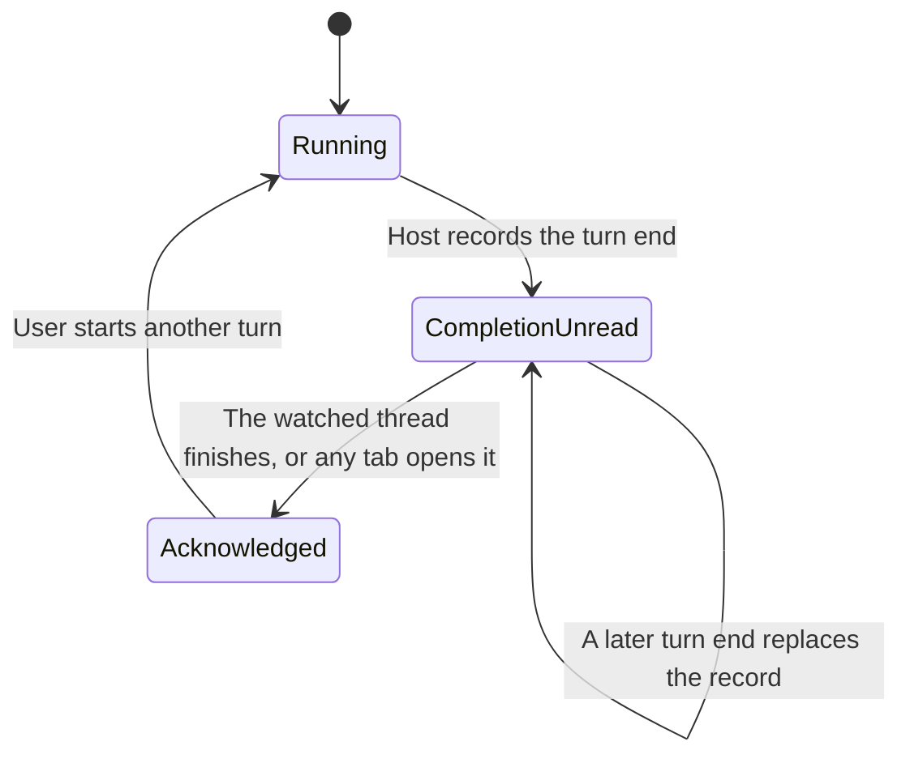

# Thread sidebar states

The sidebar shows several related signals, but they answer different questions:

- **Working:** Is this thread doing work now?
- **Attention:** Is there something the user may need to respond to, or a
  completion the user has not acknowledged?
- **Read:** Has the user acknowledged the manual unread marker or this
  completion?
- **Group and filter:** Where should the row appear, and which rows should be
  shown?

A thread can be recently **Active** without being **Working**, and a finished
thread can be unacknowledged without being active.

## Working and active are different

**Working** means the Host reports running activity. The Working filter shows
running threads; a parent thread may count while one of its child threads is
running. Working is not an unread or attention state.

**Active** is a status section, not a synonym for Working. Archived and Pinned
sections take precedence. Otherwise, running threads are Active; non-running
Parked threads are Parked; the rest remain Active until the idle threshold. By
default, a non-running thread becomes Inactive after two hours.

## Attention

Attention is separate from running state:

- A pending approval or plan review appears as **Approval needed**.
- A structured question appears as **Input needed**.
- A finished turn appears as **Turn finished** while the Host holds an
  unacknowledged attention record for that thread.
- A thread appears as **Needs resume** only when the managed restart captures it
  still running immediately before Host exit. Idle, completed, and user-cancelled
  threads are not added by a restart. Resume is an explicit new continuation
  prompt; it does not replay the interrupted model or tool request.

Approval and Input come from the Host's pending-interaction status as the
Client sees it. The Host records Turn finished itself: the plugin listens to
committed `turn/end` session events and stores one durable row per
unacknowledged thread in the `thread_attention` storage domain, then serves
that row through the `thread-sidebar-attention` API. `completed`, `error`,
`aborted`, `blocked` and `max-tokens` turn ends count; `forked` (fork
bookkeeping) and `interrupted` (the turn continues in the next one) never do.

The selected thread is not listed in these attention groups. Mutes, archives,
the workspace filter, and—by default—the subagent setting can also keep a row
out. **Turn finished** additionally requires that thread not to be running and
not to be waiting on approval or input. Desktop notifications are a separate
opt-in (`desktopNotificationsEnabled` in Host settings): turning them off
disables system alerts, not the sidebar's attention state.

A failed turn has a separate failure signal. It can also have **Turn finished**
attention while its record is unacknowledged; failure and attention can overlap.

## Read state

**Mark unread** adds a manual unread mark for that thread, and opening it drops
the mark. The mark is a Host record, so every browser, plugin and CLI reads the
same one: a thread marked unread in one tab keeps its dot in the others, and a
mark made on the thread you are already reading is not cleared by that
selection — only opening the thread clears it.

For a finished turn the Host keeps the record until the completion is
acknowledged. Watching a thread finish acknowledges that completion (the thread
you are looking at never asks for attention), and so does opening it from any
tab or through the API. Acknowledgement carries the record version the caller
rendered, so a turn that finished after that read stays unacknowledged and
surfaces normally. It clears only the completion: a manual mark on the same
thread survives until the thread is opened.

> **Technical note:** the Host owns every attention fact: the running flag, the
> pending interaction, the native question projection the sidebar queries so a
> continued form stays **Input needed**, the unacknowledged-completion record,
> and the managed-restart recovery status whose candidates are stored under
> `DSH_HOME/runtime` until resumed or dismissed. The saved thread views are the
> Host-synced `threadViews` setting. A browser owns only presentation state (row
> layout, open panels) plus the one-time copies of the older browser-local
> markers and views, which it hands to the Host on load.

## Groups and filters

**Group** controls layout; **Filter** controls which threads are included.
Changing a group does not acknowledge threads, stop work, or create attention.

With **Group: Status**, attention categories configured as groups appear above
the ordinary status sections. Categories configured as labels stay on their
thread rows. With Project or Date grouping, attention is shown inline on rows.
Turn finished defaults to an inline label; it can be changed to a group.

The status sections are **Pinned**, **Active**, **Parked**, **Inactive**, and
**Archived**. The separate filters are **All**, **Working**, **Attention**,
**Muted**, and **Archived**. For example, the Working filter hides a finished
thread when neither it nor its child work is running, even if its attention
display is configured as a group. **Filter: None** means no additional status
filter.

### Reading the sidebar counts

If the sidebar shows **Active (4)** and **Working (3)**, those numbers count
different things: Active includes recent non-running threads, while Working is
based on running activity. A **Turn finished (4)** heading counts eligible
finished threads with an unacknowledged record, not running threads. The
heading appears when Group is Status, Turn finished is configured as a group,
and the current filters include those rows.

## Completion read flow

Manual **Mark unread** follows the same flow: the record is created without a
finished turn and disappears when the thread is opened. Acknowledging one
thread never touches another thread's record.

## Staying in step

Every client reads the record through the API and refreshes when a session
stops running, when the window regains focus or becomes visible again, and on a
slow interval, so another browser's acknowledgement reaches this one without a
reload. Writes answer with the snapshot they produced, and a snapshot is only
adopted when its revision is not older than the one already held, so a read
that started before a write never replaces it.

## Sources and verification

The regression tests cover the store (`completed`/`error`/`aborted`/`blocked`/
`max-tokens` recorded, `forked`/`interrupted` ignored, version-guarded
acknowledgement, manual marks, browser migration, trimming) in
[`src/attention-store.test.ts`](src/attention-store.test.ts), the Host wiring
that turns a committed turn end into a durable row in
[`src/host.test.ts`](src/host.test.ts), the browser-to-Host handover in
[`src/thread-notifications.test.ts`](src/thread-notifications.test.ts), and the
full journey — a finished turn reaches the Host, a second tab shows it, a reload
keeps it, and opening it clears it everywhere — in
[`thread-sidebar.feature`](../../../tooling/dshx/e2e/features/thread-sidebar.feature)
(`@scenario:thread-sidebar.turn-finished-attention`).

This guide reflects the Host-owned attention store introduced with the
`thread-sidebar-attention` API and the `thread_attention` domain. The plugin's
feature catalog is [dshx.features.json](dshx.features.json).
