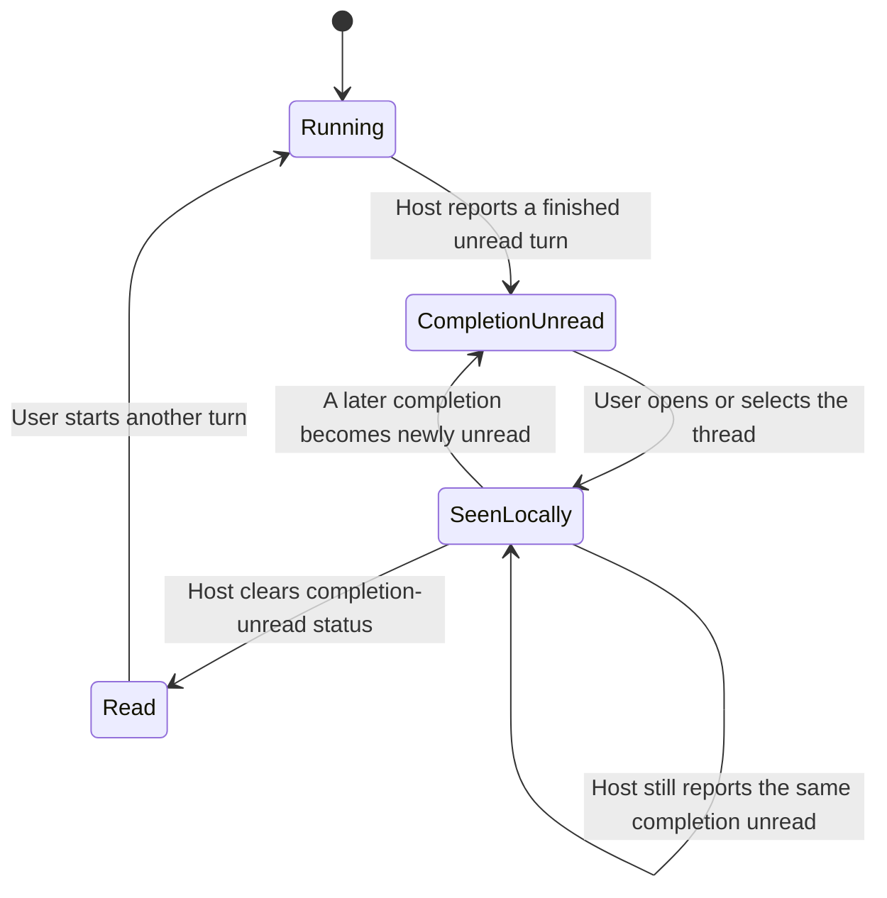

# Thread sidebar states

The sidebar shows several related signals, but they answer different questions:

- **Working:** Is this thread doing work now?
- **Attention:** Is there something the user may need to respond to, or a
  completion the user has not seen?
- **Read:** Has the user locally acknowledged the manual unread marker or this
  completion?
- **Group and filter:** Where should the row appear, and which rows should be
  shown?

A thread can be recently **Active** without being **Working**, and a completed
thread can be unread without being active.

## Working and active are different

**Working** means the Host reports running activity. The Working filter shows
running threads; a parent thread may count while one of its child threads is
running. Working is not an unread or attention state.

**Active** is a status section, not a synonym for Working. Archived and Pinned
sections take precedence. Otherwise, running threads are Active; non-running
Parked threads are Parked; the rest remain Active until the idle threshold. By
default, a non-running thread becomes Inactive after two hours.

## Attention

Attention is separate from running state:

- A pending approval or plan review appears as **Approval needed**.
- A structured question appears as **Input needed**.
- A completed turn appears as **Turn finished** when the Host reports it unread
  and the thread is eligible to surface.

The selected thread is not listed in these attention groups. Mutes, archives,
the workspace filter, and—by default—the subagent setting can also keep a row
out. **Turn finished** specifically requires that thread not to be running;
approval and input rows come from pending interactions and are not just a
running-state check. Desktop notifications are a separate opt-in: turning them
off disables system alerts, not the sidebar's attention state.

A failed turn has a separate failure signal. It can also have **Turn finished**
attention when its completion is unread; failure and attention can overlap.

## Read state

**Mark unread** adds a manual, browser-local unread marker. Opening or selecting
that thread clears the manual marker. This marker is separate from Host running
state and pending interactions.

For a finished turn, the sidebar also remembers when that completion has been
seen. Opening or selecting the thread clears its local Turn finished marker and
records the completion as seen. If the Host still reports that same completion
as unread, the sidebar keeps it dismissed instead of immediately adding it
back. The seen marker clears when the Host reports the completion read. If a
later completion then becomes newly unread, it can surface normally.

> **Technical note:** Host owns running, pending-interaction, and
> completion-unread status. The browser stores the manual unread marker, the
> local Turn finished timestamp, and the seen-completion marker. The local seen
> marker does not itself change Host status.

## Groups and filters

**Group** controls layout; **Filter** controls which threads are included.
Changing a group does not mark threads read, stop work, or create attention.

With **Group: Status**, attention categories configured as groups appear above
the ordinary status sections. Categories configured as labels stay on their
thread rows. With Project or Date grouping, attention is shown inline on rows.
Turn finished defaults to an inline label; it can be changed to a group.

The status sections are **Pinned**, **Active**, **Parked**, **Inactive**, and
**Archived**. The separate filters are **All**, **Working**, **Attention**,
**Muted**, and **Archived**. For example, the Working filter hides a finished
thread when neither it nor its child work is running, even if its attention
display is configured as a group. **Filter: None** means no additional status
filter.

### Reading the sidebar counts

If the sidebar shows **Active (4)** and **Working (3)**, those numbers count
different things: Active includes recent non-running threads, while Working is
based on running activity. A **Turn finished (4)** heading counts eligible
completion-attention rows, not running threads. The heading appears when Group
is Status, Turn finished is configured as a group, and the current filters
include those rows.

## Completion read flow

Manual **Mark unread** is independent of this completion flow. Opening one
thread does not clear another thread's unread marker.

## Sources and verification

The regression test covers opening a finished thread, keeping it dismissed
while the Host status remains unread, clearing the seen marker when the Host
clears that status, and surfacing a later completion:
[`src/thread-notifications.test.ts`](src/thread-notifications.test.ts#L82-L115).
The key implementation is in
[`src/thread-notifications.ts`](src/thread-notifications.ts#L80-L144), with
visibility and grouping in [`src/client.tsx`](src/client.tsx#L1302-L1459),
section rules in [`src/organization.ts`](src/organization.ts#L324-L344), and
filter rules in [`src/thread-view.ts`](src/thread-view.ts#L45-L57).

This guide reflects source revision `247efa33` (`fix(thread-sidebar): keep
finished threads read`). The regression is verified by unit tests. A scratch
browser confirmed the plugin loads and the regular unread journey works; it did
not produce the Host's completion-unread state, so that exact transition was
not separately verified in the browser.
