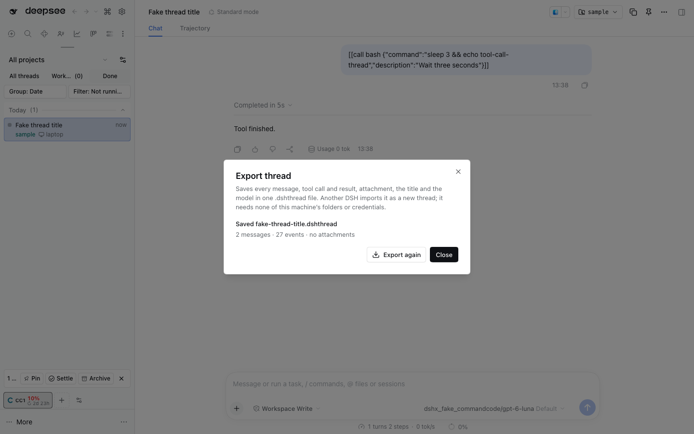
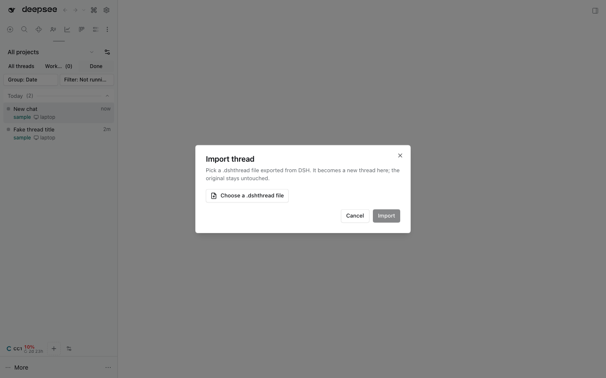

# @dshfiles/thread-transfer



Hand a thread to someone on another machine. **Export…** saves the whole
conversation — every message, tool call and result, attachment, the title and
the model — in one `.dshthread` file; **Import thread…** on any other DSH turns
that file into a new thread there, in the project or folder they pick. Their
machine can look nothing like yours: no folder, account or credential of the
source machine is needed to read or continue the thread.

## Use it

| Where                             | What                                                                                                                                                                      |
| --------------------------------- | ------------------------------------------------------------------------------------------------------------------------------------------------------------------------- |
| A thread's row menu (right-click) | **Export…** builds the bundle and the browser downloads it. The dialog says how many messages, events and attachments it holds.                                           |
| Command palette                   | **Export this thread…** does the same for the open thread.                                                                                                                |
| Command palette                   | **Import thread…** picks a `.dshthread` file, previews its title, counts and model, and imports it into a registered project, the home folder or another folder you type. |



The imported thread gets a fresh id and opens right away. It is an ordinary
thread: continue it, rename it, or archive it to undo the import. The source
thread is never touched.

### Agent tools

| Tool                         | Kind  | Does                                                                                                     |
| ---------------------------- | ----- | -------------------------------------------------------------------------------------------------------- |
| `thread_export`              | write | Writes one thread's bundle to an absolute path on the Host that does not exist yet.                      |
| `thread_bundle_inspect`      | read  | Previews a bundle file (title, counts, model) and says why this machine cannot import it, if it cannot.  |
| `thread_import`              | write | Imports a bundle file as a new thread in a project (`workspaceId`), a folder (`cwd`) or the home folder. |
| `thread_import_destinations` | read  | Lists the registered projects and the home folder an import can target.                                  |

Write tools run only when the user asked for that export or import.

## The bundle

A `.dshthread` file is gzip of one JSON document:

- `format: "dshthread"`, `formatVersion` (this file's version) and
  `producer.sessionFormat` (the DSH Session log format of the events).
- `thread`: title, creation time, model, message count and the **base name**
  of the source folder — a hint for the importer, never a path.
- `events`: the Session log, verbatim, from seq 0.
- `attachments`: each image or file once, keyed `sha256:<hex>` of its exact
  bytes, with its bytes in base64; `references` maps every attachment id the
  log cites to its key; `missingAttachments` lists the ones the source could
  not read.

On import every attachment is saved into the importing machine's attachment
store and the log's references are rewritten to the new ids; nothing else in
the log changes. The log is then stored as a new Session through Session
persistence and joined to the chosen project, and read back: a log this DSH
stores but cannot replay is archived and reported rather than left as a thread
that fails to open.

### What it refuses, and what to do

| Refusal                                         | Next step                                                                        |
| ----------------------------------------------- | -------------------------------------------------------------------------------- |
| Another bundle format version                   | Update `@dshfiles/thread-transfer` on the older machine, export or import again. |
| Another DSH Session log format                  | Run the same DSH release on both machines, export again.                         |
| Damaged file (log gaps, checksum mismatch)      | Export the thread again.                                                         |
| Unknown project or missing folder               | Pick a registered project or an existing folder.                                 |
| Upload or download interrupted, or Host restart | Start the export or import again (staged transfers expire after 15 minutes).     |

### Limits

- **Privacy.** The bundle is the conversation verbatim: whatever paths, URLs or
  pasted text the thread contains travel with it. Nothing is redacted; review
  a thread before you share it.
- **Sub-agent threads** are not carried. The parent's tool results that
  summarize them are, so the parent reads complete.
- **Model.** The bundle records the last model, and the log keeps the routes
  that answered. If the importing machine has no such provider, pick a model
  there before continuing the thread.
- **Agent preset** of the source is recorded but not applied: the import runs
  with the importing machine's default preset.
- A bundle holds at most 512 MiB uncompressed.

## How it works

Owned plugin built on supported Host services only; no DSH core change.

| Step                   | Host service                                                                                         |
| ---------------------- | ---------------------------------------------------------------------------------------------------- |
| Read a thread          | `sessionPersistence.flush()` then a read handle on the log (a live thread's newest events included). |
| Read/save attachments  | `attachments.readImage` / `readFileStream` / `saveImage` / `saveFile`.                               |
| Store the imported log | `sessionPersistence.create` + `append` + `flush`; read back to prove this DSH can replay it.         |
| Join the project       | `workspaceRegistry` (`attachSession`; `archiveSession` for a refused log).                           |

The browser moves bundles in 512 KiB chunks through staged transfers (one dshx
API call carries at most 1 MiB). The thread row action comes from the
`@dshfiles/thread-sidebar/thread-row-actions` registry, the palette rows from
`@dshfiles/command-palette/palette-contract`.

Source: [`src/bundle.ts`](src/bundle.ts) (format, pure),
[`src/transfer-service.ts`](src/transfer-service.ts) (export/import/transfers),
[`src/host-edge-promise.ts`](src/host-edge-promise.ts) (Host services),
[`src/transfer-dialog.tsx`](src/transfer-dialog.tsx) (UI).

## Verify

```sh
pnpm --dir plugins/@dshfiles/thread-transfer test       # bundle + two-machine round trip on real persistence and attachments
pnpm check:e2e thread-transfer                           # palette export → download → import → new thread
dshx dev open thread-transfer/thread-export             # row menu Export… in a scratch DSH
```
