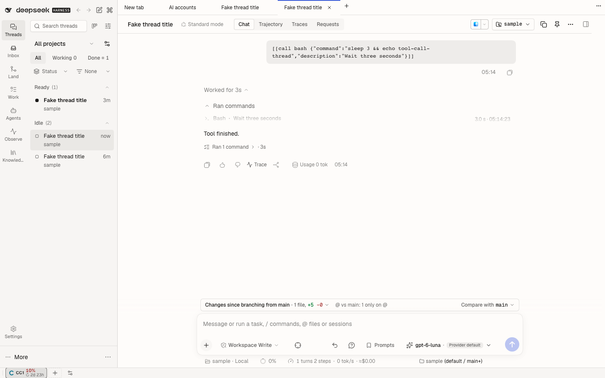

# @dshfiles/tool-meta

Start time and duration on every tool call in the chat transcript: `1.2 s · 14:02:11` at the right of each tool card's header row, for native tools and plugin-owned ones, root calls and PTC children alike. While a call runs the duration counts up every second. `job_output` waits and `background_jobs_wait` calls name what they are waiting for and show a live wait bar: a countdown against an explicit timeout when one is supplied, otherwise an indeterminate bar with elapsed time. The bar measures the wait, not the job's progress or expected completion. To interrupt a wait, steer or stop the turn with the existing composer controls. It also renders the file tool cards themselves: `read` on the shared `CodeBlock`, and `edit` / `write` / `apply_patch` on the shared `PatchView`; and the native approval request as a risk card in the composer.

Built with dshx (no port: nothing upstream does this). Its own small plugin rather than a slice of an existing one, because it touches no other plugin's state and has its own fragile seam to watch. Run `pnpm build`, `pnpm test` and `pnpm typecheck` from this package.

## Settings (`dshfiles-tool-meta`)

| Key          | Default    | Meaning                                                                                   |
| ------------ | ---------- | ----------------------------------------------------------------------------------------- |
| `enabled`    | `true`     | Show the timing line on tool cards.                                                       |
| `timeFormat` | `absolute` | `absolute`: clock time, with the day when not today. `relative`: `12 s ago`, `5 min ago`. |
| `fileCards`  | `true`     | Show file reads as a code card and file mutations as collapsible diffs.                   |
| `approvalCard` | `true`   | Show tool approval requests as a risk card instead of the native panel.                  |

## File tool cards

A settled `read` renders through the shared `CodeBlock`: the gutter counts from the `offset` the call asked for, the grammar follows the file extension, and wrap and copy are the block's own controls. The header names the file and how much of it this window holds (`Showing 40 of 210 lines`); the path opens the file at the first line the model saw. The card starts closed because a window can hold thousands of lines, and the open card scrolls inside a bounded height.

The file mutations render through the shared `PatchView`: one card with the added/removed totals, then one collapsible unified diff per reported hunk, so an `apply_patch` with several edits stays scannable. Each card takes the hunks DSH persists with the result (`meta.diffs`, the change with three context lines) or, for a `write` on a created file, the content from the call arguments; `apply_patch` has no result-side hunks at all, so its card reads the requested edits from the arguments and shows `apply_patch` as its title. Both card kinds fall back to the native row when they have nothing better to show: a running, failed, nested or metadata-less call, a call whose arguments left the loaded history, or `fileCards` turned off — except `apply_patch`, which has no native card to fall back to.

## Approval card

A native approval request renders in the composer as one card instead of the native panel: a risk badge, the tool, the
request's reason, the command the call runs, and Reject / Allow once with their Esc and Enter keys. Risk is a label for
attention, never a policy: **Destructive** for a command that deletes, overwrites or publishes (`rm -rf`,
`git push --force`, `jj abandon`, `sudo`, `curl … | sh`), **Read-only** for a tool that only reads, **Review**
otherwise.

The card is a `conversation.composer` chain entry ahead of the native panel (priority 0.5 against 1): it renders the
request and asks the native approval package to answer, so its waterfall, hand-on (`delegate`), withdrawal and
one-answer lock stay the native package's, and `approvalCard` off hands the next request back to it. The card mounts
per request key, so an answered or withdrawn request never unlocks the next one. A remote thread's approval
(multi-host) is a different interaction and keeps its own panel.

## Where the times come from

DSH already folds them into the blocks it hands every tool view: a dispatched call carries its `tool/call` time, a result carries its `tool/result` time and, while the call is still in the loaded window, the call's time (`callTime`). Nothing is read from the event stream. A result whose call fell outside the loaded window shows only `ended 14:02:12`; a call whose arguments are still streaming shows nothing.

## How it decorates native cards

`tool.call.toolview` is keyed per tool, so a registration replaces a card instead of adding to it. One level up, `@deepseek-ai/dsh-client-ui-tool` renders each tool call through its `conversation.chat.node` `tool-call` entry (`ToolCallTree`), which dispatches every atomic call through its `renderSlot('tool.call.toolview', owner)`. This plugin swaps that ledger entry's component (read through the public `ctx.slots.entriesOfSlot`) for a wrapper that renders the original tree with a `renderSlot` framing each dispatch with the timing line. The tree keeps its slot authorization, keys and memoization, and every card renders exactly as before. It re-wraps when the entry is re-registered (HMR, a plugin taking the key) and puts the original back on dispose. A shadowing registration cannot do this: the tree's `tool.call.toolview` child slot is declared by the native entry, so a shadow could not render the cards.

### Sections under a card

Other plugins add to the same frame through the `@dshfiles/tool-meta/tool-call-sections` dshx module: `plugin.add(ToolCallSections, { id, Section })` renders `Section` under every tool card, whichever view owns the card. `@dshfiles/background-jobs` uses it for the live job preview. A `Section` returns null for calls it has nothing to say about, and it subscribes to its own live data so the transcript above it does not re-render.

### Self-detection

The seam depends on three things DSH could change. Each logs one `@dshfiles/tool-meta:` console warning and leaves the cards untouched:

- no `conversation.chat.node` `tool-call` entry 15 s after boot;
- the tree receives no `renderSlot`, or renders without dispatching `tool.call.toolview`;
- the toolview owner stops carrying `phase` and `block.time`/`callTime`.

The `tool-meta` journeys (`tooling/dshx/e2e/features/tool-meta.feature`) and the catalog `reach` fail when the line disappears. The additive route is in [`plans/dsh-host-gaps.md`](../../../plans/dsh-host-gaps.md).
