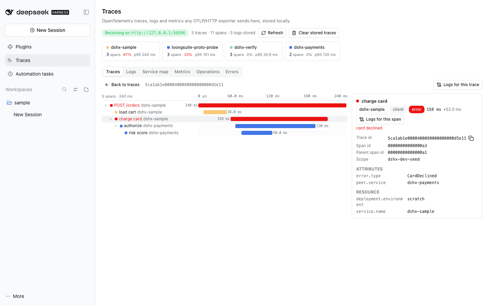
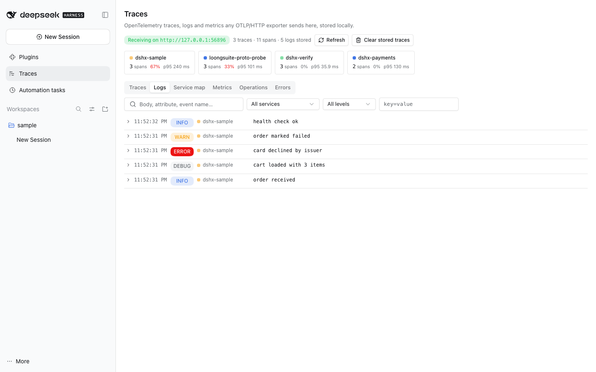
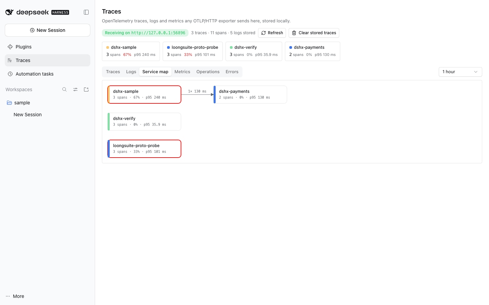
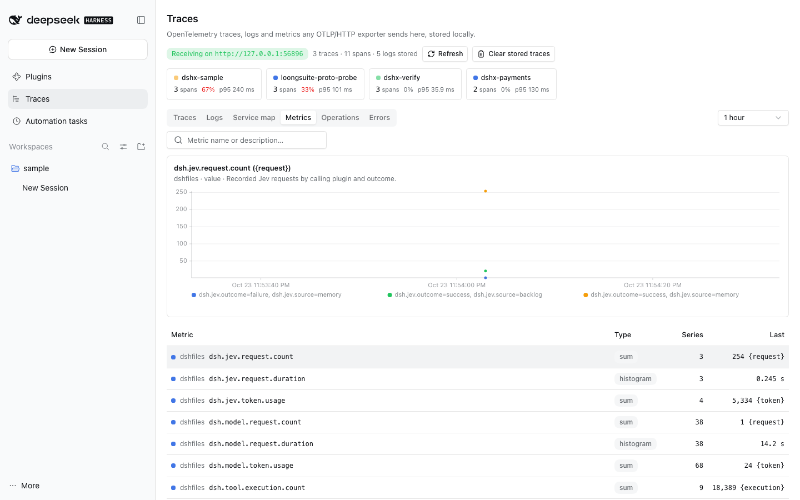
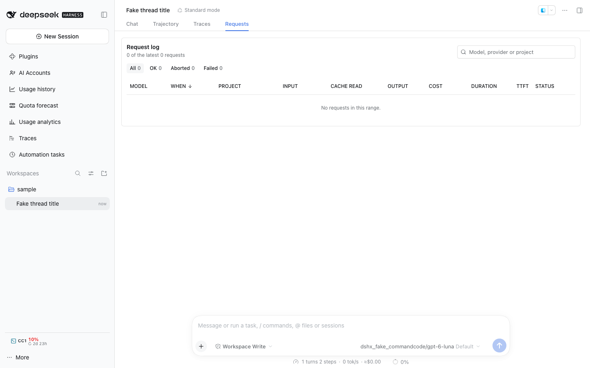
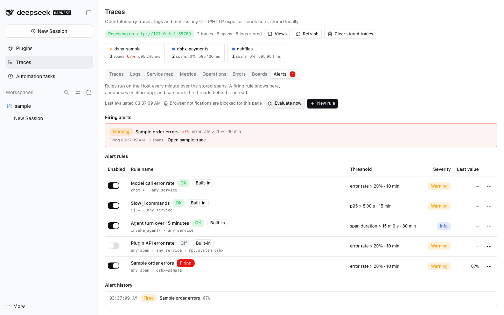
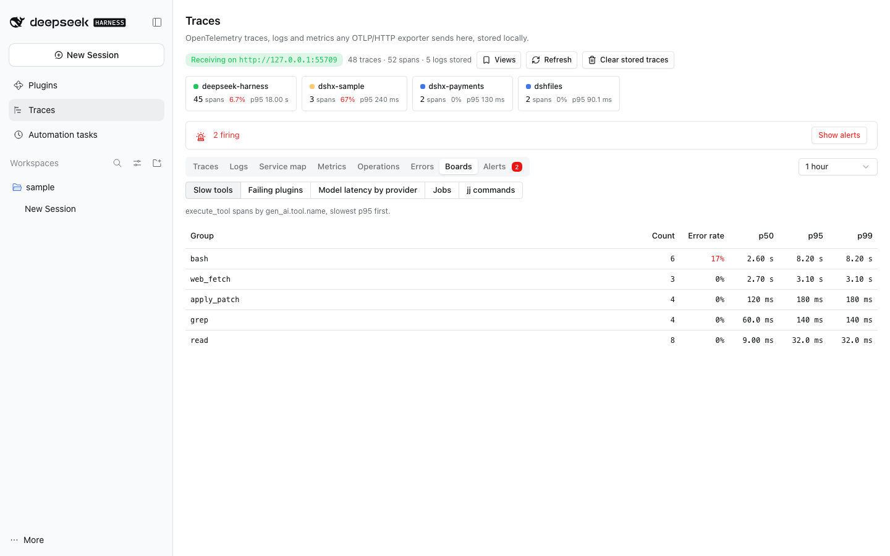

# @dshfiles/traces















A local OpenTelemetry viewer inside DSH, in the spirit of [Maple Local](https://maple.dev/): one OTLP/HTTP receiver on
`127.0.0.1:4318`, an embedded SQLite store, a typed query API with agent tools, and a **Traces** panel with a trace
list, a span waterfall, a per-span attribute panel, log search correlated with traces and spans, a service map, metric
charts, a service/operation overview and error groups.

It is a generic viewer: anything that speaks OTLP/HTTP can send to it, with any `service.name`, resource, scope,
span kind or attribute key. DSH-specific touches are enrichments only: a span carrying `dsh.session.id` gets an
**Open thread** button.

Choice: **build with dshx**. The marketplace has exporters (LoongSuite, dsh-observe) but no in-DSH viewer, and an
external viewer (otel-desktop-viewer, Jaeger) cannot open a DSH thread or serve agent tools.

## Sending telemetry here

Point an exporter at the receiver with the standard variable:

```sh
OTEL_EXPORTER_OTLP_ENDPOINT=http://127.0.0.1:4318
```

DSH itself needs no variable: in `plugin` and `both` modes the receiver publishes its bound address to its own Host
process through `@dshfiles/dshx/tracing` (`publishLocalOtlpEndpoint`), and agent telemetry (turn, step, model and tool spans), dshx
tracing (plugin API, jj, secret, Jev spans) and the usage plugin's metrics push deliver there, re-reading the target at every export. The address is
withdrawn when the receiver stops, loses its port or switches to `external`. An explicit `OTEL_EXPORTER_OTLP_ENDPOINT`
in the Host environment always wins; see [observability](../../../docs/observability.md#in-dsh-viewer-dshfilestraces).

When nothing arrives, the panel and `traces_status` carry a `diagnosis` (`waiting`, `receiving`, `exporting-elsewhere`,
`no-exporter`, `port-in-use`, `external-mode`, `failed`) and `exporters` (where this process's spans and metrics go
now). A restart from the DSH UI reuses the supervisor's environment, so a launcher environment change needs `dsh-web`
restarted from a terminal.

## Per-thread Traces tab

Every thread gets a **Traces** tab in its conversation view, right after **Trajectory** (a `conversation.view`
entry, `order: 11`; Trajectory is 10 and only shows with developer tools on). It shows that thread's telemetry only:
every trace in which any span carries `dsh.session.id` = the thread's Session id, so plugin spans nested under an agent
turn count even without the attribute.

- **Summary**: traces, spans, error spans, total trace time, model calls (`gen_ai.operation.name = chat`, one per
  attempt), tool calls (`execute_tool`), trace and model-call p50 · p95, and `gen_ai.usage.*` token totals summed over
  model calls only (the turn span repeats them as its own totals). Unclassified producers fall back to the span-name
  prefix (`chat `, `execute_tool `, `invoke_agent`).
- **Turns**: the thread's traces newest first; a row opens the panel's span waterfall and span detail (without Open
  thread, since it is this thread).
- **Logs**: records correlated with one of the thread's traces, or carrying its `dsh.session.id`; a span's
  **Logs for this span** narrows them.
- **Empty**: says that nothing carried this thread's id yet, plus the receiver diagnosis (exporter elsewhere or off,
  port held, external mode) with the restart hint.

Agent-tool calls into dshx APIs carry the calling Session as `dsh.session.id` on their dispatch span, so the plugin
work a thread's agent triggers shows up even without an agent telemetry exporter. Turn, step, model and tool spans come
from [`@dshfiles/agent-telemetry`](../agent-telemetry/README.md) (or any exporter keeping LoongSuite's attribute names). The tab reads
`traces_session_summary`, `traces_search` with `sessionId` and `traces_search_logs` with `sessionId`, so an agent sees
the same data.

## Alerts

Rules run on the Host every minute (and on **Evaluate now**) over the stored spans, in the spirit of Maple's alerts:

| Kind         | Value                                          | Threshold                 |
| ------------ | ---------------------------------------------- | ------------------------- |
| `error-rate` | failed share of the matching spans             | 0 to 1 (0.2 = 20%)        |
| `latency`    | p50/p90/p95/p99 duration of the matching spans | ms                        |
| `throughput` | matching spans per minute                      | spans/min, above or below |
| `span-count` | matching spans in the window                   | spans, above or below     |
| `duration`   | any matching span longer than the threshold    | ms (a 15-minute turn, …)  |

Each rule has a filter (service, span name exact or a `prefix*`, one attribute `key=value` or `key=*`), a window (a
span counts in the window it **ended** in), a comparator, a minimum span count (error-rate and latency stay quiet below
it), a severity, and three switches: enabled, announce, mark threads.

- **States.** `ok` or `firing`. A rule fires on the first breaching evaluation and resolves after **two** clear
  evaluations in a row, so a signal that swings every minute fires once. Disabling or deleting a firing rule resolves
  it. History keeps the newest 500 firing/resolved events with their value, sample count, sample trace and threads.
- **Delivery.** A firing rule shows in the **Alerts** tab with its value and sample trace, puts a red count on the tab
  and a banner above the other tabs, and is announced in-app wherever the user is (a `shell.overlay` client polls
  `traces-alerts/feed` every 15 s and renders the Host `Toast`; with permission from the Alerts tab, also a browser
  notification). The announced event id is shared across tabs in localStorage, so one alert is announced once, and a
  reload after a long absence announces nothing older than 10 minutes. With **mark threads**, the threads its spans
  carry (`dsh.session.id`, at most five) are marked unread through thread-sidebar's `thread-sidebar-attention`
  contract; without thread-sidebar the event records why nothing was marked. A muted rule (1 h, 4 h, 24 h) still
  evaluates and records events but announces and marks nothing.
- **Built-in rules**, seeded once when `alerts.db` is created (edits and deletions stick), enabled with conservative
  thresholds: model call error rate (`chat *`) over 20% in 10 min with at least 5 calls, marking threads; jj p95
  (`jj *`) over 5 s in 15 min with at least 5 runs; an agent turn (`invoke_agent*`) over 15 min, marking its thread
  (only finished turns export a span); and, off by default, plugin API error rate (`rpc.system=dshx`) over 20% with at
  least 20 calls.
- **Storage.** `$DSH_HOME/plugins/traces/alerts.db`, apart from the span store so alert changes never migrate it. At
  most 50 rules; an evaluation samples the newest 20,000 matching spans per rule.
- **Its own telemetry.** Each evaluation is a `traces alerts evaluate` span with `dshx.traces.rules`, `.transitions`
  and `.firing`; this receiver drops the routine ones (no transition, no failure) and the `traces-alerts` /
  `traces-boards` dispatch spans, so the timer and the notifier poll never bury real traces. External viewers see all.
- **Gaps** ([ledger](../../../plans/dsh-host-gaps.md) 82–84): no Host-side announcement service (nothing is announced
  while no DSH page is open), no activity-timeline ingest, and thread attention without a reason.

## Boards and saved views

The **Boards** tab is a small fixed set of breakdowns over the window's spans, each row with count, error rate and
p50/p95/p99, and a row opens the trace list filtered to its spans:

| Board                     | Spans                          | One row per            |
| ------------------------- | ------------------------------ | ---------------------- |
| Slow tools                | `execute_tool *`               | `gen_ai.tool.name`     |
| Failing plugins           | `rpc.system=dshx` API dispatch | `dshx.plugin.package`  |
| Model latency by provider | `chat *`, with TTFT p50 · p95  | `gen_ai.provider.name` |
| Jobs                      | `job *`                        | `dsh.job.kind`         |
| jj commands               | `jj *`                         | span name              |

The header's **Views** menu opens any board and saves the panel's current view (tab, trace filters, log filters,
window, open board) under a name, then reapplies it. Saved views are browser presentation state (localStorage), not a
dashboard builder; `traces_breakdown` gives an agent the same groupings.

## Settings (`dshfiles-traces`)

| Setting                 | Default     | Effect                                                                                                                                  |
| ----------------------- | ----------- | --------------------------------------------------------------------------------------------------------------------------------------- |
| `mode`                  | `plugin`    | `plugin`: the receiver owns the port. `external`: receiver off, another viewer owns it. `both`: store here and forward to `forwardUrl`. |
| `host`                  | `127.0.0.1` | Listen address.                                                                                                                         |
| `allowNonLoopback`      | `false`     | A non-loopback `host` is refused unless this is on.                                                                                     |
| `port`                  | `4318`      | OTLP/HTTP port; `0` picks a free one (the panel shows it).                                                                              |
| `forwardUrl`            | empty       | `both` mode: the external viewer's OTLP base URL, e.g. `http://127.0.0.1:4319`. The raw body is forwarded to `/v1/<signal>`.            |
| `externalViewerUrl`     | empty       | Linked from the panel in `external` and `both` modes, e.g. `http://127.0.0.1:8000` for otel-desktop-viewer.                             |
| `redactGenAiContent`    | `true`      | Store GenAI message, prompt and tool-payload attributes as `[redacted: N chars]`. The span panel says when a value was redacted.        |
| `retentionHours`        | `72`        | Drop telemetry received longer ago.                                                                                                     |
| `retentionSpans`        | `100000`    | Keep at most this many spans; whole traces drop, oldest first.                                                                          |
| `retentionLogs`         | `100000`    | Keep at most this many log records, oldest first.                                                                                       |
| `retentionMetricPoints` | `200000`    | Keep at most this many metric data points, oldest first.                                                                                |

Settings apply live: changing `mode`, `host` or `port` restarts the receiver without a Host restart.

How the modes map to `OTEL_EXPORTER_OTLP_ENDPOINT`:

- `plugin` / `both`: the endpoint is this receiver, `http://<host>:<port>`.
- `external`: the endpoint is the external viewer; this panel only shows what it stored before.
- `both` with an external viewer: run the viewer on another port (for example 4319) and set `forwardUrl` to it.

## Agent tools

Every read the panel makes is a read-only tool; the destructive verbs (`traces_clear`, `traces_alert_delete`) need an
explicit opt-in.

| Tool                     | What it returns                                                                                                      |
| ------------------------ | -------------------------------------------------------------------------------------------------------------------- |
| `traces_search`          | Traces newest first; filter by service, operation, error status, min duration, time, text, DSH session.              |
| `traces_get`             | One trace as a depth-first span tree with offsets, attributes, events and resource attributes.                       |
| `traces_list_services`   | Per service and operation: count, error rate, p50/p95/p99 and max duration over a window.                            |
| `traces_search_logs`     | Log records newest first; filter by service, min severity, text, one attribute, trace or span id, DSH session, time. |
| `traces_list_metrics`    | Metrics per service and name: type, unit, points, series, last value.                                                |
| `traces_get_metric`      | One metric's series per attribute set over a window (value, counter increase, or distribution mean).                 |
| `traces_service_map`     | Services with span count, error rate and latency; cross-service parent → child calls with counts.                    |
| `traces_error_groups`    | Error spans grouped by service, operation, error type and message shape, with a sample trace.                        |
| `traces_session_summary` | One thread's spans, errors, turns, model and tool calls, durations, model latency and token totals.                  |
| `traces_status`          | Receiver mode, address, state, counters, forwarding, store size, exporter targets and a diagnosis.                   |
| `traces_clear`           | Deletes every stored trace, log record and metric point; requires `confirm: true`.                                   |
| `traces_alerts`          | Alert rules with filter, threshold, state and last value; firing count; the newest firing/resolved events.           |
| `traces_alert_save`      | Creates or replaces a rule (also enables or disables it); only when the user asked.                                  |
| `traces_alert_mute`      | Mutes a rule for some minutes, or unmutes it; only when the user asked.                                              |
| `traces_alert_delete`    | Removes a rule (a firing one resolves); requires `confirm: true`.                                                    |
| `traces_alerts_evaluate` | Evaluates every enabled rule now; only when the user asked.                                                          |
| `traces_breakdown`       | Groups a window's spans by service, span name or an attribute with count, error rate, percentiles and one measure.   |

## Decisions

- **Port strategy.** Default to the standard 4318 so a stock `OTEL_EXPORTER_OTLP_ENDPOINT` works. When another process
  holds it (otel-desktop-viewer, a collector), the receiver reports `port in use` in the panel and the status tool,
  keeps serving what is stored, and retries every 30 s, so stopping the other viewer hands the port over without a
  restart. `mode: external` turns the receiver off on purpose.
- **Protobuf.** LoongSuite uses `@opentelemetry/exporter-trace-otlp-proto`, which always sends protobuf and ignores
  `OTEL_EXPORTER_OTLP_TRACES_PROTOCOL`, so protobuf has to be decoded. `@opentelemetry/otlp-transformer` 0.222 only
  serializes requests (it dropped protobufjs), so `src/otlp/protobuf.ts` is a small decoder for
  `ExportTraceServiceRequest` (opentelemetry-proto v1 field numbers) that emits the OTLP JSON mapping; both wire
  formats then cross one zod schema and one normalizer. Tests encode with the official SDK serializers
  (`ProtobufTraceSerializer`, `JsonTraceSerializer`, devDependencies only) and require identical spans from both.
- **Bounds.** Request bodies over 8 MiB get 413, gzip/deflate bodies may inflate to 32 MiB; span names keep 256
  characters, 128 attributes of 2,048 characters, 64 list items and 32 events.
- **Storage.** SQLite (`node:sqlite`, like usage and memory) at `$DSH_HOME/plugins/traces/traces.db`: spans, one row
  per trace (root, duration, counts, services, session) and deduplicated resource attributes. Retention drops whole
  traces so a kept trace never loses part of its tree.
- **Self-spans.** dshx records a span for every API dispatch; the traces API's own (`dshx.api.id = traces`) are
  dropped at ingest so the panel's 5-second polling never shows up as traces of itself.
- **Logs.** `POST /v1/logs` (JSON or protobuf, same decoder and bounds) stores records with severity, body (8 KiB),
  attributes, resource and their trace/span ids. The Logs tab filters by text, service, minimum severity and one
  `key=value` attribute; a record opens its trace, and a trace or a span opens only its own logs. With
  `redactGenAiContent`, a GenAI content event (`gen_ai.*` event name) keeps only its body size.
- **Service map.** An edge is a span whose parent belongs to another service (no `peer.service` guessing), so it
  only shows calls both sides exported. The SVG lays services out in columns by their longest incoming call chain;
  no graph library is involved.
- **Metrics.** `POST /v1/metrics` (JSON or protobuf) stores gauges, sums, histograms, exponential histograms and
  summaries as one row per data point (value, or count and sum for distributions), without buckets. The Metrics tab
  charts one metric at a time per attribute set (20 series, 500 points): a cumulative monotonic sum as its increase
  between exports (a reset restarts from the new value), a distribution as its mean. The service/operation overview
  still comes from spans. The usage plugin's ledger push lands here.

## Follow-ups

- Histogram bucket heatmaps and p95 from buckets; multiple metrics on one chart.
- Alerts: an announcement while no DSH page is open needs a Host notification service (gap 82).
- Out of scope: a dashboard builder and a query builder, session replay.
