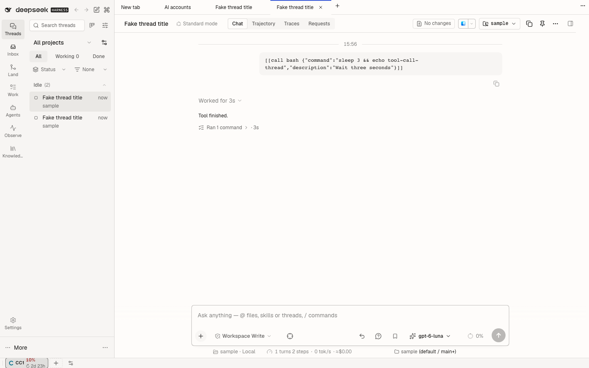
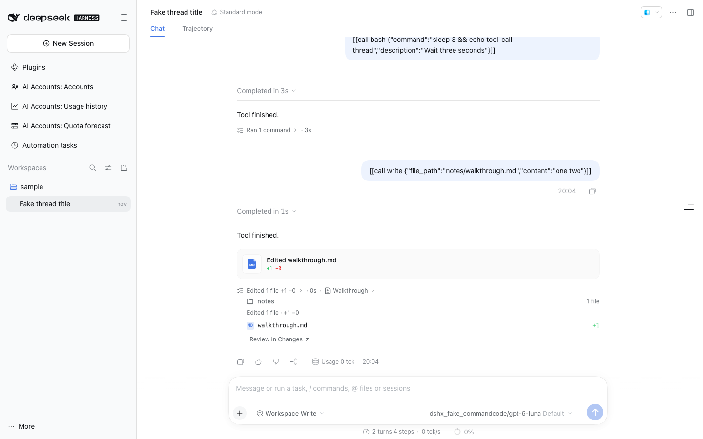

# @dshfiles/turn-summary

A footer under each finished turn that says what the agent did with tools:

> Edited 3 files +42 −7 › · ran 6 commands › · tests 40/42 · read 4 files · 2 searches · **1 failed ›** · 1m 12s

- **Edited files** count distinct files that were actually written (a rejected edit is not counted), with lines added and removed. The count opens the files with per-file `+N −M`; each opens in the editor.
- **Commands** open every command (its description, or the first line of the command) with how it ended.
- **Tests** are passed / total from the last Vitest, Jest or pytest summary a command printed in the turn; red when any failed.
- The red **failure count** opens the failed commands and how each ended: `exit 1`, `signal SIGKILL`, `no exit code`, or `error` when the tool rejected the call.
- **Duration** is the turn's wall time, from `turn/start` to `turn/end`.

After a turn that edited files, a **Walkthrough** row opens a grouped view of the changed files by folder, each folder
with a one-line summary (`Edited 2 files · +40 −3`); every file row opens that file in the editor, and **Review in
Changes** opens that turn's changed-files review in the right pane: pulls-review's Changes facet when it is loaded, else
the native review tab. It is a row in the turn footer, closed by default, so nothing floats above the composer.

Built with dshx (no port). Run `pnpm build`, `pnpm test` and `pnpm typecheck` from this package.

## Settings (`dshfiles-turn-summary`)

All apply live.

| Key            | Default | Meaning                                                        |
| -------------- | ------- | -------------------------------------------------------------- |
| `enabled`      | `true`  | Show the summary line under finished turns.                    |
| `includeReads` | `true`  | Count file reads and searches as well as commands and edits.   |
| `listFailures` | `true`  | Let the failed-command count open the list of failed commands. |
| `lineCounts`   | `true`  | Show lines added and removed next to the edited-file count.    |
| `testResults`  | `true`  | Show passed / total tests from the last test-runner summary.   |
| `duration`     | `true`  | Show how long the turn took.                                   |
| `openLists`    | `true`  | Let the edited-file and command counts open their lists.       |
| `walkthrough`  | `true`  | Show the walkthrough row after a turn that edited files.       |

## How it works

- **Data.** A state-only Conversation Definition, registered on `ctx.uiConversation.events`, follows each turn's `turn/start`, `tool/call`, `tool/result` and `turn/end` events and, when the turn ends, publishes a `TurnActivitySummary` on the turn under `dshfiles-turn-activity` (a `ConversationTurnDataMap` key). It owns no view target, so it never claims an event from a native Definition.
- **Changes address.** The Definition also follows the turn's `workspace/changes` event (the Host's changed-files summary) and publishes its sequence, which addresses the native `dsh-resource://changes-review/session/<id>/<seq>/<turn>` review; the card opens it in the right pane of the thread on screen.
- **View.** A `conversation.chat.turnTail` list entry (the seat of the native "Edited files" chip) reads that value through `turn.data.source(...)`.
- **Arguments** are read with the Host's own `PartialArguments` from `@deepseek-ai/dsh-util-values`; dshx inlines that package into client bundles for this plugin.
- **Exit codes** come from the `[exit code: N]` / `[killed by signal: …]` footer the bash tool appends to its result.
- **Line counts** come from the edit calls' own arguments (`edit`, `str_replace_editor`, each `apply_patch` edit: old and new text with their shared leading and trailing lines dropped; `write`: its whole content as added).
- **Seat.** The plan named `conversation.chat.assistant-actions` for this footer, but that slot's owner props carry only the message id; `conversation.chat.turnTail` carries the turn, its data and `openFile`, so the footer stays there.

## Limits

- The summary sits under the turn, not in each "Ran commands" group header: the Host draws that header with no plugin seam ([`plans/dsh-host-gaps.md`](../../../plans/dsh-host-gaps.md)).
- A turn whose tool calls fell outside the loaded history summarises only the calls still loaded.
- A `write` that replaced an existing file counts all its lines as added: the call does not carry the old content.
