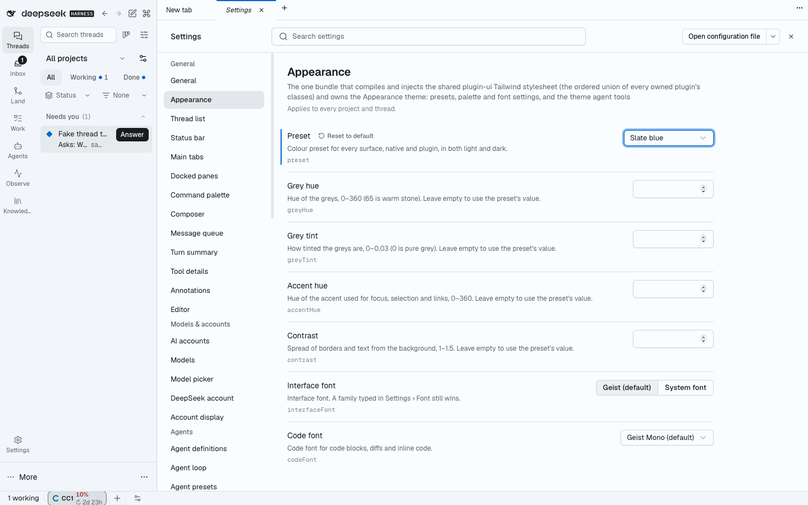

# @dshfiles/ui-styles



The one bundle that compiles and injects the shared `@dshfiles/plugin-ui` stylesheet (the ordered union of every owned
plugin's classes), and the owner of the theme.

## Theme

- **First paint.** `src/theme.generated.css` is the static visual-refresh theme (warm stone, indigo accent, status
  trios, radii, Shiki colours) generated from `plugin-ui/src/theme/palette.ts`; `src/fonts.css` sets Geist and Geist
  Mono through the Host's default font stacks. It retunes the Host `--dsw-*` variables, so native core surfaces and
  plugins share one palette. Regenerate with `node plugins/@dshfiles/plugin-ui/scripts/emit-theme-css.ts`.
- **Appearance settings** (namespace `dshfiles-ui-styles`, Settings › General › Appearance): a preset (Warm stone,
  Neutral, High contrast, Slate blue, Moss), optional grey hue, grey tint, accent hue and contrast overrides, and the
  interface and code font, and an optional serif for reply prose (**Reading font**, off by default: a system serif —
  Charter, Iowan Old Style or Georgia — so nothing is downloaded; code and tables keep their fonts). Light, dark or
  system stays the native `ui-theme` setting.
- **Runtime.** The client regenerates the palette with the same generator (`plugin-ui/theme/appearance`) and injects
  one `<style id="dshfiles-ui-styles-theme">` whose selectors out-rank the static block, only when the settings differ
  from the default; the default injects nothing. The last custom CSS is cached in localStorage and applied before the
  settings mirror answers, so a reload of a custom theme does not flash warm stone.
- **Contrast.** Every preset, and every corner of the override bounds, keeps WCAG AA for text in light and dark
  (`plugin-ui/tests/appearance.test.ts`); the generator darkens (light) or lightens (dark) an accent hue that would
  fall below AA.
- **Agent tools.** `theme_get` (read-only) and `theme_set` (only when the user asked; `reset: true` restores the
  defaults) are bound to the `ui-theme-appearance` API in `src/api.ts`, the same settings the form writes.

Interface font choices are Geist and the system font; Inter is not vendored (loading it only when chosen needs a Host
static-asset route).

## Verify

```sh
pnpm --dir plugins/@dshfiles/ui-styles test   # theme drift, Host variable guard, settings and tool transitions
pnpm check:e2e ui-styles                      # isolated-boot sheet, preset + reload + reset, agent tool round trip
```
