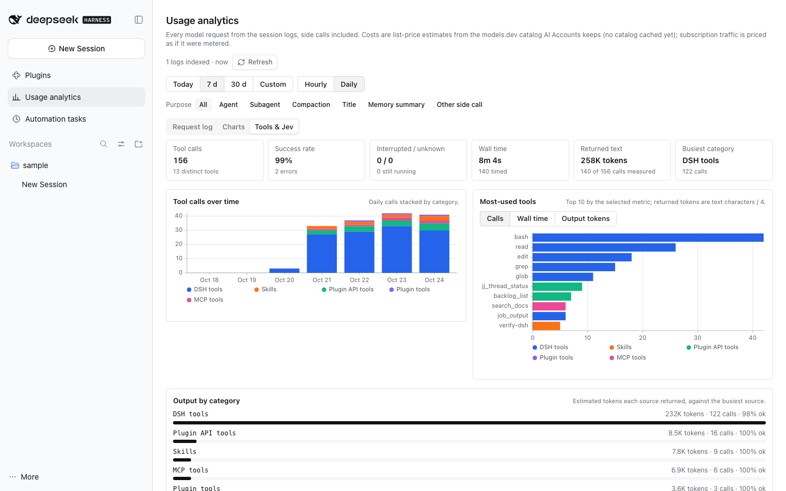
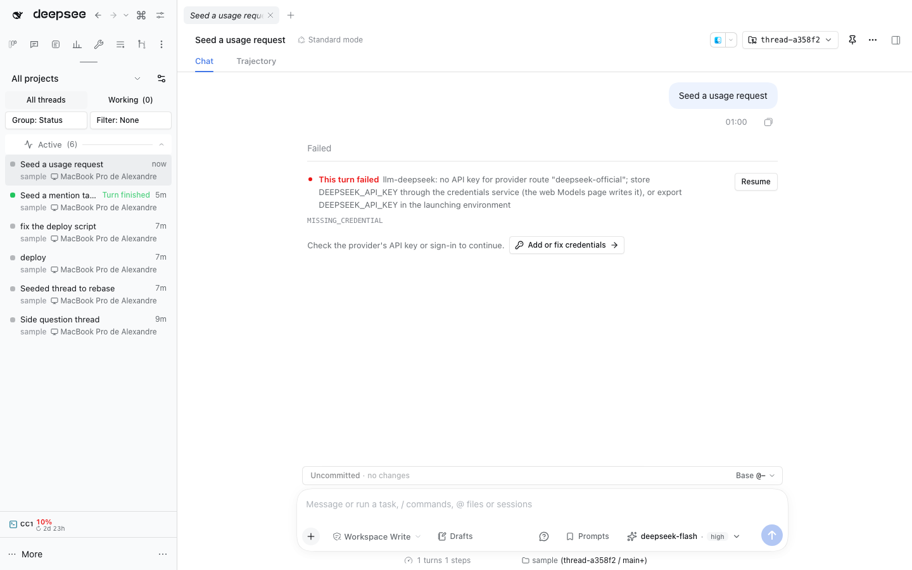
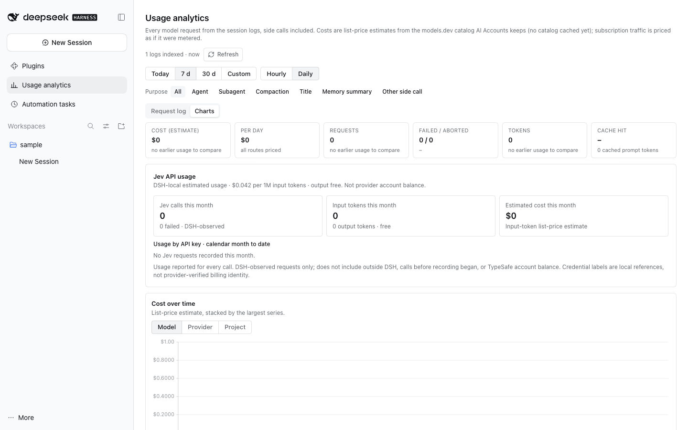

# DSH usage analytics

A **Usage analytics** main panel (sidebar) with a model request log, usage charts,
and a local tool/Jev activity report, built from DSH session logs and bounded Host-side
call observations. Observation only.

- **Request log**: model and provider, when, project, input, cache read,
  output, cost, duration, TTFT and status with the stop reason; status chips
  with counts, search by model, provider, project or thread title, a purpose
  filter (agent, subagent, compaction, title, memory summary, other side
  call) and a date range. A row opens its thread.
- **Charts**: headline tiles against the previous period, cost over time
  stacked by model, provider or project, cost per model, provider and project
  (selecting one filters the log), tokens by kind, cache hit ratio, requests
  and failures, TTFT and duration p50/p90, and the top threads by cost,
  hourly or daily. Charts use TanStack Charts from `@dshfiles/plugin-ui`.
- **Jev API usage**: DSH-origin calls from Backlog and Memory, grouped by the
  configured secret reference (or the `TYPESAFE_API_KEY` environment-variable
  label), with provider-reported tokens, request counts and a TypeSafe
  list-price estimate. Calendar month-to-date spend, request count and tokens
  are shown per label, with bars comparing input-token volume to the most-used
  label this month. These are DSH-local observations, not provider account billing, and
  exclude calls outside DSH; labels are not verified billing identities.
- **Tools & Jev**: tool counts split into skill, plugin API, plugin, MCP, DSH
  and other sources, with per-tool/plugin counts, outcome totals and latency
  statistics, next to Jev request totals per calling plugin (Backlog, Memory).
  The read-only `usage_activity_report` Agent tool defaults to the last 30 days
  and answers rankings such as most-used skills or MCP tools; optional `days`
  (not with explicit `from`/`to`), `category`, `limit` and `eventLimit` narrow
  its result. It includes outcomes, timestamps, average/p50/p90/max durations
  and bounded recent events. Explicit ranges are half-open `[from, to)` and
  tool events are attributed by start time.

## Data

The Host walks `<sessions root>/<project>/<session>/session[.vN].jsonl.zstd`
(newest generation only) and keeps, per log, the byte offset of the last
complete Zstandard frame and the fold state, in
`$DSH_HOME/plugins/usage/usage.db` (node:sqlite). A pass every 30 s, or
**Refresh**, decodes only the frames a log gained; a torn final frame waits for
the writer.

| Field       | Source                                                                                                                                                                                                                   |
| ----------- | ------------------------------------------------------------------------------------------------------------------------------------------------------------------------------------------------------------------------ |
| route       | `assistant/message` `message.source`, else the latest `request/header`, `request/context` or `model/selection`                                                                                                           |
| tokens      | `usage` (or the stream's last `usage` chunk): uncached input, cache read, cache write, output, reasoning                                                                                                                 |
| stop reason | `replayState.response.stopReason` (`toolUse`, `stop`, `length`), else the `finish` chunk kind                                                                                                                            |
| status      | `finish` kind `error` → Failed with the failure code; an attempt without a finish resolves at `llm/retry` (Failed) or `turn/end` (`aborted`/`interrupted` → Aborted); a step with no answer in an aborted turn → Aborted |
| duration    | `step/start` → `finish` chunk time                                                                                                                                                                                       |
| TTFT        | `step/start` → first stream chunk that is not `finish`/`usage`, so it includes request assembly before the provider call; `–` for compaction, titles and failures without output                                         |
| compaction  | `compaction/start` → `compaction/summary` (route and usage, no stream)                                                                                                                                                   |
| title       | `session/title-llm-request` → provider `session/title`; the log keeps no usage                                                                                                                                           |

An `llm/stream` observer adds what the logs lack: the usage and TTFT of title
calls (merged into the log row), memory digests (`memory`) and other plugin
calls (`other`). It only sees calls made while the plugin is loaded.

Jev usage is recorded separately as one bounded row per DSH call reported by
Backlog or Memory. Rows contain source, configured credential label, time,
outcome, duration and provider-reported tokens; the API key, prompt and response
are never stored. Legacy rows are grouped as `Legacy / unknown`. The card has no
historical data before these integrations are loaded.

## Tool telemetry

Tool executions are derived from durable `tool/call` + `tool/result` session
records. Calls are paired in the resumable fold and persisted locally for up to
365 days as event sequence and turn/step, sanitized tool name, source category,
optional plugin owner, timestamps, duration and outcome (`success`, `error`,
`interrupted`, `unknown` or `pending`). Categories come from the live dshx
registry (`api`, `plugin`, `mcp`, `tool`); recognized skill-loader calls retain
only a bounded skill ID parsed from the call's `name` field. Other arguments are
never persisted. Error means the recorded result marks `isError`; the report
does not infer a process exit code from tool output. Unfinished calls older than
24 hours are finalized as `unknown`, so crashed sessions cannot leave permanent
pending rows.

The activity report and the OTLP export read Jev figures from the same
`jev_requests` rows the Jev usage card uses: calling plugin, outcome
(`success`/`failure`), duration and provider-reported tokens. The credential
label stays in the card; neither the activity report nor the export carries it.

## OTLP metrics

The read-only `usage_otel_metrics` Agent tool returns an OTLP/HTTP JSON
`ExportMetricsServiceRequest` built directly from `$DSH_HOME/plugins/usage/usage.db`.
The tool itself never posts anything: SQLite remains the source of truth. Omit
inputs for the last 30 days, pass `days` (1–365), or specify a half-open
`[from, to)` range in Unix milliseconds (at most 365 days). The tool's counters
and histograms use delta temporality over that range; when importing multiple
tool exports, choose adjacent non-overlapping intervals to avoid counting the
same events twice.

The document follows the OTLP/JSON mapping of `opentelemetry-proto`:
`aggregationTemporality` is the enum number (`1` delta, `2` cumulative, never
the enum name), 64-bit integers (`asInt`, `count`, `bucketCounts`) and
`startTimeUnixNano`/`timeUnixNano` are decimal strings, sums are monotonic,
histogram `explicitBounds` ascend with one more bucket count than bounds and the
buckets add up to `count`, attribute values are `stringValue`s sorted by key,
the resource carries `service.name`, and the scope is `@dshfiles/usage`.

### Periodic export

The Host can also push the same metrics to an OTLP/HTTP collector. One of these
variables in the DSH Host's environment names it (a change needs a **Host
restart** with the variable in that environment). They are the standard
variables every OTLP exporter of the Host reads, so one endpoint receives
everything; see
[observability](../../../docs/observability.md#usage-ledger-metrics).

Without an endpoint variable, the export goes to the Host's own
`@dshfiles/traces` receiver whenever it listens (it publishes its address
through `@dshfiles/dshx/tracing`; the target is re-read at every export, so a
receiver that starts later is picked up, and nothing is sent while there is
none). An endpoint variable always wins, and its headers are never sent to the
local receiver.

| Variable                                                           | Effect                                                                                 |
| ------------------------------------------------------------------ | -------------------------------------------------------------------------------------- |
| `OTEL_EXPORTER_OTLP_METRICS_ENDPOINT`                              | Full metrics URL, used verbatim. Wins over the base endpoint.                          |
| `OTEL_EXPORTER_OTLP_ENDPOINT`                                      | Base URL; `/v1/metrics` is appended.                                                   |
| `OTEL_METRIC_EXPORT_INTERVAL`                                      | Export interval in ms (default `60000`, minimum `1000`).                               |
| `OTEL_EXPORTER_OTLP_HEADERS`, `OTEL_EXPORTER_OTLP_METRICS_HEADERS` | `key=value,…` request headers (URL-encoded), e.g. collector auth; metrics headers win. |
| `OTEL_EXPORTER_OTLP_TIMEOUT`, `OTEL_EXPORTER_OTLP_METRICS_TIMEOUT` | Request timeout in ms (default `10000`).                                               |
| `OTEL_SERVICE_NAME`                                                | `service.name` resource attribute (default `dshfiles`); the tool uses it too.          |
| `OTEL_SDK_DISABLED=true` or `OTEL_METRICS_EXPORTER=none`           | Keeps the exporter off.                                                                |

Payloads are always `application/json` (`http/json`), whatever
`OTEL_EXPORTER_OTLP_PROTOCOL` says; gRPC is not supported. Each export is
cumulative: every data point counts the events recorded since the exporter
started, with the same `startTimeUnixNano` on every export, so a backend can
diff consecutive exports (a Host restart starts a new series, which backends
treat as a counter reset). Nothing is sent while there is nothing to report.
A failed export never throws; the exporter logs the first failure, retries with
exponential backoff (doubling the interval, capped at 15 minutes, honouring
`Retry-After`) and resumes the interval after the next success. It stops when
the plugin is disposed. Named tool sources stay capped at the 500 most used, so
a source can drop out of a later export while category totals stay exact.

The export includes model request and token counters, model request-duration
histograms, exact tool counts by category and outcome, named-source counts for
the 500 most-used tools, tool duration histograms by category/outcome, and Jev
request counters (`dsh.jev.source`, `dsh.jev.outcome`), token counters and
duration histograms. All duration values use seconds and explicit OTLP
histogram buckets. Tool-category totals stay exact even when named-source
details hit their cap. Metrics contain bounded route/tool labels, but no
session IDs, paths, arguments, request/response bodies, credential labels or
raw errors. Model route labels may identify a configured provider/account route.
The AI Accounts quota snapshots and Fast-mode history remain in their existing
SQLite domain and are not included in this Usage export.

The telemetry database is mode 0600. Tool rows do not store raw tool arguments
(including commands or user file paths), output text, prompts, credentials or
raw error messages; only bounded skill IDs are extracted from the strict
`{name}` skill-loader argument. The existing request index separately retains
local session-log cursors and session metadata for its request-log and project
views; the OTLP export omits those fields. The report does include sanitized
tool and skill IDs, source categories, and plugin owner identifiers.

## Cost

Costs are never stored. Queries join per-route, per-context-band rates derived
with AI Accounts' `resolveRouteQuote` and `costOfTokens` from the models.dev
cache AI Accounts keeps (`$DSH_HOME/plugins/ai-accounts/pricing.json`); this
plugin never fetches it. Subscription traffic is priced at list price, so
every figure is an estimate. AI Accounts' per-route price overrides live in its
settings namespace and are not applied here.

Jev's estimate uses TypeSafe's published price of `$0.042` per million input
tokens; output is free. The rate lives in `src/jev-usage.ts` and is not fetched
from a billing endpoint. Unknown input-token counts remain visible as calls but
do not contribute to cost. This is DSH-local request usage, not account-wide
billing or balance. TypeSafe's public API documents per-call usage but no account balance/history endpoint ([API reference](https://docs.typesafe.ai/api/system-one), [models/pricing](https://docs.typesafe.ai/models)).
