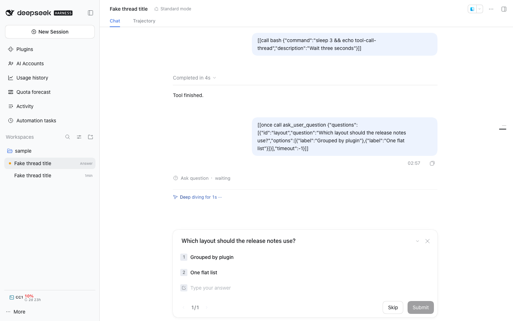

# @dshfiles/user-questions

Owned fork of DSH's native question form (`ask_user_question` and plan review). It keeps the native composer takeover,
answer panels and late-reply node, and stops an answered `continued` form from flashing back while its reply waits for
admission (b:270).

## Upstream and license

- Upstream: [`deepseek-ai/deepseek-harness`](https://github.com/deepseek-ai/deepseek-harness)
- Package: `@deepseek-ai/dsh-client-ui-user-questions@0.2.1-rc.2` (MIT, [LICENSE](./LICENSE))
- Pinned revision: tag `dsh-v0.2.1-rc.2`
- Vendored source: [`src/native`](./src/native) is upstream `packages/client/ui-user-questions/src/client`;
  [`src/host.ts`](./src/host.ts) (upstream `src/index.ts`), [`src/css-modules.d.ts`](./src/css-modules.d.ts) and
  [`locale`](./locale) keep the upstream relative layout.

### Why a whole-package fork

The flash comes from `publishContinuedQuestions`, a private reconcile loop inside the native plugin that republishes a
card whenever the projection lists its call as answerable. No Slot or registration API reaches that loop, so this
package replaces the `ui-user-questions` Loader row: its `cordis.patch.yml` disables `ui-user-questions` and inserts
`dshfiles-user-questions`. It provides the same `userQuestionPanels` service, composer chain entry, chat node and
`user-questions/request` listener, so `@deepseek-ai/dsh-client-ui-plan` and `@dshfiles/agent-questions` keep working.

### Local delta

Every other vendored file is byte-identical to the pinned revision.

| File                  | Change                                                                                                                                                                                                                                                                                                                                 |
| --------------------- | -------------------------------------------------------------------------------------------------------------------------------------------------------------------------------------------------------------------------------------------------------------------------------------------------------------------------------------- |
| `src/native/index.ts` | upstream revision `69f2241e` (`fix(ui-user-questions): keep an answered question from flashing back`), not yet released: the Remote answer path records each call this Client answered until the Host stops listing it, and the reconcile creates that card without taking the composer seat, so the tool call row can still reveal it |

Answering a `continued` form queues a `user-question-reply` in the Inbox. The step boundary's `claim()` empties the
Inbox several awaits before the admitted `user/message` settles the `userQuestions` projection; for that gap the
projection still offers the call as answerable, and the native reconcile took the seat again with the form just
answered.

## Verification

The delta's regression tests live upstream, in `packages/client/ui-user-questions/tests/browser-plugin.client.spec.ts`
at `69f2241e`: the vendored components import browser-only native bundles that this repository's Vitest cannot load.
`node scripts/native-fork-diff.mjs user-questions` proves every other vendored file equals the pinned tag.

## Dropping the fork

When a DSH release ships `69f2241e`, remove this bundle from `profiles/web/package.json` and run
`pnpm profile:sync --profile web`, which restores the native `ui-user-questions` row.
