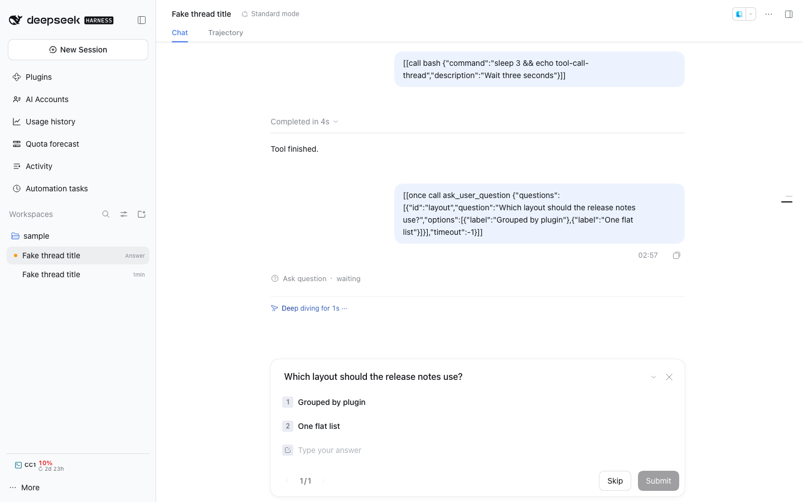
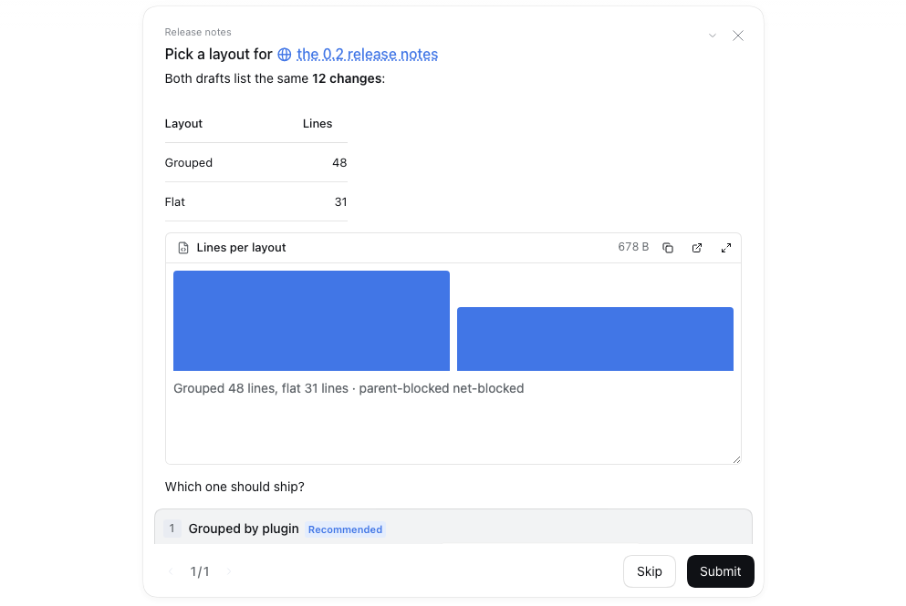

# @dshfiles/user-questions





Owned fork of DSH's native question form (`ask_user_question` and plan review). It keeps the native composer takeover,
answer panels and late-reply node, stops an answered `continued` form from flashing back while its reply waits for
admission (b:270), and renders questions as markdown with sandboxed HTML previews (b:6).

## Markdown questions

An agent can show what it is asking about instead of describing it: a screenshot, a link, a table, a code sample or a
chart. The `question` text and each option's `description` are markdown; they are the only rich fields that survive
both the live answerer request and the Host `userQuestions` projection, which strips any other field, so nothing new
is added to the tool schema. [`@dshfiles/tool-ask-user`](../tool-ask-user) tells the model about it.

- **Heading**: the first paragraph (a leading `#` heading loses its markers). Plain prose keeps the native `h2`; inline
  markdown (a link, `code`, emphasis) renders in an ARIA heading. A question that opens with an image or a fence gets a
  visually hidden heading from its `header`, else from its prose.
- **Body**: everything after the heading, through the native `MarkdownText` the chat transcript uses (GFM tables,
  links, fenced code with highlighting, KaTeX math). Images follow the transcript's policy: an absolute local path
  resolves through the file API, an https image loads directly, anything else renders as its alt text. The body and
  markdown option descriptions render through Chat's `FencedMarkdown` (`@dshfiles/chat/fenced-markdown`), so a fence a
  code-fence renderer claims renders as it does in the transcript: a ```` ```mermaid ```` fence is a diagram when
  [`@dshfiles/mermaid-diagrams`](../mermaid-diagrams) is loaded.
- **HTML preview**: a fence whose info string is `html preview`, optionally followed by a title
  (` ```html preview Revenue by month `), goes to the `QuestionHtmlPreview` registry this package declares as the
  dshx module `@dshfiles/user-questions/html-preview`. [`@dshfiles/html-render`](../html-render) provides it with its
  sandboxed card: `sandbox="allow-scripts"` without same-origin, a no-network Content-Security-Policy first in the
  head, Copy / Open in new tab / Expand. Without a provider the fence renders as an `html` code block, and a plain
  ` ```html ` fence or an unclosed preview fence is always code, so markup never runs outside a sandbox.
- **Options**: a markdown description renders under its option button instead of inside it, so a link stays a link
  (clicking it does not pick the option) and the button keeps its short accessible name (`aria-describedby` points at
  the description). The whole row carries hover and selection. Plain descriptions render inline as before.
- **Size**: a question with a body may take up to `min(72vh, 720px)` before its seat scrolls; the header and footer
  stay pinned. Images and tables are clamped to the pane, checked at iPhone 15 width in WebKit.

Parsing lives in [`src/rich/question-markdown.ts`](src/rich/question-markdown.ts) (unit-tested in
[`tests/question-markdown.spec.ts`](tests/question-markdown.spec.ts)); rendering in
[`src/rich/QuestionMarkdown.tsx`](src/rich/QuestionMarkdown.tsx).

## Upstream and license

- Upstream: [`deepseek-ai/deepseek-harness`](https://github.com/deepseek-ai/deepseek-harness)
- Package: `@deepseek-ai/dsh-client-ui-user-questions@0.2.1-rc.2` (MIT, [LICENSE](./LICENSE))
- Pinned revision: tag `dsh-v0.2.1-rc.2`
- Vendored source: [`src/native`](./src/native) is upstream `packages/client/ui-user-questions/src/client`;
  [`src/host.ts`](./src/host.ts) (upstream `src/index.ts`), [`src/css-modules.d.ts`](./src/css-modules.d.ts) and
  [`locale`](./locale) keep the upstream relative layout.

### Why a whole-package fork

The flash comes from `publishContinuedQuestions`, a private reconcile loop inside the native plugin that republishes a
card whenever the projection lists its call as answerable. No Slot or registration API reaches that loop, so this
package replaces the `ui-user-questions` Loader row: its `cordis.patch.yml` disables `ui-user-questions` and inserts
`dshfiles-user-questions`. It provides the same `userQuestionPanels` service, composer chain entry, chat node and
`user-questions/request` listener, so `@deepseek-ai/dsh-client-ui-plan` and `@dshfiles/agent-questions` keep working.

### Local delta

Every other vendored file is byte-identical to the pinned revision. Owned files outside `src/native` (`src/rich/`,
`src/html-preview.ts`) are not vendored.

| File                                     | Change                                                                                                                                                                                                                                                                                                                                 |
| ---------------------------------------- | -------------------------------------------------------------------------------------------------------------------------------------------------------------------------------------------------------------------------------------------------------------------------------------------------------------------------------------- |
| `src/native/index.ts`                    | upstream revision `69f2241e` (`fix(ui-user-questions): keep an answered question from flashing back`), not yet released: the Remote answer path records each call this Client answered until the Host stops listing it, and the reconcile creates that card without taking the composer seat, so the tool call row can still reveal it |
| `src/native/QuestionComposer.tsx`        | the question is markdown: heading split, rich body and html previews from `src/rich/`, markdown option descriptions under their button (b:6)                                                                                                                                                                                           |
| `src/native/QuestionComposer.module.css` | `.optionItem` row highlight, `.srOnly` heading, `.cardRich` height for those (b:6)                                                                                                                                                                                                                                                     |

Answering a `continued` form queues a `user-question-reply` in the Inbox. The step boundary's `claim()` empties the
Inbox several awaits before the admitted `user/message` settles the `userQuestions` projection; for that gap the
projection still offers the call as answerable, and the native reconcile took the seat again with the form just
answered.

## Verification

The delta's regression tests live upstream, in `packages/client/ui-user-questions/tests/browser-plugin.client.spec.ts`
at `69f2241e`: the vendored components import browser-only native bundles that this repository's Vitest cannot load.
`node scripts/native-fork-diff.mjs user-questions` proves every other vendored file equals the pinned tag.

## Dropping the fork

When a DSH release ships `69f2241e`, remove this bundle from `profiles/web/package.json` and run
`pnpm profile:sync --profile web`, which restores the native `ui-user-questions` row.
