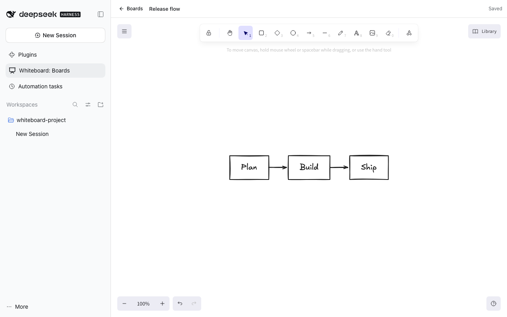
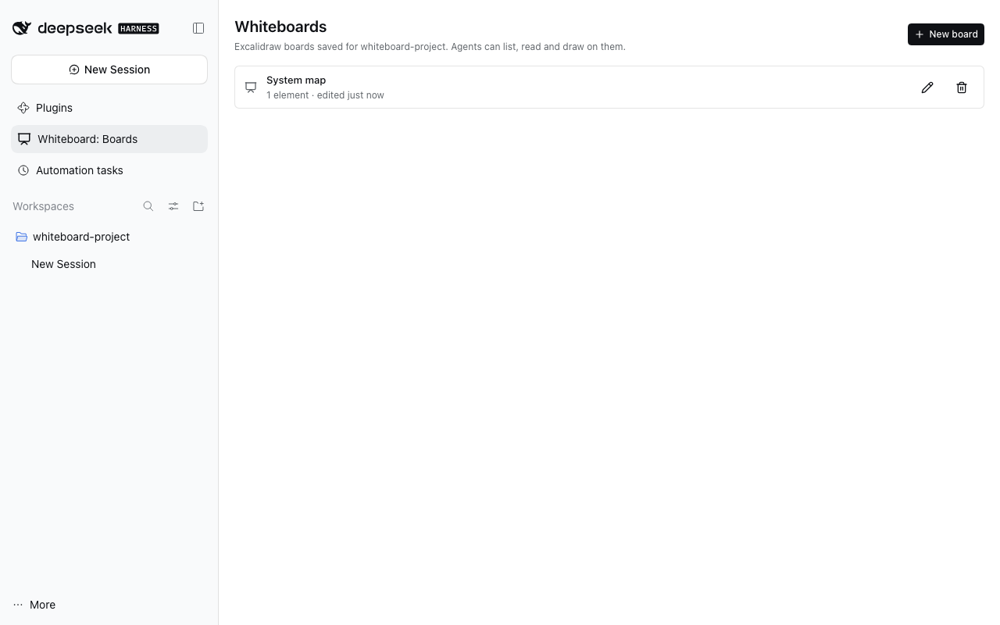
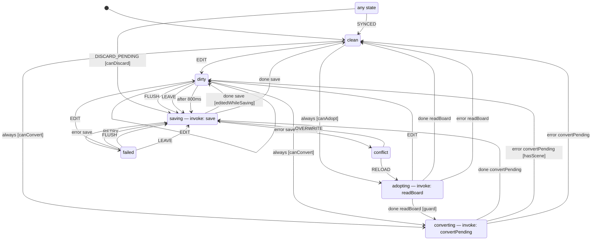

# @dshfiles/whiteboard



**Whiteboard** in the navigation: [Excalidraw](https://github.com/excalidraw/excalidraw) boards saved on the
DSH Host, one list per registered project. Create a board, draw (autosaved), rename it, delete it to **Recently
deleted** and restore it. Agents get the same verbs as tools and can draw from Mermaid.



## Why Excalidraw, and why owned

- **Adopt** was checked first on [dshmarket.com](https://dshmarket.com): `dsh-diagram` (MIT, Excalidraw in a session
  tab) pins DSH 0.1.x peers and Cordis 4.0.2 and stores canvases per session; `dsh-excalidraw` renders imported
  `.excalidraw` files without project storage; `@1agents/feature-blueprint` is a sidebar mind-map/canvas with local
  files. None fits DSH 0.2.1 with per-project Host storage and agent tools, so this is **built with dshx**.
- **Excalidraw over tldraw**: Excalidraw is MIT. The tldraw SDK is source-available, not open source: by default it
  is licensed for development only and "will not work in production without a valid license key" (100-day trial,
  paid commercial, or a discretionary hobby key that must show the "made with tldraw" watermark —
  [tldraw license](https://tldraw.dev/community/license)). Every user of this repository would need their own key.

## What it stores

`$DSH_HOME/plugins/whiteboard/boards.db` (owner-only, via `@dshfiles/sqlite-store`): one row per board with its project
root path, title, revision, the Excalidraw scene as JSON (live elements, the images they use, background/grid), any
queued agent source, and `deleted_at`. Deleting only sets `deleted_at`; the scene is kept until the board is restored.
Every write names the revision it read, so a stale write is refused instead of overwriting newer edits.

**Size:** a scene, images included, must stay under **900 KiB**. Every dshx API call is capped at 1 MiB of JSON in
and out; the rest is headroom for queued source and the text list `whiteboard_read` returns. A larger board fails to
save with a message to remove or crop images. (Raising this needs a per-method payload cap in dshx; see Follow-ups.)

## The editor loads only when a board opens

Excalidraw is several megabytes. A dshx Client build is one chunk every page downloads at boot, so the editor is a
second build (`vite.editor.config.ts` → `dist/editor/`): an ES module graph with code-split chunks, Excalidraw's fonts
and the lazily imported Mermaid converter. The Host serves exactly that directory at `/dshfiles-whiteboard/editor/`
(`src/editor-assets.ts`: known extensions only, no symlinks or `..`, gzip, immutable caching for hashed files) — the
same trust class as the `/plugins/<id>/client.js` DSH serves. The Client imports it on first open
(`src/editor-loader.ts`), hands it the page's React through a global (one React per page), and points
`EXCALIDRAW_ASSET_PATH` at the same route, so fonts never come from a CDN. `client.js` contains no Excalidraw code.

Initial editor download: about 1.6 MB uncompressed, ~480 KB gzipped; Mermaid (~2 MB) loads only when a queued
diagram is converted or the Excalidraw text-to-diagram dialog is used.

## Agent tools

| Tool                 | Kind                   | What it does                                                                                                |
| -------------------- | ---------------------- | ----------------------------------------------------------------------------------------------------------- |
| `whiteboard_list`    | read-only              | Boards (all, or one `project`), with revision, element count and queued source; `includeDeleted`            |
| `whiteboard_read`    | read-only              | One board's scene JSON, queued source and the text of every text element                                    |
| `whiteboard_write`   | write (user asked)     | Create (`project` + `title`) or update (`boardId` + `expectedRevision`) from elements, Mermaid or skeletons |
| `whiteboard_rename`  | write (user asked)     | Rename with the current revision                                                                            |
| `whiteboard_delete`  | destructive, `confirm` | Move to Recently deleted; needs `confirm: true`                                                             |
| `whiteboard_restore` | write (user asked)     | Bring a deleted board back                                                                                  |

Mermaid and skeleton elements need the browser (Mermaid lays out in the DOM; skeletons need Excalidraw's text
measurement), so the Host queues them and the editor converts and appends them the next time the board opens;
`whiteboard_read` shows them as `pending` until then. If the source does not parse, the board says so and offers
**Discard queued diagram**. mermaid-to-excalidraw converts flowcharts, sequence and class diagrams into shapes; other
Mermaid types arrive as one image.

## xstate machines as diagrams

`@dshfiles/whiteboard/xstate-diagram` exports `machineToMermaid(machine, format)`, a pure function over an xstate v5
machine's state-node tree (no xstate import). `flowchart` is what `whiteboard_write({ mermaid })` turns into editable
shapes; `state` is a `stateDiagram-v2` for Markdown. Render any plugin's machine from a shell:

```sh
pnpm --dir plugins/@dshfiles/whiteboard run machine-diagram plugins/@dshfiles/editor/src/editor-save-machine.ts
```

The board's own autosave flow (`src/board-sync-machine.ts`), generated by that command with `--format state`:



Findings and options compared: [plans/xstate-viz/README.md](../../../plans/xstate-viz/README.md).

## Verify

```sh
pnpm exec turbo run build --filter=@dshfiles/whiteboard...
pnpm --dir plugins/@dshfiles/whiteboard typecheck && pnpm --dir plugins/@dshfiles/whiteboard test
pnpm check:e2e whiteboard          # create → draw → reload → rename → delete/restore; agent Mermaid conversion
```

The catalog reach (`dshx dev open whiteboard/project-whiteboards`) walks the rail, so it needs the bundles that own it;
`dshx dev up --plugin @dshfiles/whiteboard` alone has no `Knowledge` tab:

```sh
dshx dev up --plugin @dshfiles/frame-layout --plugin @dshfiles/thread-sidebar --plugin @dshfiles/session-controller \
  --plugin @dshfiles/rich-composer --plugin @dshfiles/chat --plugin @dshfiles/main-tabs --plugin @dshfiles/workbench \
  --plugin @dshfiles/whiteboard
```

A Host change (`dist/index.js`, the asset route) needs a DSH restart; a Client or editor-only change does not.

## Follow-ups

- dshx: a per-method payload cap (or a streamed body route) so boards with large images fit.
- dshx: first-class lazy Client chunks served by the Host would replace this plugin's own asset route.
