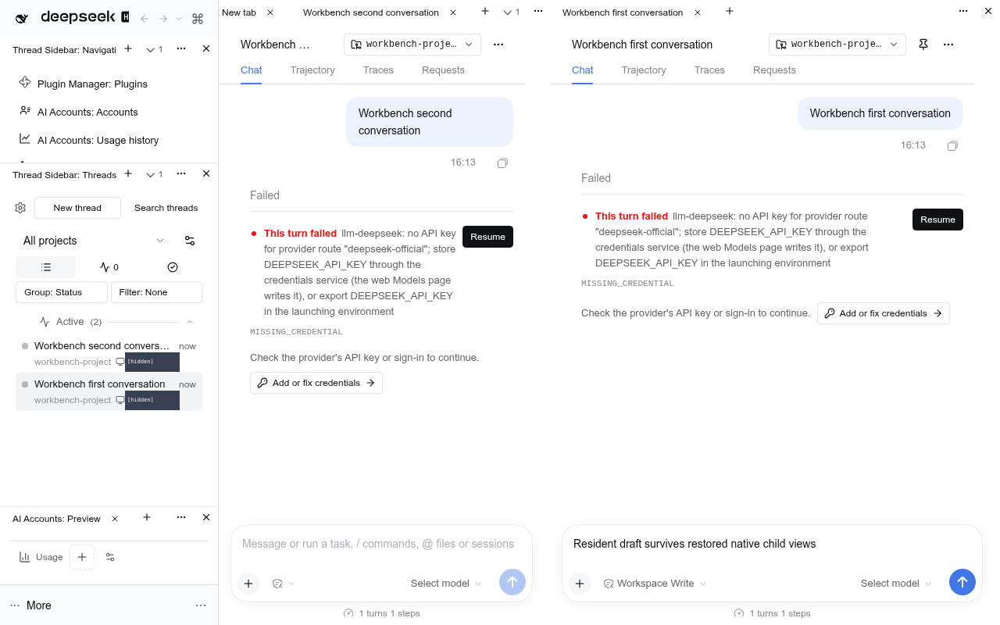
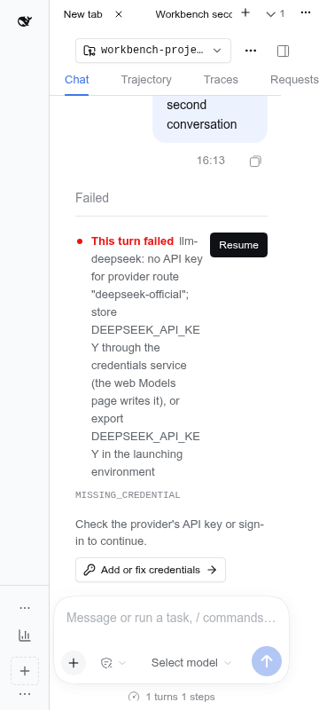
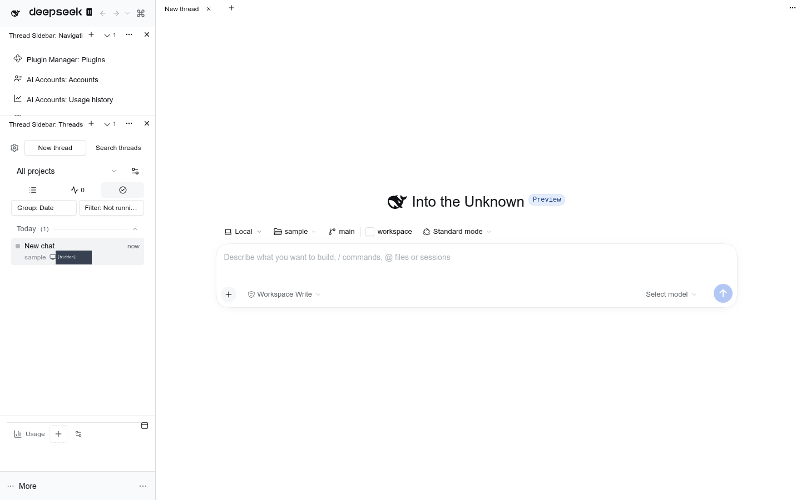
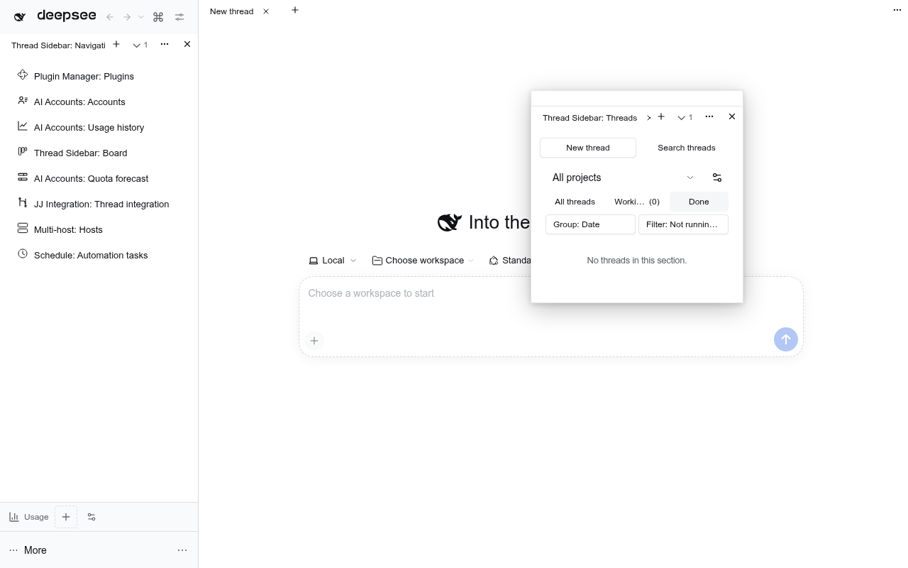
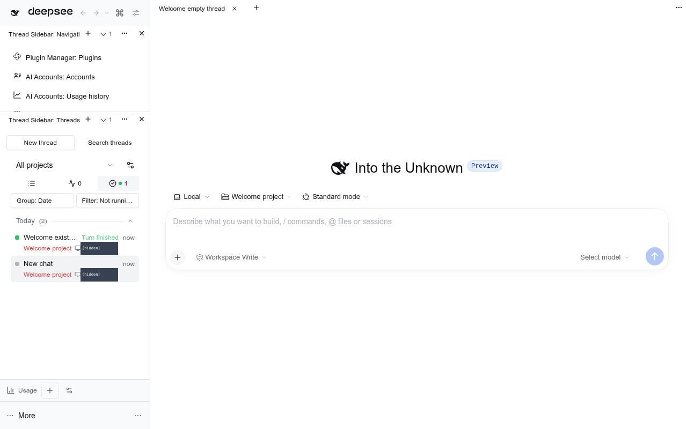
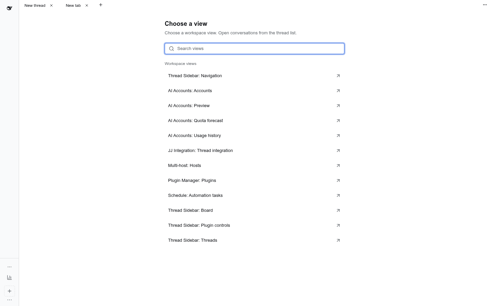
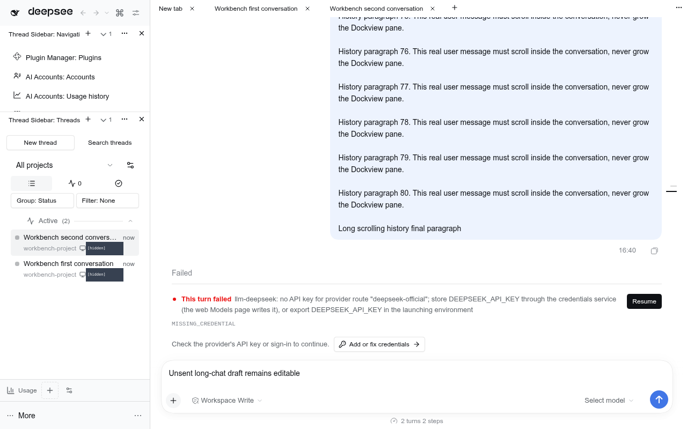
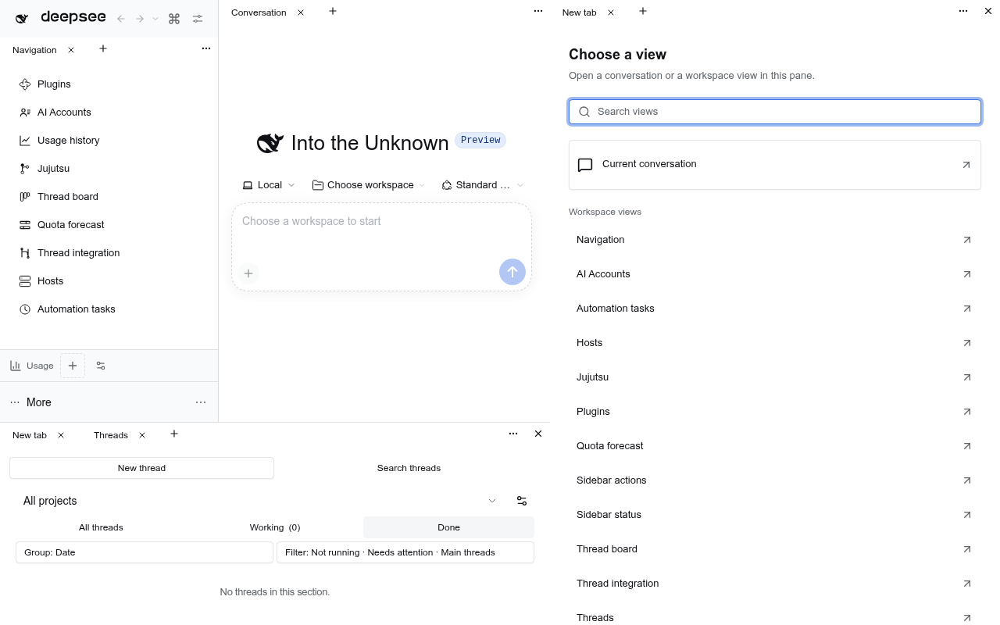
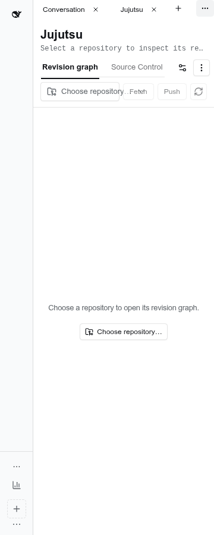
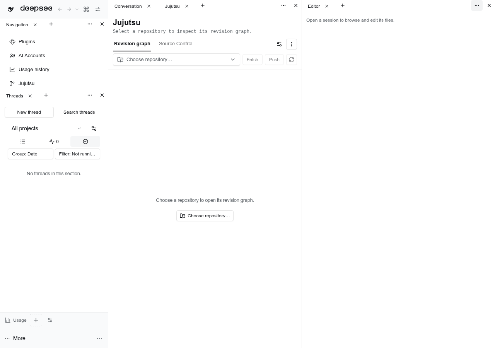

# @dshfiles/workbench

Split-pane and narrow-header verification

The synthetic split/narrow fixture intentionally has no provider credentials; these captures verify controls, history and drafts, not a successful model request.

The fixed-chat fixture has no external model credentials; it verifies preserved history and editable drafts.

[View contract and layout recovery](docs/layout-recovery.md) · [Native terminal ownership and verification](docs/terminal-pages.md)

Docking workbench for DSH, with left, centre, right and bottom panes over one panel registry. Tabs can move, split and float; each region persists its own layout. The centre hosts real independently bound conversations alongside registered main pages, plugin views, the Settings hub and native resources. There is no Workbench heading or persistent top toolbar. The [`@dshfiles/editor`](../editor/README.md) package
contributes an editor panel, and [`@dshfiles/jujutsu`](../jujutsu/README.md) a reusable repository view.

## Use

- **View names**: reusable plugin views use **Plugin: View** everywhere they are offered, for example **AI Accounts: Preview**, **Editor: Files**, **Backlog: Items**, **Thread Sidebar: Threads** and **Settings Shell: Settings**. The chooser searches full names. Saved layout IDs and view state stay unchanged; restored captions update in place. Conversation names, scoped subjects and file/resource instance titles are not renamed.
- **One view system**: plugins export reusable components through `@dshfiles/workbench/registry`. Views open in left, centre, right or bottom panes and their Dockview split groups. The owned Threads list and Navigation use this same contract. The sidebar keeps only its brand/history/palette row and native account/footer chrome fixed. Sidebar customization belongs to the Threads panel's settings gear and follows that view.
- **Stable window scene**: switching between already-open conversations from different projects changes only the selected conversation, not the tab set or layout. Unrelated New tab choosers, order, pins and drafts remain. Reload uses the current region layouts instead of an older scope cache; a chooser you explicitly close stays closed.
- **New thread welcome**: an empty conversation keeps the native centered **Into the Unknown** heading, workspace/model controls and its original composer inside its own tab. Drafting alone keeps the welcome; the first real turn switches that same editor into normal chat. Loading/unknown history is not mistaken for an empty thread. The welcome also fits narrow and split panes.
- **Conversation tabs**: one complete chat-and-editor view per Session. Clicking a closed conversation in the thread list opens a new kept tab; clicking an open conversation focuses that exact tab, including after all tabs were closed. A tab never follows selection of another conversation. Drafts survive switching, closing and reopening. Closing the last tab leaves the chooser rather than resurrecting the global current chat. Old disabled/preview/replace settings cannot override this Workbench default; no speculative single-current-tab mode is added. Panel previews and standalone preferences are unchanged.
- **Original chat header**: each conversation retains its own title/mode, workspace utilities, Pin/More menu and native Chat/Trajectory/Traces/Requests tabs when their providers are present. Child views use the same session and resident editor; hiding the outer Workbench row does not hide or cover this header. The original right-sidebar opener controls the actual dock. [Ownership and verification](docs/conversation-header.md).
- **Long chats**: history scrolls inside its pane while the original input remains reachable. Fixed conversations have a viewport-sized flex host through tab switches and reload. Closing an inactive tab leaves the selected chat alone; closing an active tab chooses an existing neighbor without retargeting another tab.
- **Terminals**: choose **New tab → Terminal: Terminal** in any pane. Each explicit launch creates an independent native terminal for the selected conversation's workspace, without forcing open the right pane. Moving, hiding and reloading retain the real PTY; closing its tab uses native cleanup. Select a conversation/workspace first if no context is available. The launcher never creates hidden conversations or allocates from a passive layout restore.
- **New tab**: each group's **+**, accessible as **New tab**, sits immediately after its last tab and opens an actual **New tab** chooser tab, not a dropdown. Empty right/bottom panes start with the same chooser. Its **Choose a view** region contains **Search views**, one **Settings Shell: Settings** hub and reusable plugin views. Conversations open from the thread list or **New thread**; there is no separate **Rich Composer** or **Current conversation** picker entry. Legacy global-following conversation aliases retire without changing canonical fixed-session tabs. Choosing an existing unscoped plugin view adopts its occurrence. Per-chat Trajectories, resource occurrences and Settings leaf sections are not primary suggestions; saved occurrences still restore. [Workspace-only chooser](docs/screenshots/main-panel-sources.png).
- **Pane options**: the far-right menu in each group offers **Split right**, **Split down**, **Layouts**, **Move tab to**, **Reset layout** and the bottom-pane toggle. Splits create actual Dockview groups, not nested containers. Layouts opens the saved-layout dialog; Move tab to acts on the active tab. There is no duplicate Add panel menu or pane-preference checkbox/up/down control strip.
- **Hide one tab row**: right-click its sole tab or blank row space and choose **Hide tab row**. Only the row disappears; the same content, input and draft stay docked and mounted. Hover the content to find **Show tab row** at its top-right, focus that button by keyboard, or use the global **Workbench: Show tab rows** command. Dropping/adding another tab into the group immediately shows the row and clears the hidden preference. Going back to one does not hide it again automatically. Multiple-tab groups cannot be hidden. The native header flag saves in the existing layout.
- **Account Preview is a view**: the existing AI Accounts-only preview starts as a regular bottom-left tab group, not a special fixed strip. It uses the genuine contributor and supports the same move, hide-row, split and close controls. Existing saved placements win, including nested panes; closing it stays closed across reload, and the chooser can reopen it. **Reset layout** restores the default. Native sidebar account/settings controls, brand and update notices remain fixed. A standalone Sidebar without the Workbench override retains its old Preview fallback.
- **Window-wide floats**: right-click a tab and choose **Float panel**, or use native Shift-float. In the four root panes the floating window can move outside its source pane. Drag its top titlebar to move it; drag its tab onto another pane to dock it. The native panel, live content and draft remain mounted while moving/resizing. Each clicked floating window comes to the front across panes, without raising unrelated sibling floats; its native window position saves normally. Nested paint-contained workbenches still float locally. Hiding/collapsing a source pane keeps its native descendant-visibility behavior; reopening restores it. Legacy local float positions may shift once into window coordinates, without resetting the layout or losing the view.
- **Permanent centre**: the last docked centre group has no **Close pane** action. Closing or floating its last tab leaves a docked **New tab** chooser, never a missing tab system. Split groups merge only into another docked centre group; floating views keep their resources and drafts. Old floating-only layouts repair automatically. A valid singleton's hidden row stays intentional and recoverable; invalid multi-tab hidden rows reveal automatically.
- **Recovery**: **Reset layout always restores the visible chat list on the left and the current conversation in the centre**, even from a tool page, collapsed sidebar, displaced chats or floating-only layout. It resets root/nested/project placements without changing chat history, drafts, semantic tabs, pins or named layouts. `Workbench: Reset layout` in the global command palette works independently of centre controls. [Recovered chat layout](docs/screenshots/layout-recovery.png).

- **One centre surface**: conversations, pages and plugin views always use Dockview tabs. There is no native-surface option or separate Workbench destination. Saved native preferences are decoded for compatibility but cannot switch the renderer.
- **Right pane**: **Open right pane** appears only in the main group's **Pane options**, only while the pane is closed. It and the original right-sidebar shortcut control the same full-height tabbed dock, including outside a thread. **Close pane** is an icon at the right pane's own right edge, never a centre Close right pane control. Closing the pane hides rather than unmounts it, preserving live views, drafts and resource lifetimes. Closing its **last remaining tab** automatically closes the pane instead of replacing that tab with a chooser. Closing one of several tabs leaves it open. Manual reopen provides one chooser; a resource/view can reopen and adopt directly. A right-owned floating panel still counts as a live view.
- **Bottom pane**: opened from **Pane options** or `bottomPanel`, below left and centre only. It never cuts into the full-height right pane. The frame owns its height and resize handle. An empty pane starts with the chooser and adopts moved views instead of duplicating them. Its own far-right **Close pane** icon hides it.
- **Resources**: preview, review and terminal providers retain their real Session records behind authorized presentation targets. Original resource commands reveal the tabbed right pane; the Terminal chooser honors the selected pane instead. Passive restoration does not reopen a deliberately closed pane. Views previously moved elsewhere retain their saved destination.
- **Move**: **Pane options › Move tab to** lists where the active tab can go — the other docking regions, and the feature's own
  full main-view page when its definition names one. A panel lives in exactly one region, so moving it closes the copy
  the source held; asking for a region that is closed opens it first and hands the panel over when it reports ready.
- **Narrow surfaces**: quiet group chrome keeps the **New tab**, **Pane options** and applicable **Close pane** icons accessible without a separate toolbar row.
- **Drag**: a panel dragged by its tab into another region is adopted there and leaves the source. Where Dockview's own
  targets answer, the surface accepts the transfer through `api.onUnhandledDragOver` (the React wrapper exposes no such
  prop), which is how a group or tab shows the drop overlay. Dockview's layout-edge target refuses a foreign view
  outright, so over a region with no panel of its own no target answers at all: the view's own drop zone takes that
  case, reading the same page-global `getPanelData()` transfer. Either way the embedder adds the panel — or activates
  the copy the target already showed — and closes the source's copy. The `workbench.drag-between-regions` journey drives
  real pointer input for a round trip between the dock and the bottom row.
- **Layouts**: **Pane options › Layouts** opens the dialog that saves the arrangement of every region under a name, and applies, renames or
  deletes those names later. A layout only changes the regions it recorded, and applying one opens a region it needs.
  A saved layout captures every _mounted_ region: a region that was closed while saving is not part of that name.

## Settings (`dshfiles-workbench`)

| Key           | Default  | Meaning                                                                                                               |
| ------------- | -------- | --------------------------------------------------------------------------------------------------------------------- |
| `bottomPanel` | `hidden` | `shown` opens the tabbed bottom pane below left and centre; `hidden` closes it.                                       |
| `demoPanels`  | `false`  | Developer fixtures: the Scratchpad and Ticker panels, which count mounts and renders to prove docking never remounts. |

The owned frame (`@dshfiles/frame-layout`) is required. It owns the geometry and publishes the existing main, right and bottom seats. Browser-local right-pane visibility is the single owner of open/close state; the frame and sidebar shortcut consume registered `DockPaneActions` rather than mirroring a Session's expansion state. Hidden legacy `mainSurface`, `rightPanel` and `headerToggle` keys only decode old profiles. The old dock value seeds visibility once; subsequent closes and reloads preserve the browser's choice.

**Native resources.** In main-workbench mode the owned Sidebar Right declarer portals real session-bound file preview, diff and terminal slots into panels. It retains the genuine TabDomain, navigation and cleanup contract; moving a panel only detaches its presentation target. Native mode keeps the legacy right-column fallback. A saved resource panel reacquires its real session on reload, never a client-side invented resource.

**Legacy nested surfaces.** Existing nested-container layouts still restore, retain stable path ownership and participate in saved layouts/reset. No control offers new nested containers. Use **Pane options › Split right / Split down** for new side-by-side or stacked Dockview groups. Legacy containers cannot move into themselves or descendants.

## Responsive evidence

The same controls remain reachable at 360, 480, 768 and 1024 pixels, including when main-tabs contributes New tab.

## Panels

- `register({ id, title, component, dockDefault? })` on the page-global registry
  (`@dshfiles/workbench/registry`), from any plugin.
- `dockDefault` remains readable for existing contributor/layout compatibility. Fresh right and bottom panes start with a **New tab** chooser; a saved layout still wins.
- Layouts persist per surface in `localStorage`: `dshfiles.workbench.layout.v1` (main),
  `dshfiles.workbench.dock-layout.v1` (dock), `dshfiles.workbench.bottom-layout.v1` (bottom row),
  `dshfiles.workbench.side-panel-layout.v1` (per-thread tab), and named layouts under
  `dshfiles.workbench.saved-layouts.v1`. Nested containers use `dshfiles.workbench.nested-surfaces.v1`, a `nested-paths.v1` index and `nested-layout.v1:<path>` stores. Existing root keys and named-layout records remain readable; migration preserves existing panels and active selection.

This is an owned DSH bundle and shared panel registry. Run `pnpm build`, `pnpm test`, and `pnpm typecheck` from this package.
