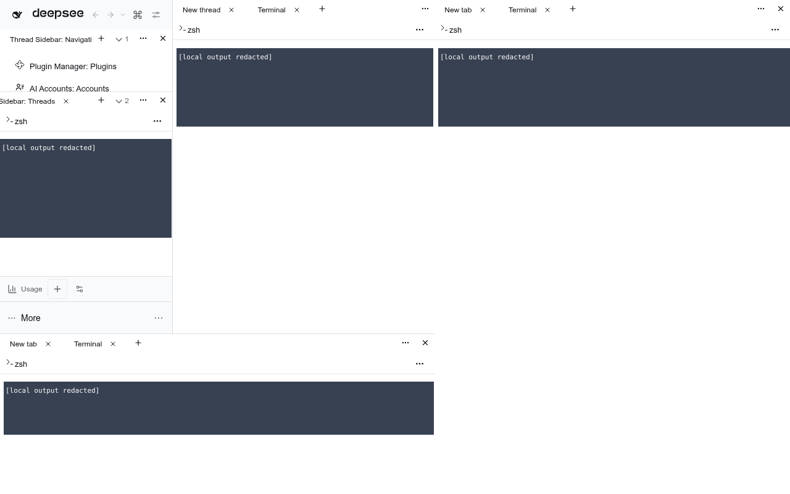

# Native terminal pages

Choose **New tab → Terminal: Terminal** in any Workbench group. Each selection creates a separate native terminal in that exact group, including main, left, right and bottom panes. Select a conversation with a workspace first; an unavailable native provider/context shows guidance rather than inventing a Session. The original terminal command still opens the native right-pane destination.



## Ownership

This adopts the installed stock `terminalController`, `webTerminals` and sidebar-terminal renderer through the already-owned Sidebar Right package. They already supply genuine PTYs, shell selection, input/output, Session bindings, retention and cleanup. A second process service or terminal emulator would duplicate that lifecycle. No new Host verb, Host execution facade or DSH core patch is added.

The existing `@dshfiles/sidebar-right/resource-panels` dshx module has an optional explicit `openPage(kind, beforePublish)` bridge. The native owner captures its adopted Session once and supplies the exact resource ID before publishing the native record. Unlike its original `openTab`, this path does not reveal the right pane. Workbench records only the short-lived ID-to-API/group destination, registers the genuine resource definition, then admits that exact ID. No kind/diff/last-record correlation is used.

The launcher has no allocating mount effect or repeatable dummy terminal component. Repeated explicit choices create independent native records. An old already-loaded bridge without the optional method leaves the passive guidance view, not an invented terminal. Refreshing all cooperating client bundles enables the method.

A completed choice closes a semantic Start chooser through its actor owner before retiring the presentation, so the Start tab cannot return on the next metadata update. A cancelled unseated destination claims only its exact new native resource and forwards native close, never falls through into an unrelated pane. Reset/disposal does not close already seated terminals.

## Move, restore and close

Moving changes an authorized presentation target, not the record, binding or shell. Portal containers can change across regions, so the invariant is the native occurrence and PTY PID, not a promise that every DOM node survives. Hidden and dormant records retain their native bindings.

Reload restores the saved binding and the same live Host terminal. A bound terminal from a previous Host lifetime is not silently replaced with a new process; native missing/recovery behavior remains authoritative. An unbound native record keeps stock first-display behavior. Mounting the Workbench launcher itself never allocates a page or process.

Explicit tab close forwards the native resource close/cleanup admission first. Workbench then retires only the exact surviving panel with `api.removePanel`, rather than replaying `panel.api.close` after an owner has already disposed it. Other terminals and their buffers stay intact.

## Verification

The real-browser `workbench.terminal-picker-lifecycle` journey creates terminals in all four panes, sends a harmless `printf` whose generated PID marker is not contiguous in the echoed command, and checks the actual output and workspace cwd. It compares native record IDs, persisted bindings and shell PIDs across moves and reload, then closes every terminal and checks that each process exits. Use a normal-height left Threads group for output assertions: the short Navigation group legitimately fits only one terminal row.

Run from `tooling/dshx` with the stock-core and system-Chromium executable environment configured:

```sh
DSHX_E2E_PREBUILT=1 DSHX_E2E_PREWARM=0 node node_modules/@playwright/test/cli.js test --config=playwright.e2e.config.ts --workers=1 --grep '@scenario:workbench.terminal-picker-lifecycle'
```

The isolated genuine-PTY journey passes, including all four native cleanup paths. Six source-admission tests use real Dockview APIs; fifteen Sidebar Right tests use the adopted controller, store and lifetime owners. Both packages pass strict types. Broader Workbench unit coverage includes canonical close and activation ordering. Native-fork comparison reports no drift for the changed Sidebar Right delta. These checks do not claim that the user's already-open browser has loaded the rebuilt clients.
