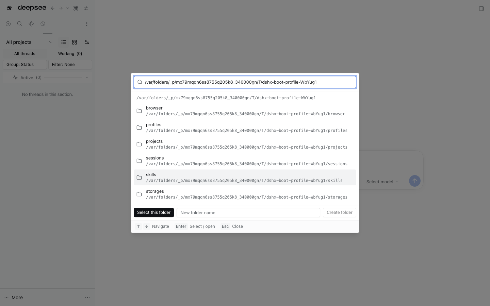
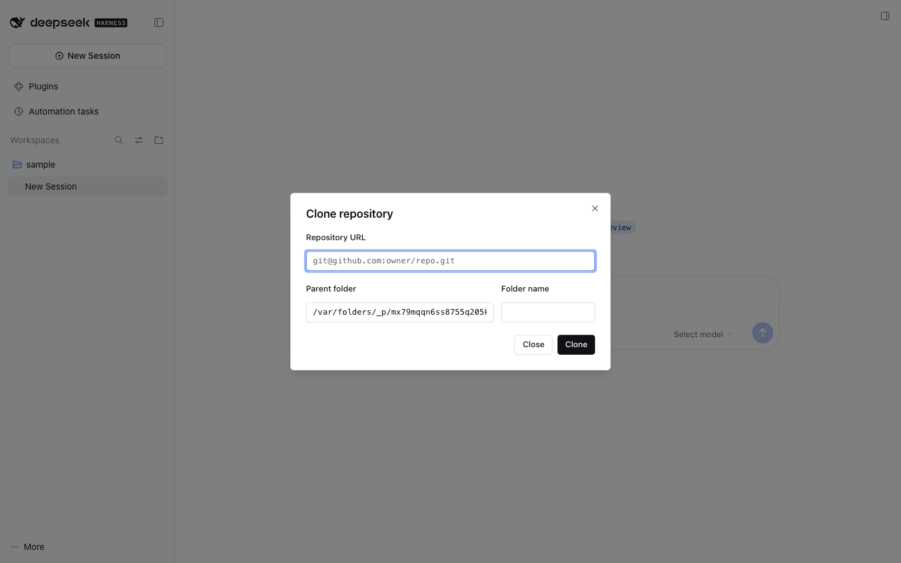
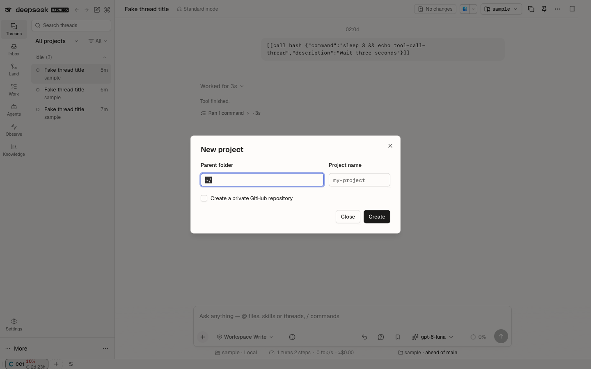

# Workspace Folder Picker



Replaces the Add workspace directory flow in the header workspace menu and the
sidebar browser with the shared `ProjectFolderPicker` opened directly in
directory-browsing mode. It also exports the same Host API for the New-thread
project chooser, whose Host may only expose the native OS picker through DSH's
global `directoryPicker` service. The API uses DSH's official browse backend in
a private Cordis context, so these flows can list and create folders without
replacing the global service or removing the native chooser from other
consumers. Absolute paths can still be submitted directly to the workspace
owner's existing registration callback.

The chooser intentionally does not show registered projects or the
"Register project" action: this entry point adds a workspace rather than
choosing one that already exists. The New-thread project picker also lets you
remove a project registration after confirmation; its folder and files stay on
disk, while its threads lose their project grouping.

## Native folder dialog and Windows paths

**Browse…** appears when the Host's global `directoryPicker` is native (the
desktop app). Choosing a folder in that dialog adds it as a workspace, or in the
New-thread picker registers and selects it; cancelling changes nothing. The
read-only `workspace_folder_browser_capabilities` agent tool reports the same
capability, and the Host's path style, without opening the dialog. A
browse-only Host, a Host without a picker, or an older Host that cannot answer
the read hides **Browse…** and keeps the in-app browser and absolute-path entry.

On a Windows Host, paths can be typed or pasted as drive paths
(`C:\projects\game` or `C:/projects/game`), UNC paths (`\\server\share\game`),
Unix-style absolute paths or home-relative paths (`~/game`, `~\game`). They
compare case-insensitively across both separators; drive-relative (`C:game`)
and device (`\\?\`, `\\.\`) paths are not absolute and are never browsed. The
picker learns the Host's style from the capability read, or else from the home
folder the Host lists. On macOS and Linux, and before the style is known, drive,
UNC and `~\` text stays a project search, as it always was.

## Clone a repository



**New → Clone repository…** in the same dialog clones a Git repository
(`https://`, `ssh://`, `git@host:path` or a local `file:///` URL) into a new
folder `<parent>/<name>` on this machine. The clone runs as a background Host
job: `git clone --progress` feeds the progress bar, **Cancel clone** stops it
and deletes the partial folder, then `jj git init --colocate` runs when jj is
installed and the clone is registered as a project and selected. Closing the
dialog leaves the job running; it still registers the project when it ends.

The same jobs are agent tools: `project_clone` (URL, parent folder, folder
name), `project_clone_jobs` (read-only trail, newest first) and
`project_clone_cancel` (requires `confirm: true`). An existing destination is
refused, a second start for the same folder returns the running job, and each
clone leaves one `project clone` span with its final state and phase. Jobs live
in Host memory, so a Host restart drops the trail. `multi_host_clone_project`
stays the remote counterpart; it runs `git clone` over SSH and shares no code
with this local job beyond the idea.

## Create a new project



**New → New project…** creates `<parent>/<name>`, runs `jj git init
--colocate`, writes a `README.md`, commits it as `chore: initialize <name>`,
creates the `main` bookmark on that commit and registers the folder as a
project. When the GitHub CLI is installed, **Create a private GitHub
repository** also runs `gh repo create <name> --private --source . --remote
origin` and pushes `main`; the option is hidden without `gh`. An existing
folder, a missing parent or a missing jj is refused before anything is
written; a failure before registration removes the folder again, and a GitHub
failure after it keeps the project and shows the command that finishes the
job. The `project_create` agent tool takes the same inputs, with
`createGitHubRepository` required so an agent never creates a GitHub repository
by default, and `project_tools_status` reports which of git, jj and gh are
installed. Each run leaves one `project create` span.

## Runtime support

The plugin builds against the published
`@deepseek-ai/dsh-host-directory-picker-browse@0.2.0-rc.2` backend, provided by
the DSH Host through peer dependencies, and exposes it through its own
authenticated Host API. It does not depend on the unshipped `hybrid` mode or
require a DSH Core patch.

## Boundaries

- The header and sidebar workspace owners retain open/busy state and workspace
  creation.
- Add Workspace calls the official browse backend through this plugin's Host
  API. An isolated Cordis context keeps that browse capability from replacing
  the global `directoryPicker` service, so other consumers retain native picking.
- The shared picker defaults to project mode for its other consumers. This
  bundle opts into directory-only mode without duplicating the explorer UI.
- Host browsing follows the DSH process user's filesystem access; it is not
  confined to the current workspace or home directory, and symlinked directories
  remain navigable. This broader capability is enabled here only for Add Workspace.
- The Host API lists directory names only, caps each level at 1,000 directories,
  and creates a single child directory only after an explicit user action. It
  does not read file contents or restrict paths to the current workspace.

## Checks

```sh
pnpm typecheck
pnpm test
pnpm build
pnpm test:boot
pnpm test:e2e
```

## Picker component (`@dshfiles/workspace-folder-picker/picker`)

Reusable React picker for DSH clients. The package has no Host wiring of its
own; callers pass the registered workspace snapshot, the Host directory picker
port, and a workspace registration callback.

### Public component contract

```tsx
<ProjectFolderPicker
  projects={projects}
  directoryPicker={{ pick, list, createDirectory }}
  onRegisterWorkspace={registerWorkspace}
  onSelect={selection => setFolder(selection)}
  onClose={closePicker}
/>
```

Optional props: `title`, `machineName`, `placeholder`, `recentFolders`,
`initialTab`, `pinnedWorkspaceIds`, `disabled`, `mode`, `showNativePicker`,
`pathStyle` (`'windows'` or `'posix'`, when the caller knows the Host's),
`onUseAbsolutePath`, and `onRemoveProject`. When supplied, each registered
project has a separate remove control. It asks for confirmation before calling
`onRemoveProject`; consumers decide how to unregister the project. The default
`projects` mode shows registered projects and switches to browsing when the
query is an absolute or home-relative path. A unique matching folder opens as the path is
typed; ambiguous matches remain available for keyboard selection, and truncated
listings never trigger a guess. Home-relative paths resolve against the Host's
reported home directory. While an absolute query is not the current listing,
its direct-path action uses the workspace-registration callback, which returns
the Host-canonical path.

`directories` starts in folder browsing and hides project choices and project
registration. It offers direct path submission only when `onUseAbsolutePath` is
provided, so the caller can validate the uncanonicalized path. Set
`showNativePicker` to `false` when the injected Host backend has no native
chooser. A native pick selects the folder in `directories` mode and registers it through
`onRegisterWorkspace` in `projects` mode.

Project mode opens on the **Projects** tab: registered projects without JJ thread
workspaces (any project carrying `isJjWorkspace: true`). Tabs mirror the command
palette's: **Everything** lists recents, then projects, then workspaces, each
folder once; **Recents** and **Workspaces** appear only when they have folders.
`recentFolders` is newest first; a registered recent folder shows as its project,
any other one yields a `directory` selection, and a JJ workspace is never a recent.
`pinnedWorkspaceIds` lead Everything and Projects (the New-thread picker pins
**No folder**). `initialTab` overrides the default.

`RegisteredProject` requires `workspaceId`, `title`, and the Host-canonical
`canonicalPath`; `removable: false` hides the remove control for special entries.
Selection is a discriminated union:

- `{ kind: 'workspace', workspaceId, canonicalPath, title }`
- `{ kind: 'directory', canonicalPath, title }`

The component filters registered projects by title/path, enters path browsing
when the query is an absolute or home-relative path, and supports arrows, Enter, and
Command/Ctrl+1–9. An absolute path can also be submitted without browsing: project
mode uses the workspace-registration callback, and directory mode calls the
opt-in `onUseAbsolutePath` callback. The callback owner must validate and
canonicalize that raw path. Escape, mask click, focus trapping, and return focus
come from the Host `Modal` it renders in headless mode. Folder browsing, OS
picking, folder creation, and project registration are injected ports, so a
consumer can replace them in tests or reuse this UI from another DSH plugin
without importing Secret Catalog code.

### Marketplace decision

The catalog search found `WenhongPan/dsh-projects`, a complete project and
session organization plugin with project picking as one part of its UI. It does
not publish a standalone picker component or stable component contract, so it
was not adopted or forked. This package is a small shared component built for
the local DSH plugin set; its Secret Catalog adapter calls the installed rc.2
`remote.directoryPicker` and `remote.workspace.create` APIs.

The component's only DSH import is the Host platform module
`@deepseek-ai/dsh-client-ui-primitives` (its `Modal`, `Button`, `Input`, and
keycaps), which the consuming bundle leaves external; every Host operation
still arrives as an injected port. The consuming Secret Catalog package pins
the rc.2 workspace-controller peer contract. DSH refusals are surfaced to the user; the adapter does not
approximate an unavailable Host operation.

### Why this is not in the web profile

Every other package under `plugins/@dshfiles/` is a bundle: it has a
`dshx.config.ts`, a `cordis.patch.yml`, and an entry in the profile's
`dsh.profile.bundles`. This one has none of those, deliberately. `dshx build`
refuses it with `DSHX4006: No Host or Client entry is enabled for this project`,
and that refusal is correct — adding it to a profile would fail the boot, not
extend it.

A bundle registers Slots and Host services; this package only exports a React
component. It has no Host wiring of its own because every capability it needs
arrives as an injected port, which is what lets Secret Catalog swap the real
`remote.directoryPicker` in and a test swap a fake in.

The distinction that matters when adding a package to a profile: a bundle has a
`dsh` block in its `package.json`, a library does not. Me reads for that, not for
a plugin-shaped directory name.

Secret Catalog is the consumer, and it declares the dependency with
`link:../project-folder-picker`, the same relative form every sibling uses,
because pnpm resolves `link:` from the workspace root rather than from the
depending package.
