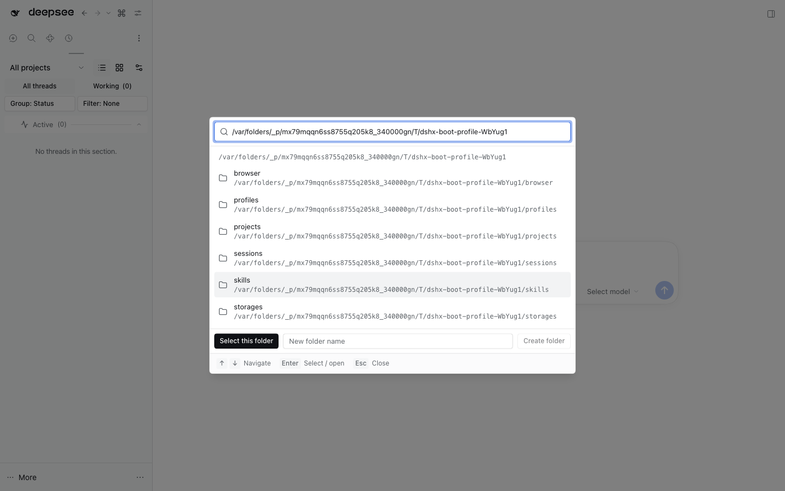

# Workspace Folder Picker



Replaces the Add workspace directory flow in the header workspace menu and the
sidebar browser with the shared `ProjectFolderPicker` opened directly in
directory-browsing mode. It also exports the same Host API for the New-thread
project chooser, whose Host may only expose the native OS picker through DSH's
global `directoryPicker` service. The API uses DSH's official browse backend in
a private Cordis context, so these flows can list and create folders without
replacing the global service or removing the native chooser from other
consumers. Absolute paths can still be submitted directly to the workspace
owner's existing registration callback.

The chooser intentionally does not show registered projects or the
"Register project" action: this entry point adds a workspace rather than
choosing one that already exists. The existing workspace-selection UI remains
unchanged.

## Runtime support

The plugin builds against the published
`@deepseek-ai/dsh-host-directory-picker-browse@0.2.0-rc.2` backend, provided by
the DSH Host through peer dependencies, and exposes it through its own
authenticated Host API. It does not depend on the unshipped `hybrid` mode or
require a DSH Core patch.

## Boundaries

- The header and sidebar workspace owners retain open/busy state and workspace
  creation.
- Add Workspace calls the official browse backend through this plugin's Host
  API. An isolated Cordis context keeps that browse capability from replacing
  the global `directoryPicker` service, so other consumers retain native picking.
- The shared picker defaults to project mode for its other consumers. This
  bundle opts into directory-only mode without duplicating the explorer UI.
- Host browsing follows the DSH process user's filesystem access; it is not
  confined to the current workspace or home directory, and symlinked directories
  remain navigable. This broader capability is enabled here only for Add Workspace.
- The Host API lists directory names only, caps each level at 1,000 directories,
  and creates a single child directory only after an explicit user action. It
  does not read file contents or restrict paths to the current workspace.

## Checks

```sh
pnpm typecheck
pnpm test
pnpm build
pnpm test:boot
pnpm test:e2e
```
