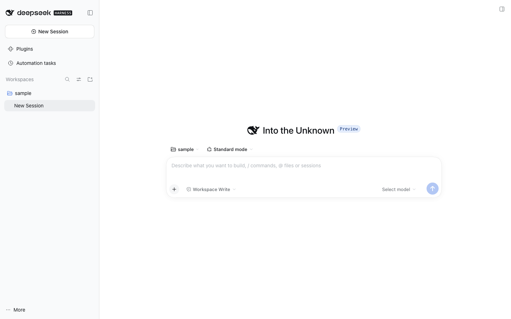

# @dshfiles/workspace-nav

Owned fork of `@deepseek-ai/dsh-client-ui-workspace` (the Workspace picker and the `uiWorkspace` navigation
service). A New thread switches the main view to its Session **before** the Host creates it, so the composer is
usable while `session/create` is in flight.

Without the fork, `UiWorkspace.startSession` awaited `session/create` before revealing the composer: 1.7 s on a
quiet Host, up to 9.5 s under load ([performance](../../../docs/performance.md#first-send-no-longer-waits-for-its-thread-workspace)).
Text typed during that wait landed in the previous Session's draft. The landed jj-integration change removed the
first-send wait, not the click wait; this fork removes the click wait.

## What changes

Every New thread entry point (sidebar `+`, main-tabs `+`, command palette, ⌘N, the hero project picker, the
schedule dialog) funnels into `UiWorkspace.startSession` / `openWorkspace`, so the fork fixes them all at once:

1. `newThreadRequest` (non-vendored, tested in `tests/new-thread-request.test.ts`) picks the request: the
   Workspace's first listed blank when draft options allow reuse, otherwise no `sessionId` so the Host mints one.
2. `ctx.sessions.createOptimistic` (from `@dshfiles/session-controller`) publishes the provisional blank list row
   synchronously and settles `session/create` in the background.
3. `replaceMain` runs immediately: the composer binds to the provisional Session, the draft and references move
   with it, and the saved selection records it.
4. The Host creates (or reuses) the Session under that identity. If it returns another identity, the view follows
   it; a refused creation shows the create-failed notice, drops the provisional row and returns the view.

`connectWorkspace` stays waiting on purpose: jj-integration's thread warmup resolves a thread workspace's blank
Session before it sends into it.

## Provenance

|                     |                                                                                             |
| ------------------- | ------------------------------------------------------------------------------------------- |
| Upstream package    | `@deepseek-ai/dsh-client-ui-workspace`                                                      |
| Pinned              | `0.2.1-rc.2`, ref `dsh-v0.2.1-rc.2`                                                         |
| Upstream path       | `packages/client/ui-workspace`                                                              |
| Loader row replaced | `ui-workspace` (disabled in `cordis.patch.yml`, stock row stays off in profile composition) |
| Delta               | `src/native/navigation.ts` only; new logic lives in `src/new-thread-request.ts`             |
| Verification        | `node scripts/native-fork-diff.mjs workspace-nav`, `tests/new-thread-request.test.ts`       |

Update policy: bump with `node scripts/native-fork-diff.mjs workspace-nav --to <new-tag>`, re-apply the
`navigation.ts` delta (the `openOptimistic` path and `blankRequest`), and re-run the journeys below.

## Journeys

- `thread-sidebar.new-thread-composer-instant` — the sidebar `+` reaches a usable composer before the Host
  answers.
- `main-tabs.start-page-new-thread` — the Start page's New thread suggestion takes the composer's place.

## Screenshot

