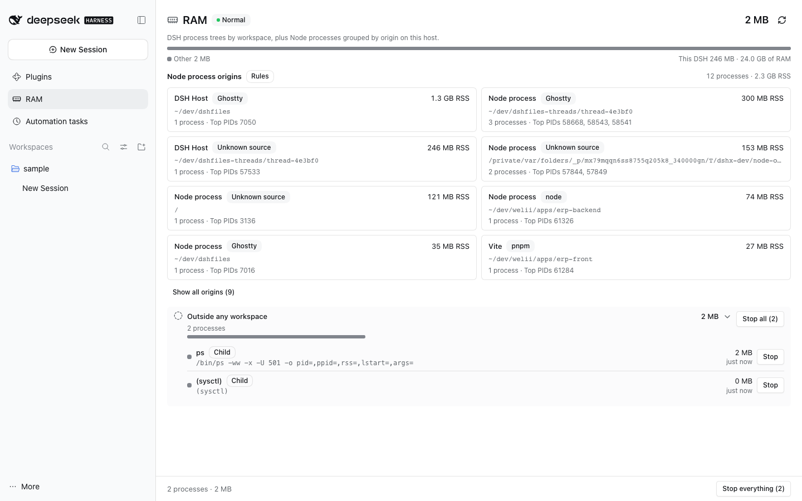

# DSH worktree memory



System monitors show many `node` rows without context. This page adds a rule-based summary of current-user Node
processes (known script labels, nearest app ancestor or immediate parent, and working directory) alongside DSH trees
grouped by workspace. Node origins are read-only: they expose process IDs and resident RSS, not command arguments or
environment values. Stops remain scoped to DSH trees and require confirmation.

## Where the rows come from

```
ps (current UID, pid, ppid, rss, lstart, args) ──► DSH candidates + Node rows ──► bounded cwd probes
                                          │
ctx.jobs live views ──────────────────────┼──► ProcessTable.snapshot ──► worktree-memory API ──► RAM panel
workspaceRegistry + sessionController ────┘
```

- **Candidates** are this Host's direct children and the user's orphans (`ppid = 1`) that are not apps or system
  agents. The Host also probes up to 100 highest-RSS Node PIDs, within the same 400-process limit.

- **Node origin** uses a fixed script-name rule list, the nearest `.app` ancestor (or immediate parent executable), and
  working directory. Home paths display as `~`; unknown scripts use the generic `Node process` label. The summary
  covers only the current OS user and never returns argv or env. RSS is resident memory, not compressed or swapped.
- **Workspace** is the deepest registered workspace containing the working directory, else a jj sibling checkout of
  one (`<repo>-<name>`, `<repo>-threads/<name>`). An orphan outside every workspace is not ours and is not listed.
- **Origin**: `job` when a live job of this Host owns the tree (matched by label prefix, then by a unique start time),
  `host` for other children of this Host, `detached` for a tree init adopted that still runs inside a workspace — a
  leaked dev server, a test browser, an earlier `dshx dev up` Host. A daemon started on purpose looks the same, so
  the page labels it and asks for confirmation instead of guessing.
- A tree's memory is the sum of RSS over the root and its descendants; its name is the heaviest process
  (`node …/node_modules/vitest/vitest.mjs run` reads as `vitest run`).
- The Host that serves the page and every ancestor of it (a supervisor) are never listed, so they cannot be stopped.

The sidebar samples every 30 s and the open panel polls every 5 s; both share one 3 s process-table cache.

## Stop

`stop` takes `{ pid, startedAt }` pairs from a snapshot and re-reads the process table first: a pid that is not a
listed tree root is refused, and a recycled pid (another start time) too. A job tree goes through the job registry so
its Session records the kill; any other tree gets SIGTERM children-first, then SIGKILL after 3 s on the exact
identities that were signalled.

The panel offers the verb at three scopes: one tree, one section — the `Stop all (N)` button in a workspace header,
so a leaked pile goes without expanding the card — and the sticky footer's `Stop everything (N)`, which covers every
listed tree except a job whose owning thread is mid-turn: that one is left to its own Stop so the turn cannot fail,
and the footer says how many it left alone. A bulk stop names the tree count before it arms, continues in batches of
200 (the API's target limit) and reports one summary. `Stop detached (N)` keeps the narrower leftovers-only verb, per
section and in the footer.

## Agent tools

`worktree_memory_snapshot` (read-only) and `worktree_memory_stop` (requires `confirm: true`).

## Host gap

The job registry exposes no pid or working directory for a job, so attribution is inferred from the process table.
Recorded in [`plans/dsh-host-gaps.md`](../../../plans/dsh-host-gaps.md).
