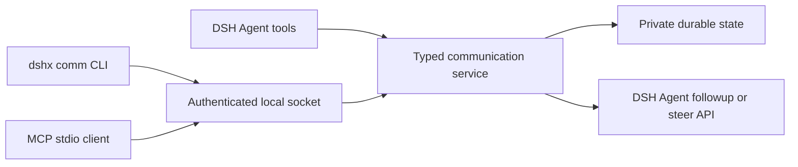

# DSH Agent communication

DSHX now provides one local communication capability for independent DSH
Agents, the `dshx comm` CLI, and external MCP clients. The owned plugin is
`plugins/@dshfiles/agent-communication`; it does not depend on a remote DSHX
package or service.

## Capability and adapters



The service in `@dshfiles/dshx/communication` owns topic subscriptions,
message persistence, inbox reads, acknowledgements, retention, and delivery
receipts. The CLI and MCP server are adapters over the same Host bridge. Agent
tools call the same service in process and take sender identity from DSH's
`ToolExecution.agent`; tool arguments cannot choose or impersonate a sender.

The Host bridge uses a Unix domain socket under
`$DSH_HOME/runtime/dshx/communication` (or `~/.dsh` when `DSH_HOME` is unset).
Its directory is mode `0700`; socket and token metadata are mode `0600`. The
token is generated for each Host lifetime. The bridge accepts only external
principals; DSH Agent identities are taken from the Host tool execution.

## Delivery behavior

- Agents automatically subscribe to `workspace/<sha256-prefix>` derived from
  their resolved Session working directory. The path itself is not stored in
  the topic or message. Agents with the same working directory discover one
  another without being created by a shared lead Agent.
- Agents also get a private inbox for direct messages. Both automatic
  subscriptions use queue delivery.
- The private inbox cannot be unsubscribed because direct messages are
  addressed to it; subscribe to `inbox` with `quiet` delivery to mute notices
  while keeping messages available to poll.
- `quiet` stores messages without adding a Session message. The Agent can read
  them with `dshx_comm_inbox` when convenient.
- `queue` adds a content-free DSH follow-up notice. It does not interrupt the
  current request. The Agent fetches the peer text from its inbox by message id.
- `steer` is Agent-only and requires the receiver to name allowed sender
  Session ids. Only an `urgent` message from one of those Agent ids calls DSH's
  native `Agent.steer`; other messages still use queued follow-up delivery.
- Unsubscribing from a workspace topic persists an automatic-join opt-out.
  Explicitly subscribing to a workspace topic again clears that opt-out.
- Peer message bodies are untrusted data. Notices do not include the body, and
  Agent inbox output quotes the body as JSON. A recipient must still apply its
  own task and user policy before acting on peer content.

External CLI/MCP principals are local names, separate from DSH Agent ids. The
default CLI name is `cli`; MCP defaults to `mcp.default`. Use
`--principal <name>` to keep multiple external inboxes separate. External
subscribers can select `quiet` or `queue`; they cannot request steering.
External MCP clients discover `comm_*` tools and poll their own inbox. The
stdio process does not expose a network listener.

## Observability

The Host records each Agent communication-tool invocation with operation,
Agent identity, tool/root call ids, outcome, duration, timestamp, and a bounded
error code. It never records tool arguments or message text. Activity history is
bounded to 5,000 events and 30 days; it begins with the first recorded tool
call, so older use cannot be inferred. Existing message and notification state
remains separate evidence of message lifecycle.

`dshx comm report` returns bounded, metadata-only health, Agent, topic,
subscription, message-lifecycle, and tool-activity data. It is read-only and
never prints message bodies. A missing bridge or an empty event history is not
proof that Agents never used the capability.

The owned `@dshfiles/agent-communication` bundle adds a sidebar inspector for
live Agents, topics, subscriptions, recent tool activity, and message-recipient
status. It uses the Host API; the browser never reads the state file. Message
bodies stay hidden in reports and lists until a per-message reveal action.
Delivery changes, unsubscribe/rejoin, and acknowledgements are scoped and
confirmed. `steer` requires selecting live sender Agents; current sender IDs are
not returned by diagnostics, so an edit requires selecting the desired set
again. The UI intentionally adds no publish, send, or bulk-delete controls.

The bridge setup is gated on DSH supplying live Agents to the Host plugin. An
empty Session or unavailable report is not evidence that the integration is
broken or that communication was not used.

## Commands

```sh
dshx comm agents --json
dshx comm topics --json
dshx comm report --limit 20 --json
dshx comm subscribe release-notes --delivery quiet
dshx comm publish release-notes "Review the compatibility notes"
dshx comm send <dsh-session-id> "The build finished; please review"
dshx comm inbox --limit 20 --json
dshx comm ack <message-id>
dshx comm mcp --principal editor
```

Every query and mutation except `mcp` supports `--json`, `--quiet`, and
`--no-color`. JSON uses the DSHX `{schemaVersion, command, ok, data|error}`
envelope. Invalid arguments exit with code `2`; bridge and operation failures
exit with code `1`; successful commands exit with code `0`. MCP reserves stdout
for protocol frames and reports startup errors to stderr.

Message bodies are limited to 12,000 characters. State is private JSON, written
atomically with mode `0600`, capped at 5,000 retained messages and activity
events and 16 MiB, with messages and activity pruned after 30 days. Acknowledgements and notification receipts are
idempotent. Delivery is at-least-once across a Host crash in the narrow window
between DSH accepting a follow-up and the receipt being persisted; notice text
contains a stable communication id so Agents can recognize a repeated notice.

## Candidate decision

| Candidate                       | Fit for independent Sessions, durable topics, quiet delivery                                                                      | Decision                                                    |
| ------------------------------- | --------------------------------------------------------------------------------------------------------------------------------- | ----------------------------------------------------------- |
| DSH Agent Team                  | Experimental team lifecycle is centered on lead-created peers and team coordination; it is not this general topic/inbox boundary. | Reuse only the native Agent queue/steer APIs.               |
| Marketplace `dsh-agent-message` | Its published package generation was not verified against installed DSH `0.2.0-rc.2`.                                             | Do not install unchanged.                                   |
| Marketplace `dsh-interconnect`  | Dynamic peer subscriptions are relevant, but its current source and lifecycle contracts were not verified against this Host.      | Keep as a future comparison, not a runtime dependency.      |
| Koinon                          | Useful orchestration reference, with a separate local peer protocol and credential boundary.                                      | Do not couple DSH to it.                                    |
| Build with DSHX                 | Can match independent Agent ids, receiver-owned delivery, durable inboxes, and the installed DSH runtime contract.                | Chosen; one typed service backs plugin tools, CLI, and MCP. |

References: [DSH Agent Team](https://github.com/deepseek-ai/deepseek-harness/blob/master/packages/experimental/agent-team/README.md),
[dsh-agent-message](https://dshmarket.com/p/GengDaPeng/dsh-agent-message/),
[dsh-interconnect](https://dshmarket.com/p/Chinesezjc/dsh-interconnect/),
[Koinon](https://github.com/rwcii/koinon).

## Activate a profile

The plugin is source-complete but does not silently change an installed DSH
profile. Build the package, add a local `link:` dependency to the profile
manifest, and include `@dshfiles/agent-communication` in that profile's
`dsh.profile.bundles`. Run `pnpm install` in the profile and restart DSH to
load the Host tools and socket bridge. Keep the dependency path at the scoped
package directory; this profile uses `pnpm install` for local links instead of
`pnpm add <path>`.

After startup, confirm the Host activation output, then run
`dshx comm agents --json` and `dshx comm topics --json`. Configure an external
agent with `dshx comm mcp --principal <name>` as its stdio MCP command. The
running DSH process is not restarted as part of source changes.
