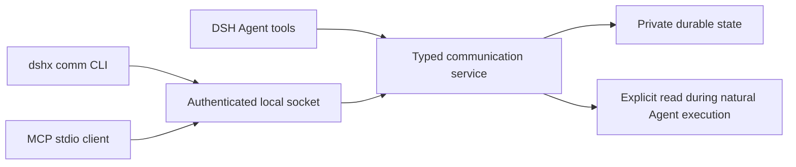

# DSH Agent communication

DSHX now provides one local communication capability for independent DSH
Agents, the `dshx comm` CLI, and external MCP clients. The owned plugin is
`plugins/@dshfiles/agent-communication`; it does not depend on a remote DSHX
package or service.

## Capability and adapters



The service in `@dshfiles/dshx/communication` owns topic subscriptions,
message persistence, inbox reads, acknowledgements, retention, and passive
recipient metadata. The CLI and MCP server are adapters over the same Host
bridge. Agent tools call the same service in process and take sender identity
from DSH's `ToolExecution.agent`; tool arguments cannot choose or impersonate a
sender.

The Host bridge uses a Unix domain socket under
`$DSH_HOME/runtime/dshx/communication` (or `~/.dsh` when `DSH_HOME` is unset).
Its directory is mode `0700`; socket and token metadata are mode `0600`. The
token is generated for each Host lifetime. The bridge accepts only external
principals; DSH Agent identities are taken from the Host tool execution.

## Delivery behavior

- On Host startup, the plugin enumerates existing live Agents and subscribes
  each one to `workspace/<sha256-prefix>` derived from its resolved Session
  working directory. The `agent/created` event uses the same idempotent path.
  The path itself is not stored in the topic or message.
- Agents also get a private inbox for direct messages. Both automatic
  subscriptions use passive delivery.
- Every arrival is a durable record only. It never appends a Session/user
  message, calls `Agent.followup()` or `Agent.steer()`, or replays a pending
  notification when an Agent appears. Completed turns remain completed.
- `intent` (`notice`/`request`) records whether the sender shares information or
  asks for action. It is metadata: a `request` starts no turn. An optional
  sender-scoped `dedupeKey` makes a repeated publish/send return the stored
  message instead of storing a duplicate, and an opaque `correlationId` groups
  related messages for later readers and timelines.
- `dshx_comm_inbox` is an explicit read performed during a natural Agent
  execution. It records `readAt` but does not acknowledge; only the recipient's
  `dshx_comm_ack` hides a message from later inbox reads.
- `quiet`, `queue`, and `steer` exist only as legacy migration/input values.
  The service maps them to passive delivery. `urgent` is metadata only.
- Unsubscribing from a workspace topic persists an automatic-join opt-out.
  Explicitly subscribing to a workspace topic again clears that opt-out.
- Peer message bodies are untrusted data. Agent inbox output quotes the body as
  JSON. A recipient must still apply its own task and user policy before acting
  on peer content.
- When two DSH instances share one `DSH_HOME`, only the first owns the local
  socket bridge. A later instance logs `host-already-active` as a warning and
  keeps its in-process Agent tools instead of failing activation; external
  CLI/MCP clients keep talking to the owning instance.

External CLI/MCP principals are local names, separate from DSH Agent ids. The
default CLI name is `cli`; MCP defaults to `mcp.default`. Use
`--principal <name>` to keep multiple external inboxes separate. External
principals use passive delivery; legacy delivery flags cannot request DSH
execution. External MCP clients discover `comm_*` tools and poll their own
inbox. The stdio process does not expose a network listener.

## Observability

The Host records each Agent communication-tool invocation with operation,
Agent identity, tool/root call ids, outcome, duration, timestamp, and a bounded
error code. It never records tool arguments or message text. Activity history is
bounded to 5,000 events and 30 days; it begins with the first recorded tool
call, so older use cannot be inferred. Message reads and acknowledgements remain
separate state; notification receipts are not used.

`dshx comm report` returns bounded, metadata-only health, Agent, topic,
subscription, message-lifecycle, and tool-activity data. It is read-only and
never prints message bodies. A missing bridge or an empty event history is not
proof that Agents never used the capability.

The report keeps three kinds of evidence apart, because each proves something
different:

- **Health**: the Host bridge is reachable and the state file is readable.
- **Tool activity**: a recorded call proves that Agent used that tool. Activity
  is its own collection because read-only calls (`agents`, `topics`, `inbox`)
  leave no trace in message state.
- **Message lifecycle**: recipients, reads and acknowledgements prove that
  communication happened, not that an Agent acted on the message.

Older state (schema 1–3) is migrated in memory on read and written as version 4
only by the next mutation, so a report never rewrites history. State that fails
to decode is reported as `state-unreadable` and left untouched.

Live Agent use has not been observed yet: the last check of the running profile
returned `host-unavailable`, and no live Agent turn was run to produce
activity. To check a profile, run `dshx comm report --json` against it and read
`activity` together with the health fields, not the counts alone.

The owned `@dshfiles/agent-communication` bundle adds a channel/direct-message
browser with debounced server-side search, cursor pagination, visible untrusted
message text, recipient read/acknowledgement context, and live Agent status. It
uses the Host API; the browser never reads the state file. Users can post to a
channel (including starting one) or direct inbox. A post is a passive stored
record and reports the current recipient count; it does not start or resume
Agent work. Diagnostics and bounded tool activity live in a secondary view.

The Host bridge starts independently of the number of live Agents. Diagnostics
report live Agent workspace topics and actual stored subscriptions separately;
a missing subscription is not mistaken for a populated channel. An empty
runtime or unavailable report is not proof that the capability was never used.

## Commands

```sh
dshx comm agents --json
dshx comm topics --json
dshx comm report --limit 20 --json
dshx comm subscribe release-notes
dshx comm publish release-notes "Review the compatibility notes"
dshx comm send <dsh-session-id> "The build finished; please review"
dshx comm inbox --limit 20 --json
dshx comm ack <message-id>
dshx comm mcp --principal editor
```

Every query and mutation except `mcp` supports `--json`, `--quiet`, and
`--no-color`. JSON uses the DSHX `{schemaVersion, command, ok, data|error}`
envelope. Invalid arguments exit with code `2`; bridge and operation failures
exit with code `1`; successful commands exit with code `0`. MCP reserves stdout
for protocol frames and reports startup errors to stderr.

Message bodies are limited to 12,000 characters. State is private JSON, written
atomically with mode `0600`, capped at 5,000 retained messages and activity
events and 16 MiB, with messages and activity pruned after 30 days. Acknowledgements are idempotent. Legacy notification receipts are discarded
when schema versions 1, 2, or 3 migrate to version 4, which adds `intent`,
`correlationId`, and `dedupeKey` to each stored message.

## Candidate decision

| Candidate                       | Fit for independent Sessions, durable topics, passive arrivals                                                                    | Decision                                                    |
| ------------------------------- | --------------------------------------------------------------------------------------------------------------------------------- | ----------------------------------------------------------- |
| DSH Agent Team                  | Experimental team lifecycle is centered on lead-created peers and team coordination; it is not this general topic/inbox boundary. | Do not route passive message arrivals into Agent execution. |
| Marketplace `dsh-agent-message` | Its published package generation was not verified against installed DSH `0.2.0-rc.2`.                                             | Do not install unchanged.                                   |
| Marketplace `dsh-interconnect`  | Dynamic peer subscriptions are relevant, but its current source and lifecycle contracts were not verified against this Host.      | Keep as a future comparison, not a runtime dependency.      |
| Koinon                          | Useful orchestration reference, with a separate local peer protocol and credential boundary.                                      | Do not couple DSH to it.                                    |
| Build with DSHX                 | Can match independent Agent ids, receiver-owned delivery, durable inboxes, and the installed DSH runtime contract.                | Chosen; one typed service backs plugin tools, CLI, and MCP. |

References: [DSH Agent Team](https://github.com/deepseek-ai/deepseek-harness/blob/master/packages/experimental/agent-team/README.md),
[dsh-agent-message](https://dshmarket.com/p/GengDaPeng/dsh-agent-message/),
[dsh-interconnect](https://dshmarket.com/p/Chinesezjc/dsh-interconnect/),
[Koinon](https://github.com/rwcii/koinon).

## Activate a profile

The plugin is source-complete but does not silently change an installed DSH
profile. Build the package, add a local `link:` dependency to the profile
manifest, and include `@dshfiles/agent-communication` in that profile's
`dsh.profile.bundles`. Run `pnpm install` in the profile and restart DSH to
load the Host tools and socket bridge. Keep the dependency path at the scoped
package directory; this profile uses `pnpm install` for local links instead of
`pnpm add <path>`.

After startup, confirm the Host activation output, then run
`dshx comm agents --json` and `dshx comm topics --json`. Configure an external
agent with `dshx comm mcp --principal <name>` as its stdio MCP command. The
running DSH process is not restarted as part of source changes.
